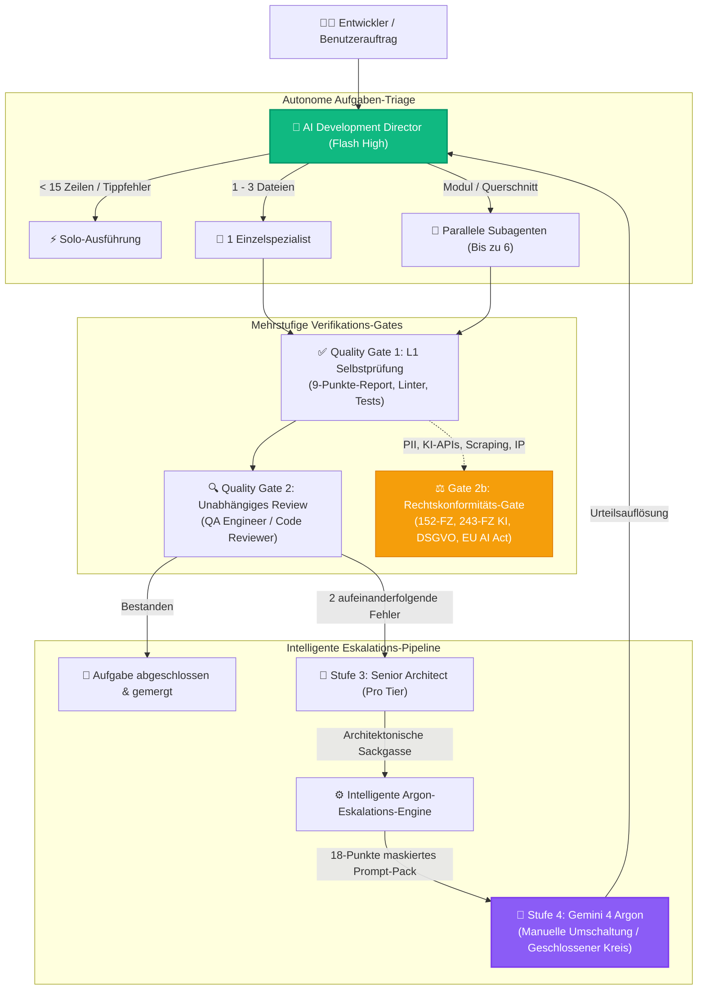

<div align="center">


# Antigravity Apex

### Next-Gen Multi-Agenten-Leitstand & Echtzeit-Telemetrie-Dashboard für Google Antigravity

[](https://github.com/fen3211/antigravity-apex/stargazers)
[](https://github.com/fen3211/antigravity-apex/releases/latest/download/Antigravity-Apex-Setup.exe)
[](LICENSE)
[](https://nodejs.org/)
[](https://react.dev/)
[](https://www.typescriptlang.org/)
[](https://sqlite.org/wal.html)
[-10B981.svg)](tests/)
[](https://codespaces.new/fen3211/antigravity-apex)
[](#-refero--vercel-design-system)

<p align="center">
  <a href="README.md">English</a> •
  <a href="README.ru.md">Русский</a> •
  <a href="README.es.md">Español</a> •
  <a href="README.fr.md">Français</a> •
  <a href="README.pt.md">Português</a> •
  <a href="README.zh.md">简体中文</a> •
  <a href="README.ja.md">日本語</a> •
  <a href="README.de.md">Deutsch</a>
</p>

<p align="center">
  <a href="#-1-klick-installation">⚡ 1-Klick-Installation</a> •
  <a href="#-hauptmerkmale">Hauptmerkmale</a> •
  <a href="#-ui-galerie">UI-Galerie</a> •
  <a href="#-17-rollen-spezialistenpool">17-Rollen-Spezialistenpool</a> •
  <a href="#-architektur--nebenl%C3%A4ufigkeit">Architektur</a> •
  <a href="#-stufe-4-argon-eskalation">Argon-Eskalation</a> •
  <a href="#-systemdiagnose-doctor">System-Doctor</a>
</p>

> 🌟 **Unterstützen Sie Open-Source-Innovation!**
> Wenn Sie **Antigravity Apex** nützlich finden, **[geben Sie dem Repository bitte einen Stern auf GitHub!](https://github.com/fen3211/antigravity-apex/stargazers)** Es dauert nur 1 Sekunde, sichert die aktive Weiterentwicklung und hilft anderen Entwicklern, autonome Multi-Agenten-Orchestrierung für Google Antigravity zu entdecken.

</div>

---

## Übersicht

**Antigravity Apex** ist ein produktionsreifer Echtzeit-Missionsleitstand und Prozess-Supervisor für **Google Antigravity** Multi-Agenten-Systeme, angetrieben durch das **AI Development Director** Framework.

Entwickelt in einer klaren **Refero / Vercel** Engineering-Ästhetik mit nativen Light- und Dark-Modi, bietet das System Entwicklungsleitern, Softwarearchitekten und Ingenieuren lückenlose Observability, deterministische Nebenläufigkeitssteuerung (bis zu 6 parallele Subagenten), mehrstufige Verifikations-Gates und autonome Level-4-Argon-Eskalationen.

---

## ⚡ 1-Klick-Installation

Wählen Sie Ihre bevorzugte Methode zur Installation und zum Start von Antigravity Apex mit **nur einem einzigen Klick oder Befehl**:

### Methode 0: Standalone Windows .EXE Installer (Ohne CLI & Git)
Laden Sie einfach das kompilierte Windows-Installationsprogramm aus den GitHub Releases herunter:

👉 **[Download Antigravity-Apex-Setup.exe (v1.0.0)](https://github.com/fen3211/antigravity-apex/releases/latest/download/Antigravity-Apex-Setup.exe)**

Doppelklicken Sie zum Installieren. Das Installationsprogramm überprüft Node.js, richtet das Projekt ein, implementiert die 17 Spezialisten in `~/.gemini`, führt den System-Doctor aus und öffnet das Dashboard automatisch in Ihrem Standardbrowser!

---

### Methode 1: Windows 1-Klick Desktop Launcher (Ohne CLI)
Wenn Sie das Repository geklont oder heruntergeladen haben:
1. Doppelklicken Sie auf [`setup.cmd`](setup.cmd) (oder [`setup.bat`](setup.bat)).
2. Das Startskript führt automatisch folgende Schritte aus:
   - Überprüft **Node.js 18+** und **Git** (mit Installationsanleitung bei Fehlen).
   - Installiert alle Abhängigkeiten (`npm install` für Server und Client).
   - Generiert Ihre `.env` aus `.env.example` mit einem sicheren persistenten API-Token.
   - Installiert das komplette **17-Agenten-Paket, Orchestrierungsregeln und Skills** nach `~/.gemini/config/plugins/ai-director`.
   - Startet die Systemdiagnose **Doctor** (`npm run doctor` mit 19/19 bestandenen Prüfungen).
   - Startet den Server und **öffnet automatisch Ihren Browser unter `http://127.0.0.1:5173/`**!

> **Täglicher Schnellstart**: Doppelklicken Sie auf [`start.cmd`](start.cmd) für sofortigen Start.

---

### Methode 2: Linux & macOS 1-Klick Shell Launcher
```bash
chmod +x setup.sh && ./setup.sh
```
> **Täglicher Schnellstart**: Führen Sie `./start.sh` aus.

---

### Methode 3: Terminal-Einzeiler (Kein vorheriges Klonen erforderlich)
Installieren und starten Sie Antigravity Apex direkt aus Ihrem Terminal:

**Windows (PowerShell)**:
```powershell
irm https://raw.githubusercontent.com/fen3211/antigravity-apex/main/scripts/get.ps1 | iex
```

**Linux & macOS (Bash)**:
```bash
curl -fsSL https://raw.githubusercontent.com/fen3211/antigravity-apex/main/scripts/get.sh | bash
```

---

### Methode 4: In-App 1-Klick Setup & Synchronisation (Web-UI)
Bereits im Dashboard?
- Klicken Sie in der oberen Navigationsleiste auf **`⚡ 1-Click Setup`** oder auf der **Agents**-Seite auf **`1-Click Sync Antigravity`**.
- Das System erstellt ein versioniertes Backup in `backups/`, kopiert alle 17 Agenten, Regeln (`AGENTS.md`) und Skills nach `~/.gemini`, überträgt den Fortschritt live über WebSocket und aktualisiert Ihre Agentenliste sofort!

---

### Methode 5: Cloud-Workspace (GitHub Codespaces)
Führen Sie Antigravity Apex in einem vorkonfigurierten Cloud-Container ohne lokale Einrichtung aus:

[](https://codespaces.new/fen3211/antigravity-apex)

---

## 📸 UI-Galerie

<div align="center">
  
  <p><em>Dark Theme — Missionsleitstand, Echtzeit-Supervisor für Nebenläufigkeit &amp; aktive Subagenten</em></p>
</div>

<details>
<summary><b>🔍 Klicken zum Ausklappen der vollständigen Screenshot-Galerie (Argon-Eskalation, Workflow, Dialoge & Light Mode)</b></summary>
<br>

| Intelligentes Argon-Eskalationszentrum | 18-Punkte-Prompt-Pack & Urteilsdialog |
| :---: | :---: |
|  |  |

| Live-Orchestrierungs-Workflow (Dark Mode) | Light Theme Missionsleitstand |
| :---: | :---: |
|  |  |

| Aufgabenerstellungs-Modal (Dark Mode) |
| :---: |
|  |

</details>

---

## 🎯 Hauptmerkmale

### 1. Kanonischer 17-Rollen-Spezialistenpool
Dynamische Zuweisung über 17 spezialisierte AI-Rollen: Kostengünstige **Gemini 3.8 Flash** Modelle für Routineimplementierungen, dedizierte **Pro-Tier** Modelle für komplexe Architektur- und Sicherheitsprüfungen und geschlossenes **Gemini 4 Argon** für kritische Blockaden.

### 2. Hochdurchsatz-Nebenläufigkeit & Prozessbaum-Überwachung
- **Dynamische Parallelitätssteuerung**: Bis zu 6 parallele Subagenten (`MAX_CONCURRENT_SUBAGENTS = 6`) mit intelligentem FIFO-Warteschlangen-Manager zur Vermeidung von Speicherüberlastung und Rate-Limits.
- **Prozessbaum-Supervisor**: Lückenlose Ausführungsüberwachung mit stdout/stderr Streaming in Echtzeit, Timeout-Durchsetzung und garantierter Baumterminierung (Windows: `taskkill /T /F`, Unix: Prozessgruppen-Signal `kill -9`), um verwaiste Zombie-Prozesse auszuschließen.

### 3. Intelligente Stufe-4-Argon-Eskalations-Engine
- **Autonome Blockade-Erkennung**: Erkennt automatisch wiederholte Fehlschläge (2 aufeinanderfolgende Versuche desselben Ansatzes), Agentenwidersprüche und algorithmische Sackgassen über konfigurierbare Empfindlichkeitsmodi (`conservative`, `balanced`, `aggressive`).
- **18-Punkte-Prompt-Pack-Generator**: Erzeugt strukturierte Markdown-Prompt-Packs mit automatischer Bereinigung von Dateipfaden (`C:\Users\username` $\to$ `~`) und Maskierung sensibler API-Schlüssel (`AIza...`, `sk-...`).
- **Anti-Spam & Wiederholungsgedächtnis**: SHA-256 Signatur-Deduplizierung mit 5-Minuten-Abklingzeit verhindert redundante Eskalationsfluten bei schnellen Neustarts.
- **Closed-Loop-Urteilsauflösung**: Der Bediener führt das versiegelte Prompt-Pack in Gemini 4 Argon aus, fügt das Urteil ein, und der AI Director leitet die Lösung zurück an Flash-Spezialisten zur Implementierung.

### 4. Mehrstufige Qualitäts- und Compliance-Governance (Gate 2b)
- **Quality Gate 1 (L1 Selbstprüfung)**: Automatisierte Testausführung, Linter-Prüfung und obligatorische Validierung des **technischen 9-Punkte-Subagenten-Reports**.
- **Quality Gate 2 (L2 Unabhängiges Review)**: Unabhängige Überprüfung von Diffs durch QA-Ingenieure und Code-Reviewer.
- **Quality Gate 2b (Rechtskonformitäts-Gate)**: Automatisierte Konformitätsprüfung für die Rechtsräume Russische Föderation (`RU`) und Europäische Union (`EU_NL`), inklusive 152-FZ, 156-FZ, 23-FZ Datenlokalisierung, 243-FZ KI-Regulierung, Urheberrecht Teil IV ZGB, DSGVO/UAVG und EU AI Act mit **nicht-blockierender Isolation** (nur die rechtswidrige Unteroperation wird gestoppt, sichere UI- und Testarbeiten laufen weiter).

### 5. Zero-Disk-Read inkrementelle Stream-Ingestion
- `JsonlStreamReader`-Engine liest Live-Transkripte von Antigravity (`~/.gemini/antigravity/brain/**/transcript.jsonl`) inkrementell in 64-KB-Puffer-Blöcken.
- Multi-Byte UTF-8 Trennungsschutz: Nahtloser Erhalt von Sonderzeichen, Umlauten und Emojis über Puffergrenzen hinweg.
- Inode- und Erstellungszeit-Tracking erkennt Datei-Rotationen und Neuerstellungen verzögerungsfrei.
- Atomare SQLite-Transaktionen garantieren absolute Ereignis-Deduplizierung.

### 6. Refero / Vercel Designsystem & Dynamische Themes
- Dual-Mode Engineering-Oberfläche: Paper White (`#FAFAFA`) & Obsidian Black (`#0A0A0A`).
- Persistente Theme-Synchronisation über `localStorage` und `prefers-color-scheme`.
- Absoluter Schutz vor FOUT (Flash of Unstyled Theme) durch Inline-Head-Bootstrap.
- Barrierefreiheit nach WCAG 2.1 AA, Tastaturnavigation mit sichtbarem Fokus (focus-visible) und responsiver Drawer für mobile Endgeräte.

---

## 👥 17-Rollen-Spezialistenpool

| # | Rollen-ID | Anzeigename | Modellstufe | Hauptdomäne & Kernaufgaben |
|---|---|---|---|---|
| 1 | `director` | **Director / Lead Orchestrator** | Gemini 3.8 Flash High | Zentrale Koordination, Task-Triage (<15 Zeilen Solo, 1-3 Dateien Spezialist, komplexe Aufgaben parallel), Gate-Schlichtung |
| 2 | `senior-architect` | **Senior Architect** | Gemini Pro | Stufe-3-Eskalation, Race Conditions, Deadlock-Untersuchung, Datenintegrität & Skalierbarkeit |
| 3 | `researcher` | **Researcher** | Gemini Flash | Repository-Exploration, Abhängigkeitsanalyse, Studium externer API-Dokumentationen (strikter Lese-Modus) |
| 4 | `frontend-developer` | **Frontend Developer** | Gemini Flash | React 19, Next.js, TypeScript, Tailwind CSS, UI-Animationen, ergonomische responsive Layouts |
| 5 | `backend-developer` | **Backend Developer** | Gemini Flash | Node.js, Python, Express, REST-APIs, WebSocket-Streaming, Server-Architektur |
| 6 | `ui-ux-designer` | **UI/UX Designer** | Gemini Flash | Refero/Vercel Designsysteme, visuelle Hierarchie, Ergonomie, Vermeidung generischer KI-Templates |
| 7 | `qa-engineer` | **QA Engineer** | Gemini Flash | Unit-, Integrations- und E2E-Automatisierung (Playwright), Randfall-Validierung, Regressionsschutz |
| 8 | `code-reviewer` | **Code Reviewer** | Gemini Flash | Unabhängiges Diff-Review, Identifikation von Code-Smells, Architekturkonformität und Refactoring |
| 9 | `legal-compliance` | **Legal Advisor & Tech Writer** | Gemini Flash | Gate 2b (152-FZ, 243-FZ KI, DSGVO, EU AI Act, Lizenzen) und verbindliche technische Dokumentation |
| 10 | `security-engineer` | **Security Engineer** | Gemini Flash / Pro | OWASP Top 10, SQLi, XSS, SSRF, Schutz vor Prompt Injection, Token- und Secret-Audits |
| 11 | `devops-engineer` | **DevOps Engineer** | Gemini Flash / Pro | GitHub Actions, CI/CD, Docker, Ausfallsicherheit, Backups, Prozess-Supervisor-Integration |
| 12 | `product-manager` | **Product Manager** | Gemini Flash | Anforderungsanalyse, User Stories, Akzeptanzkriterien, Festlegung des MVP-Umfangs |
| 13 | `ai-evaluation-engineer` | **AI Evaluation Engineer** | Gemini Flash / Pro | Prompt-Evaluierung, Halluzinationsüberwachung, Optimierung von Latenz und Tokenkosten |
| 14 | `performance-engineer` | **Performance Engineer** | Gemini Flash / Pro | Core Web Vitals (LCP, CLS, INP), Bundle-Size-Profiling, Diagnose von Speicherlecks, SQL-Tuning |
| 15 | `accessibility-specialist` | **Accessibility Specialist** | Gemini Flash | Barrierefreiheit nach WCAG 2.1/2.2 AA/AAA, Screenreader, semantisches HTML, Tastaturfokus |
| 16 | `database-specialist` | **Database Specialist** | Gemini Flash / Pro | Schema-Modellierung, Normalisierung, Indizes, Migrationen, Transaktionssicherheit, SQLite WAL |
| 17 | `data-engineer` | **Data Engineer** | Gemini Flash / Pro | ETL/ELT-Pipelines, Streaming-Ingestion von JSON/JSONL, Deduplizierung und Telemetrie-Qualität |

---

## 🏛 Architektur & Nebenläufigkeit



---

## 🩺 Systemdiagnose (`doctor`)

Antigravity Apex verfügt über ein integriertes Diagnose-Tool. Führen Sie es jederzeit aus, um Systemzustand, Antigravity-Konnektivität und Datenbankintegrität zu validieren:

```bash
npm run doctor
```

```text
======================================================================
       ANTIGRAVITY APEX - SYSTEM DIAGNOSTICS & HEALTH CHECK           
======================================================================

=== 1. Runtime & Environment ===
  [✓] Node.js v24.20.0 (Required >= 18.0.0)
  [✓] npm v11.19.0
  [✓] git version 2.55.0

=== 2. Project Configuration ===
  [✓] package.json valid (antigravity-apex v1.0.0)
  [✓] node_modules directory present
  [✓] .env configured with persistent API key

=== 3. AI Director Instructions & Rules ===
  [✓] GEMINI.md verified
  [✓] AGENTS.md verified (max 6 concurrency rule)

=== 4. 17 Specialized Agent Definitions ===
  [✓] All 17 agent definitions verified

=== 5. Orchestration Skills ===
  [✓] director-orchestration skill verified
  [✓] argon-escalation skill verified

=== 6. Antigravity Runtime & CLI Bridge ===
  [✓] Antigravity CLI: 1.4.7
  [✓] Brain transcripts & presence locks active
  [✓] Director Knowledge Base connected

=== 7. Database Health & Persistence ===
  [✓] SQLite database integrity check passed
  [✓] SQLite WAL journal mode active
  [✓] All required tables present (tasks, events, settings, model_usage, escalations)

=======================================================================
Diagnostic Summary: 19 Passed, 0 Warnings, 0 Failures
Result: EXCELLENT! All system and agent components are fully verified.
=======================================================================
```

---

## 📂 Projektstruktur

```text
antigravity-apex/
├── .github/                       # GitHub Actions CI/CD, Issue- & PR-Vorlagen
│   ├── assets/hero-banner.svg     # Offizieller Dark-Glass Hero-Banner
│   ├── workflows/ci.yml           # Plattformübergreifender CI-Test-Workflow
│   └── workflows/release.yml      # Automatisierte GitHub Releases
├── agent-config/                  # Quelldefinitionen für Antigravity-Integration
│   ├── agents/                    # Markdown-Definitionen der 17 Spezialisten
│   ├── rules/                     # Orchestrierungsregeln (AGENTS.md, GEMINI.md)
│   ├── skills/                    # Skills (director-orchestration, argon-escalation)
│   └── templates/                 # Vorlagen für Prompt-Packs, Agenten und Regeln
├── client/                        # React 19 + TypeScript + Vite Frontend
│   └── src/
│       ├── components/            # Refero-Komponenten (Light & Dark)
│       │   ├── Modals/            # EscalationDetailModal, ArgonVerdictModal usw.
│       │   ├── Header.tsx         # Kopfzeile mit 1-Klick-Sync & Theme-Umschalter
│       │   ├── EscalationCenter.tsx # Stufe-4-Argon-Eskalationszentrum
│       │   └── Overview.tsx       # Leitstand & aktive Subagenten
│       └── services/api.ts        # REST-API- & WebSocket-Client
├── server/                        # Node.js + Express + WebSocket Backend
│   └── src/
│       ├── db/database.ts         # SQLite WAL Schema & Migrationen
│       ├── routes/api.ts          # REST-Endpunkte & Token-Authentifizierung
│       └── services/
│           ├── escalation-manager.ts # Intelligente Argon-Eskalations-Engine
│           ├── process-supervisor.ts # Prozessbaum-Lifecycle & Timeout-Guard
│           ├── antigravity-bridge.ts # Live-Antigravity-Sitzungstelemetrie
│           └── antigravity-installer.ts # 1-Klick-Synchronisationsservice
├── scripts/                       # Installations- & Diagnose-Skripte
│   ├── get.ps1                    # Remote-Einzeiler (Windows)
│   ├── get.sh                     # Remote-Einzeiler (Unix/macOS)
│   ├── install.ps1                # PowerShell Agent-Installationsskript
│   ├── install.sh                 # Bash Agent-Installationsskript
│   └── doctor.js                  # 19-Punkte-Diagnose-Engine
├── setup.cmd                      # 1-Klick Windows Desktop Setup & Start
├── setup.bat                      # 1-Klick Windows Desktop Setup & Start
├── setup.sh                       # 1-Klick Unix/macOS Desktop Setup & Start
├── start.cmd                      # 1-Klick Schnellstart (Windows)
├── start.sh                       # 1-Klick Schnellstart (Unix/macOS)
└── docs/                          # Umfassende technische Dokumentation
```

---

## 📚 Dokumentationsindex

Für vertiefende Handbücher besuchen Sie das Verzeichnis [`docs/`](docs/):

- [**AGENTS.de.md**](docs/AGENTS.de.md) — Detaillierte Spezifikation aller 17 Agentenrollen, Aufgaben und Prompts.
- [**ARCHITECTURE.de.md**](docs/ARCHITECTURE.de.md) — Backend, Datenbank, WebSocket-Event-Streams und Supervisor-Interna.
- [**ORCHESTRATION.md**](docs/ORCHESTRATION.md) — Betriebshandbuch für AI Development Director & Argon-Eskalation.
- [**INSTALLATION.de.md**](docs/INSTALLATION.de.md) — Umfassende Installations-, Backup- und Wiederherstellungsreferenz.
- [**GETTING_STARTED.de.md**](docs/GETTING_STARTED.de.md) — Erste Schritte und 5-Minuten-Schnellanleitung.
- [**CONFIGURATION.de.md**](docs/CONFIGURATION.de.md) — Umgebungsvariablen, Pfade und Token-Authentifizierung.
- [**TROUBLESHOOTING.de.md**](docs/TROUBLESHOOTING.de.md) — Fehlerbehebung und praktische Diagnosetipps.
- [**FAQ.de.md**](docs/FAQ.de.md) — Häufig gestellte Fragen und Antworten.

---

## 🛡 Sicherheit & Datenschutz

Antigravity Apex implementiert strenge Unternehmenssicherheitsstandards:
- **Lokale Loopback-Isolation**: Standardbindung an `127.0.0.1` verhindert unbefugten Netzwerkzugriff.
- **Timing-sichere Token-Authentifizierung**: Kryptografisch sichere Verifizierung mittels `crypto.timingSafeEqual` verhindert Timing-Angriffe.
- **Bereinigte Eskalationspakete**: Dateipfade (`C:\Users\username` $\to$ `~`) und sensible Schlüssel (`AIza...`, `sk-...`, `ghp-...`) werden vor der Prompt-Pack-Erstellung automatisch maskiert.
- **Schutz vor Path Traversal**: Strengste Pfadvalidierung für alle Zugriffe auf Knowledge-Dateien und Transkripte.
- **Keine unerlaubten Produktiv-Deployments**: Agenten und Skripte dürfen niemals eigenmächtige Deployments auf Produktivsystemen ausführen.

Lesen Sie unsere vollständige [Sicherheitsrichtlinie (SECURITY.md)](SECURITY.md).

---

## 🤝 Mitwirken

Beiträge sind herzlich willkommen! Bitte lesen Sie [CONTRIBUTING.md](CONTRIBUTING.md) und unseren [Code of Conduct (CODE_OF_CONDUCT.md)](CODE_OF_CONDUCT.md), bevor Sie Pull Requests einreichen.

```bash
# Vollständige Test-Suite vor PR ausführen
npm test

# Systemdiagnose ausführen
npm run doctor
```

---

## ⭐ Geben Sie dem Projekt einen Stern

Wenn Ihnen gefällt, was wir mit **Antigravity Apex** und Google Antigravity aufbauen, **geben Sie diesem Repository einen Stern!** ⭐

<div align="center">

[](https://github.com/fen3211/antigravity-apex/stargazers)

*Jeder einzelne Stern stärkt die Antigravity-Entwickler-Community und motiviert unser Team!*

</div>

---

## 📄 Lizenz

Veröffentlicht unter der **MIT-Lizenz**. Einzelheiten finden Sie in [`LICENSE`](LICENSE).
