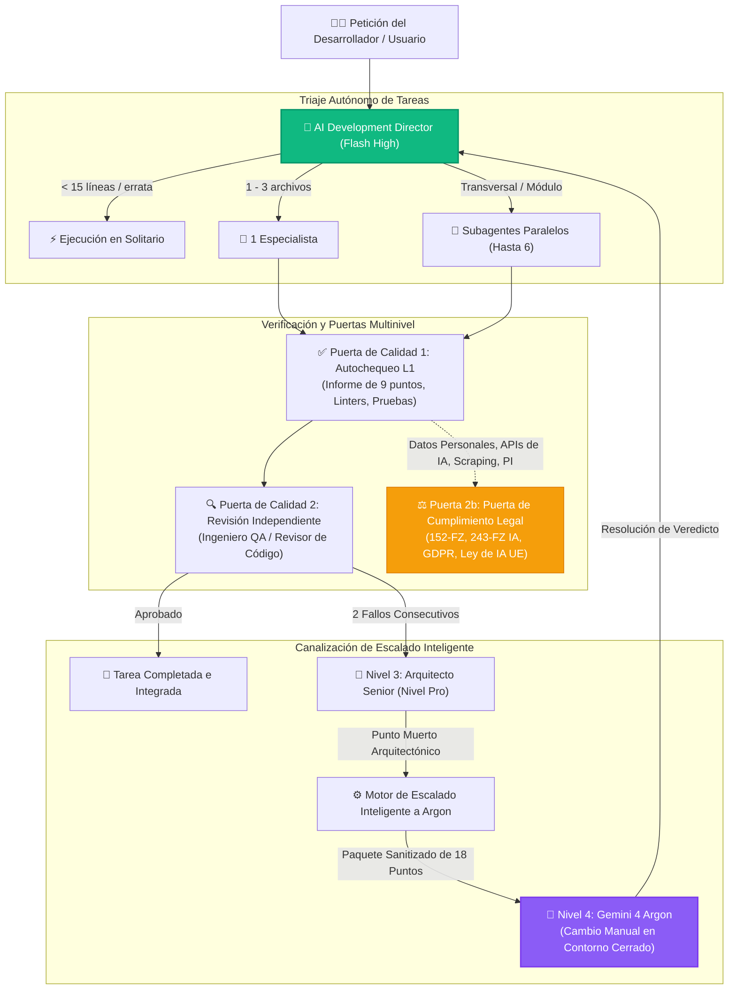

<div align="center">


# Antigravity Apex

### Panel de Control de Misiones y Telemetría Multiagente de Próxima Generación para Google Antigravity

[](https://github.com/fen3211/antigravity-apex/stargazers)
[](https://github.com/fen3211/antigravity-apex/releases/latest/download/Antigravity-Apex-Setup.exe)
[](LICENSE)
[](https://nodejs.org/)
[](https://react.dev/)
[](https://www.typescriptlang.org/)
[](https://sqlite.org/wal.html)
[-10B981.svg)](tests/)
[](https://codespaces.new/fen3211/antigravity-apex)
[](#-sistema-de-diseño-refero--vercel)

<p align="center">
  <a href="#-instalación-en-1-clic">⚡ Instalación en 1 Clic</a> •
  <a href="#-características-principales">Características Principales</a> •
  <a href="#-galería-de-la-interfaz">Galería UI</a> •
  <a href="#-grupo-de-17-especialistas">Grupo de 17 Especialistas</a> •
  <a href="#-arquitectura-y-concurrencia">Arquitectura</a> •
  <a href="#-escalado-inteligente-a-gemini-4-argon">Escalado Argon</a> •
  <a href="#-diagnóstico-del-sistema-doctor">Doctor del Sistema</a>
</p>

<p align="center">
  🌐 <b>Idiomas:</b>
  <a href="README.md">English</a> •
  <a href="README.ru.md">Русский</a> •
  <a href="README.es.md"><b>Español</b></a> •
  <a href="README.fr.md">Français</a> •
  <a href="README.pt.md">Português</a> •
  <a href="README.zh.md">简体中文</a> •
  <a href="README.ja.md">日本語</a> •
  <a href="README.de.md">Deutsch</a>
</p>

> 🌟 **¡Apoya la Innovación de Código Abierto!**
> Si encuentras útil **Antigravity Apex**, por favor **[¡dale una estrella en GitHub!](https://github.com/fen3211/antigravity-apex/stargazers)** Solo toma 1 segundo, mantiene activo el desarrollo y ayuda a más desarrolladores a descubrir la orquestación multiagente autónoma para Google Antigravity.

</div>

---

## Descripción General

**Antigravity Apex** es un panel de control de misiones y supervisor operativo en tiempo real de nivel de producción para sistemas multiagente de **Google Antigravity**, impulsado por el marco de trabajo **AI Development Director**.

Construido estrictamente con una estética de ingeniería limpia inspirada en **Refero / Vercel** con modos claro y oscuro nativos, proporciona a directores de ingeniería, arquitectos de sistemas y desarrolladores observabilidad en tiempo real, control de concurrencia determinista (hasta 6 subagentes paralelos), puertas de verificación multinivel y escalado autónomo de Nivel 4 a Gemini 4 Argon.

---

## ⚡ Instalación en 1 Clic

Elige tu método preferido para instalar e iniciar Antigravity Apex con **literalmente un solo clic o comando**:

### Método 0: Instalador .EXE Independiente para Windows (Sin CLI ni Git)
Simplemente descarga y ejecuta nuestro instalador nativo compilado para Windows desde GitHub Releases:

👉 **[Descargar Antigravity-Apex-Setup.exe (v1.0.0)](https://github.com/fen3211/antigravity-apex/releases/latest/download/Antigravity-Apex-Setup.exe)**

Haz doble clic para instalar. Verifica automáticamente Node.js, clona y configura el proyecto, despliega los 17 agentes en `~/.gemini`, ejecuta el doctor de diagnóstico y abre el panel en tu navegador predeterminado.

---

### Método 1: Lanzador de Escritorio en 1 Clic para Windows (Sin CLI)
Si has clonado o descargado el repositorio:
1. Haz doble clic en [`setup.cmd`](setup.cmd) (o [`setup.bat`](setup.bat)).
2. El lanzador realiza automáticamente:
   - Verificación de **Node.js 18+** y **Git** (te guía paso a paso si faltan).
   - Instalación de todas las dependencias (`npm install` tanto para el servidor como para el cliente).
   - Generación de tu `.env` a partir de `.env.example` con un token de API criptográfico persistente.
   - Despliegue de la suite completa de **17 Agentes, Reglas de Orquestación y Habilidades** en `~/.gemini/config/plugins/ai-director`.
   - Ejecución del **Doctor** de diagnóstico (`npm run doctor` con 19/19 verificaciones superadas).
   - Inicio de los servidores de desarrollo y **apertura automática de tu navegador en `http://127.0.0.1:5173/`**.

> **Uso diario**: Haz doble clic en [`start.cmd`](start.cmd) para un inicio instantáneo en 1 clic.

---

### Método 2: Lanzador Shell en 1 Clic para Linux y macOS
```bash
chmod +x setup.sh && ./setup.sh
```
> **Uso diario**: Ejecuta `./start.sh`.

---

### Método 3: Comando Remoto de Terminal en Una Línea (Sin clonar previamente)
Instala y ejecuta Antigravity Apex en cualquier lugar directamente desde tu terminal:

**Windows (PowerShell)**:
```powershell
irm https://raw.githubusercontent.com/fen3211/antigravity-apex/main/scripts/get.ps1 | iex
```

**Linux y macOS (Bash)**:
```bash
curl -fsSL https://raw.githubusercontent.com/fen3211/antigravity-apex/main/scripts/get.sh | bash
```

---

### Método 4: Configuración y Sincronización en 1 Clic dentro de la App (Web UI)
¿Ya estás dentro del panel de control?
- Haz clic en el botón **`⚡ 1-Click Setup`** en la barra superior de navegación o en **`1-Click Sync Antigravity`** en la página de **Agents**.
- El sistema crea automáticamente una copia de seguridad con marca de tiempo en `backups/`, copia las 17 definiciones de agentes, reglas (`AGENTS.md`) y habilidades en `~/.gemini`, transmite el progreso en tiempo real mediante WebSocket y actualiza el catálogo de agentes al instante.

---

### Método 5: Entorno Cloud en 1 Clic (GitHub Codespaces)
Ejecuta Antigravity Apex en un contenedor cloud dedicado sin necesidad de configuración local:

[](https://codespaces.new/fen3211/antigravity-apex)

---

## 📸 Galería de la Interfaz

<div align="center">
  
  <p><em>Tema Oscuro — Control de Misión, Supervisor de Concurrencia en Tiempo Real y Subagentes Activos</em></p>
</div>

<details>
<summary><b>🔍 Haz clic para expandir la galería completa de capturas (Escalado Argon, Flujo de Trabajo, Modales y Modo Claro)</b></summary>
<br>

| Centro de Escalado Inteligente Argon | Paquete de Prompts de 18 Puntos y Modal de Veredicto |
| :---: | :---: |
|  |  |

| Flujo de Orquestación en Vivo (Modo Oscuro) | Panel de Control en Tema Claro |
| :---: | :---: |
|  |  |

| Modal de Creación de Tareas (Modo Oscuro) |
| :---: |
|  |

</details>

---

## 🎯 Características Principales

### 1. Grupo Canónico de 17 Especialistas
Asignación dinámica entre 17 roles especializados de IA, reservando modelos de alta velocidad y rentabilidad **Gemini 3.8 Flash** para la implementación habitual, modelos **Pro-tier** para arquitectura compleja y auditorías de seguridad, y el contorno cerrado de **Gemini 4 Argon** para bloqueos algorítmicos críticos.

### 2. Alta Concurrencia y Supervisión de Árboles de Procesos
- **Control de Concurrencia Dinámico**: Ejecuta hasta 6 subagentes en paralelo simultáneamente (`MAX_CONCURRENT_SUBAGENTS = 6`), con un gestor de colas FIFO inteligente que previene la saturación de memoria y controla los límites de tasa de las API.
- **Supervisor de Árbol de Procesos**: Monitorización exhaustiva de ejecución con transmisión en vivo de stdout/stderr, control de tiempos de espera y terminación garantizada en árbol (`taskkill /T /F` en Windows, grupos de procesos `kill -9` en Unix) para erradicar procesos huérfanos o zombis.

### 3. Motor Inteligente de Escalado de Nivel 4 a Argon
- **Detección Autónoma de Bloqueos**: Detecta automáticamente fallos de diagnóstico recurrentes (2 intentos consecutivos fallidos), contradicciones entre agentes y puntos muertos según los modos de sensibilidad (`conservative`, `balanced`, `aggressive`).
- **Generador de Paquete de Prompts de 18 Puntos**: Sintetiza un paquete estructurado en Markdown con sanitización automática de rutas de sistema (`C:\Users\username` $\to$ `~`) y tokens sensibles.
- **Memoria Antispam y de Rechazo**: Deduplicación por firma SHA-256 con un enfriamiento de 5 minutos que evita que reinicios rápidos inunden el sistema con escalados redundantes.
- **Resolución de Veredictos en Circuito Cerrado**: El operador ejecuta el paquete de prompts sellado en Gemini 4 Argon, pega el veredicto en el modal, y el AI Director analiza las recomendaciones y redirige la ejecución de vuelta a los especialistas Flash.

### 4. Gobernanza Legal y de Calidad Multinivel (Gate 2b)
- **Puerta de Calidad 1 (Autochequeo L1)**: Ejecución automatizada de pruebas, linters y validación obligatoria del **Informe de 9 Puntos del Subagente**.
- **Puerta de Calidad 2 (Verificación Independiente L2)**: Validación independiente por Ingenieros de QA y Revisores de Código.
- **Puerta de Calidad 2b (Puerta Legal)**: Evaluación automatizada de cumplimiento en jurisdicciones de la Federación Rusa (`RU`) y la Unión Europea (`EU_NL`), auditando 152-FZ, 156-FZ, localización según 23-FZ, regulación de IA 243-FZ, propiedad intelectual de la Parte IV del Código Civil, GDPR/UAVG y la Ley de IA de la UE con un **invariante no bloqueante** (bloqueando únicamente la subtarea riesgosa sin detener el desarrollo seguro de UI o pruebas).

### 5. Ingestión Incremental de Transmisiones sin Relectura de Disco
- El motor `JsonlStreamReader` procesa las transcripciones en vivo de Antigravity (`~/.gemini/antigravity/brain/**/transcript.jsonl`) de forma incremental mediante búferes fragmentados de 64 KB.
- Seguridad en fronteras UTF-8 multibyte, preservando caracteres cirílicos y emojis a través de cortes de búfer.
- Seguimiento de inodo y tiempo de creación para detectar rotaciones, truncamientos o sustituciones de archivos de forma inmediata.
- Las transacciones atómicas de SQLite garantizan cero eventos duplicados.

### 6. Sistema de Diseño Refero Vercel y Temas Dinámicos Claro/Oscuro
- Interfaz de ingeniería de modo dual: tema claro Paper White (`#FAFAFA`) y tema oscuro Obsidian Black (`#0A0A0A`).
- Alternancia de temas persistente mediante `localStorage` y detección de `prefers-color-scheme` del sistema operativo.
- Inicialización inline en la cabecera para evitar parpadeos de estilo no cargado (FOUT).
- Ratios de contraste accesibles según WCAG 2.1 AA, navegación por teclado con anillos de foco visibles y menú lateral adaptativo para móviles.

---

## 👥 Grupo de 17 Especialistas

| # | ID del Rol | Nombre para Mostrar | Nivel / Modelo | Dominio Principal y Responsabilidades |
|---|---|---|---|---|
| 1 | `director` | **Director / Líder Orquestador** | Gemini 3.8 Flash High | Coordinación central, triaje de tareas (<15 líneas en solitario, 1–3 archivos un especialista, complejas en paralelo), arbitraje de calidad |
| 2 | `senior-architect` | **Arquitecto Senior** | Gemini Pro | Escalado de Nivel 3, condiciones de carrera sutiles, bloqueos de datos y escalabilidad del sistema |
| 3 | `researcher` | **Investigador** | Gemini Flash | Exploración del código base, dependencias, análisis de documentación y API (sandbox de solo lectura) |
| 4 | `frontend-developer` | **Desarrollador Frontend** | Gemini Flash | React, Next.js, TypeScript, Tailwind CSS, animaciones UI y diseño adaptativo |
| 5 | `backend-developer` | **Desarrollador Backend** | Gemini Flash | Node.js, Python, Express, API REST, transmisiones WebSocket y arquitectura de servidores |
| 6 | `ui-ux-designer` | **Diseñador UI/UX** | Gemini Flash | Sistemas de diseño Refero/Vercel, jerarquía visual, ergonomía y auditoría anti-diseño genérico |
| 7 | `qa-engineer` | **Ingeniero de QA** | Gemini Flash | Suites automatizadas unitarias, de integración y E2E, validación de casos límite y regresiones |
| 8 | `code-reviewer` | **Revisor de Código** | Gemini Flash | Auditoría independiente de diffs, detección de antipatrones, cumplimiento arquitectónico y refinamiento |
| 9 | `legal-compliance` | **Asesor Legal y Redactor Técnico** | Gemini Flash | Puerta Legal 2b (152-FZ, 243-FZ IA, GDPR, Ley de IA de la UE, licencias) y documentación técnica de referencia |
| 10 | `security-engineer` | **Ingeniero de Seguridad** | Gemini Flash / Pro | OWASP Top 10, SQLi, XSS, SSRF, defensa contra inyecciones de prompts y auditoría de tokens |
| 11 | `devops-engineer` | **Ingeniero de DevOps** | Gemini Flash / Pro | GitHub Actions, CI/CD, Docker, resiliencia de plataforma, copias de seguridad y supervisión de procesos |
| 12 | `product-manager` | **Gerente de Producto** | Gemini Flash | Desglose de requisitos, Historias de Usuario, Criterios de Aceptación y alcance del MVP |
| 13 | `ai-evaluation-engineer` | **Ingeniero de Evaluación de IA** | Gemini Flash / Pro | Calidad de respuestas, suites de evaluación de prompts, optimización de latencia y costes de tokens |
| 14 | `performance-engineer` | **Ingeniero de Rendimiento** | Gemini Flash / Pro | Core Web Vitals (LCP, CLS, INP), perfilado de paquetes, fugas de CPU/memoria y optimización SQL |
| 15 | `accessibility-specialist` | **Especialista en Accesibilidad** | Gemini Flash | Cumplimiento WCAG 2.1/2.2 AA/AAA, lectores de pantalla, HTML semántico y navegación por teclado |
| 16 | `database-specialist` | **Especialista en Bases de Datos** | Gemini Flash / Pro | Esquemas, normalización, migraciones, índices, transacciones y contención de bloqueos |
| 17 | `data-engineer` | **Ingeniero de Datos** | Gemini Flash / Pro | Canalizaciones ETL/ELT, ingestión por streaming JSON/JSONL, deduplicación y calidad de telemetría |

---

## 🏛 Arquitectura y Concurrencia



---

## 🩺 Diagnóstico del Sistema (`doctor`)

Antigravity Apex incorpora un exhaustivo doctor de diagnóstico integrado. Ejecútalo en cualquier momento para comprobar el estado del sistema, las conexiones con Antigravity y la integridad de la base de datos:

```bash
npm run doctor
```

```text
======================================================================
       ANTIGRAVITY APEX - DIAGNÓSTICO DEL SISTEMA Y ESTADO DE SALUD   
======================================================================

=== 1. Entorno de Ejecución ===
  [✓] Node.js v24.20.0 (Requerido >= 18.0.0)
  [✓] npm v11.19.0
  [✓] git versión 2.55.0

=== 2. Configuración del Proyecto ===
  [✓] package.json válido (antigravity-apex v1.0.0)
  [✓] Directorio node_modules presente
  [✓] .env configurado con clave API persistente

=== 3. Instrucciones y Reglas de AI Director ===
  [✓] GEMINI.md verificado
  [✓] AGENTS.md verificado (regla de concurrencia máxima 6)

=== 4. Definiciones de los 17 Agentes Especialistas ===
  [✓] Las 17 definiciones de agentes verificadas

=== 5. Habilidades de Orquestación ===
  [✓] Habilidad director-orchestration verificada
  [✓] Habilidad argon-escalation verificada

=== 6. Entorno Antigravity y Puente CLI ===
  [✓] Antigravity CLI: 1.4.7
  [✓] Transcripciones del brain y bloqueos de presencia activos
  [✓] Base de Conocimiento de Director conectada

=== 7. Salud de la Base de Datos y Persistencia ===
  [✓] Comprobación de integridad de la base de datos SQLite superada
  [✓] Modo de diario WAL de SQLite activo
  [✓] Todas las tablas requeridas presentes (tasks, events, settings, model_usage, escalations)

=======================================================================
Resumen de Diagnóstico: 19 Aprobados, 0 Advertencias, 0 Fallos
Resultado: ¡EXCELENTE! Todos los componentes están verificados.
=======================================================================
```

---

## 📂 Estructura del Proyecto

```text
antigravity-apex/
├── .github/                       # GitHub Actions CI/CD, plantillas de issues y PR
│   ├── assets/hero-banner.svg     # Banner oficial dark-glass de GitHub
│   ├── workflows/ci.yml           # Flujo de trabajo de pruebas multiplataforma
│   └── workflows/release.yml      # Publicación automatizada en GitHub Releases
├── agent-config/                  # Definiciones de origen para la integración con Antigravity
│   ├── agents/                    # Definiciones markdown de los 17 agentes especialistas
│   ├── rules/                     # Reglas de orquestación (AGENTS.md, GEMINI.md)
│   ├── skills/                    # Habilidades (director-orchestration, argon-escalation)
│   └── templates/                 # Plantillas de paquetes de prompts, agentes y reglas
├── client/                        # Frontend con React 19 + TypeScript + Vite
│   └── src/
│       ├── components/            # Componentes con estilo Refero (Claro y Oscuro)
│       │   ├── Modals/            # EscalationDetailModal, ArgonVerdictModal, etc.
│       │   ├── Header.tsx         # Barra superior con sincronización en 1 clic y cambio de tema
│       │   ├── EscalationCenter.tsx # Centro de Escalado de Nivel 4 a Argon
│       │   └── Overview.tsx       # Control de Misión y subagentes activos
│       └── services/api.ts        # Cliente para API REST y WebSocket
├── server/                        # Backend con Node.js + Express + WebSocket
│   └── src/
│       ├── db/database.ts         # Esquema y migraciones SQLite en modo WAL
│       ├── routes/api.ts          # Endpoints REST y autenticación por token
│       └── services/
│           ├── escalation-manager.ts # Motor Inteligente de Escalado a Argon
│           ├── process-supervisor.ts # Ciclo de vida del árbol de procesos y control de timeout
│           ├── antigravity-bridge.ts # Telemetría de sesiones en vivo de Antigravity
│           └── antigravity-installer.ts # Servicio programático de sincronización en 1 clic
├── scripts/                       # Instaladores y diagnósticos
│   ├── get.ps1                    # Instalador remoto en una línea (Windows)
│   ├── get.sh                     # Instalador remoto en una línea (Unix/macOS)
│   ├── install.ps1                # Instalador de agentes en PowerShell
│   ├── install.sh                 # Instalador de agentes en Bash
│   └── doctor.js                  # Motor de diagnóstico con 19 comprobaciones
├── setup.cmd                      # Configuración e inicio en 1 clic para Windows
├── setup.bat                      # Configuración e inicio en 1 clic para Windows
├── setup.sh                       # Configuración e inicio en 1 clic para Unix/macOS
├── start.cmd                      # Lanzador rápido en 1 clic (Windows)
├── start.sh                       # Lanzador rápido en 1 clic (Unix/macOS)
└── docs/                          # Documentación técnica completa
```

---

## 📚 Índice de Documentación

Para consultar guías detalladas, revisa el directorio [`docs/`](docs/):

- [**AGENTS.es.md**](docs/AGENTS.es.md) — Especificación exhaustiva de los 17 roles, responsabilidades y directivas.
- [**ARCHITECTURE.es.md**](docs/ARCHITECTURE.es.md) — Backend, base de datos, flujos de eventos WebSocket e interioridades del supervisor.
- [**ORCHESTRATION.md**](docs/ORCHESTRATION.md) — Manual operativo para AI Development Director y escalado a Argon.
- [**INSTALLATION.es.md**](docs/INSTALLATION.es.md) — Referencia completa de instalación, copias de seguridad y restauración.
- [**GETTING_STARTED.es.md**](docs/GETTING_STARTED.es.md) — Primeros pasos y tutorial rápido de introducción.
- [**CONFIGURATION.es.md**](docs/CONFIGURATION.es.md) — Variables de entorno, rutas y autenticación por token.
- [**TROUBLESHOOTING.es.md**](docs/TROUBLESHOOTING.es.md) — Resolución de problemas frecuentes y consejos de diagnóstico.
- [**FAQ.es.md**](docs/FAQ.es.md) — Preguntas frecuentes.

---

## 🛡 Seguridad y Privacidad

Antigravity Apex implementa controles de seguridad de nivel empresarial:
- **Aislamiento en Loopback Local**: El enlace predeterminado a `127.0.0.1` impide el acceso no autorizado desde LAN o WAN.
- **Autenticación con Resistencia a Ataques de Temporización**: Verificación criptográfica segura mediante `crypto.timingSafeEqual`.
- **Paquetes de Escalado Sanitizados**: Las rutas del sistema (`C:\Users\username` $\to$ `~`) y los tokens confidenciales (`AIza...`, `sk-...`, `ghp-...`) se eliminan automáticamente antes de generar el paquete de prompts.
- **Protección contra Traversal de Rutas**: Valida estrictamente todas las rutas de acceso a la base de conocimiento y a las transcripciones.
- **Prohibición de Despliegue en Producción**: Los agentes y scripts tienen estrictamente prohibido realizar despliegues no autorizados en entornos de producción.

Consulta nuestra [Política de Seguridad](SECURITY.md) para el reporte responsable de vulnerabilidades.

---

## 🤝 Contribuciones

¡Las contribuciones son bienvenidas! Por favor, lee [CONTRIBUTING.md](CONTRIBUTING.md) y nuestro [Código de Conducta](CODE_OF_CONDUCT.md) antes de enviar solicitudes de extracción (pull requests).

```bash
# Ejecuta la suite completa de pruebas antes de enviar tu PR
npm test

# Verifica el diagnóstico del sistema
npm run doctor
```

---

## ⭐ Destaca el Proyecto

Si te gusta lo que estamos construyendo con **Antigravity Apex** y Google Antigravity, **¡dale una estrella a este repositorio!** ⭐

<div align="center">

[](https://github.com/fen3211/antigravity-apex/stargazers)

*¡Cada estrella ayuda a hacer crecer la comunidad de desarrolladores de Antigravity y nos motiva a seguir creando grandes funcionalidades!*

</div>

---

## 📄 Licencia

Distribuido bajo la **Licencia MIT**. Consulta [`LICENSE`](LICENSE) para más detalles.
