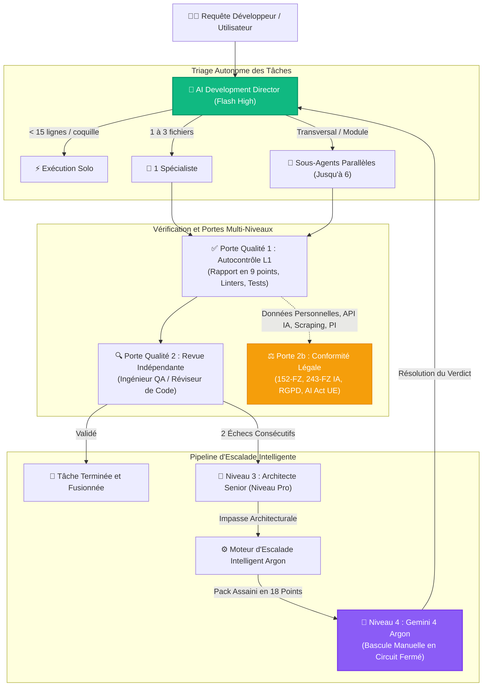

<div align="center">


# Antigravity Apex

### Tableau de Bord de Télémétrie et Centre de Contrôle Multi-Agents de Nouvelle Génération pour Google Antigravity

[](https://github.com/fen3211/antigravity-apex/stargazers)
[](https://github.com/fen3211/antigravity-apex/releases/latest/download/Antigravity-Apex-Setup.exe)
[](LICENSE)
[](https://nodejs.org/)
[](https://react.dev/)
[](https://www.typescriptlang.org/)
[](https://sqlite.org/wal.html)
[-10B981.svg)](tests/)
[](https://codespaces.new/fen3211/antigravity-apex)
[](#-système-de-design-refero--vercel)

<p align="center">
  <a href="#-installation-en-1-clic">⚡ Installation en 1 Clic</a> •
  <a href="#-fonctionnalités-clés">Fonctionnalités Clés</a> •
  <a href="#-galerie-dinterface">Galerie UI</a> •
  <a href="#-bassin-de-17-spécialistes">17 Spécialistes</a> •
  <a href="#-architecture-et-concurrence">Architecture</a> •
  <a href="#-escalade-intelligente-vers-gemini-4-argon">Escalade Argon</a> •
  <a href="#-diagnostic-système-doctor">Docteur Système</a>
</p>

<p align="center">
  🌐 <b>Langues :</b>
  <a href="README.md">English</a> •
  <a href="README.ru.md">Русский</a> •
  <a href="README.es.md">Español</a> •
  <a href="README.fr.md"><b>Français</b></a> •
  <a href="README.pt.md">Português</a> •
  <a href="README.zh.md">简体中文</a> •
  <a href="README.ja.md">日本語</a> •
  <a href="README.de.md">Deutsch</a>
</p>

> 🌟 **Soutenez l'Innovation Open Source !**
> Si vous trouvez **Antigravity Apex** utile, merci de **[lui attribuer une étoile sur GitHub !](https://github.com/fen3211/antigravity-apex/stargazers)** Cela ne prend qu'une seconde, encourage le développement actif et aide d'autres développeurs à découvrir l'orchestration autonome multi-agents pour Google Antigravity.

</div>

---

## Présentation Générale

**Antigravity Apex** est un centre de contrôle de mission et superviseur opérationnel en temps réel de niveau production pour les systèmes multi-agents **Google Antigravity**, propulsé par le cadre de travail **AI Development Director**.

Conçu rigoureusement selon une esthétique d'ingénierie épurée inspirée de **Refero / Vercel** avec des thèmes clair et sombre natifs, il offre aux directeurs techniques, architectes système et développeurs une observabilité en temps réel, un contrôle déterministe de la concurrence (jusqu'à 6 sous-agents simultanés), des barrières de vérification à plusieurs niveaux et une escalade autonome de Niveau 4 vers Gemini 4 Argon.

---

## ⚡ Installation en 1 Clic

Choisissez votre méthode préférée pour installer et démarrer Antigravity Apex en **un seul clic ou une seule commande** :

### Méthode 0 : Installateur .EXE Autonome pour Windows (Sans CLI ni Git)
Téléchargez et exécutez notre installateur natif Windows depuis GitHub Releases :

👉 **[Télécharger Antigravity-Apex-Setup.exe (v1.0.0)](https://github.com/fen3211/antigravity-apex/releases/latest/download/Antigravity-Apex-Setup.exe)**

Double-cliquez pour installer. Il vérifie automatiquement Node.js, clone et configure le projet, déploie les 17 agents dans `~/.gemini`, lance le docteur de diagnostic et ouvre le tableau de bord dans votre navigateur par défaut !

---

### Méthode 1 : Lanceur de Bureau Windows en 1 Clic (Sans CLI)
Si vous avez cloné ou téléchargé le dépôt :
1. Double-cliquez sur [`setup.cmd`](setup.cmd) (ou [`setup.bat`](setup.bat)).
2. Le lanceur prend tout en charge automatiquement :
   - Vérifie **Node.js 18+** et **Git** (avec guide d'installation si manquant).
   - Installe toutes les dépendances (`npm install` pour le serveur et le client).
   - Génère votre fichier `.env` depuis `.env.example` avec un jeton d'API persistant et sécurisé.
   - Déploie l'ensemble des **17 Agents, Règles d'Orchestration et Compétences** dans `~/.gemini/config/plugins/ai-director`.
   - Exécute le diagnostic **Doctor** (`npm run doctor` avec 19/19 vérifications validées).
   - Lance les serveurs de développement et **ouvre automatiquement votre navigateur sur `http://127.0.0.1:5173/`** !

> **Au quotidien** : Double-cliquez sur [`start.cmd`](start.cmd) pour un lancement instantané en 1 clic.

---

### Méthode 2 : Lanceur Shell en 1 Clic pour Linux et macOS
```bash
chmod +x setup.sh && ./setup.sh
```
> **Au quotidien** : Exécutez `./start.sh`.

---

### Méthode 3 : Commande Unique dans le Terminal (Sans clonage préalable)
Installez et démarrez Antigravity Apex directement depuis votre terminal :

**Windows (PowerShell)** :
```powershell
irm https://raw.githubusercontent.com/fen3211/antigravity-apex/main/scripts/get.ps1 | iex
```

**Linux et macOS (Bash)** :
```bash
curl -fsSL https://raw.githubusercontent.com/fen3211/antigravity-apex/main/scripts/get.sh | bash
```

---

### Méthode 4 : Configuration et Synchronisation en 1 Clic dans l'Interface (Web UI)
Vous êtes déjà dans le tableau de bord ?
- Cliquez sur le bouton **`⚡ 1-Click Setup`** dans la barre supérieure ou sur **`1-Click Sync Antigravity`** sur la page **Agents**.
- Le système crée automatiquement une sauvegarde horodatée dans `backups/`, copie l'ensemble des 17 définitions d'agents, règles (`AGENTS.md`) et compétences dans `~/.gemini`, diffuse la progression en direct via WebSocket et synchronise instantanément le catalogue d'agents !

---

### Méthode 5 : Environnement Cloud en 1 Clic (GitHub Codespaces)
Exécutez Antigravity Apex dans un conteneur cloud dédié sans aucune configuration locale :

[](https://codespaces.new/fen3211/antigravity-apex)

---

## 📸 Galerie d'Interface

<div align="center">
  
  <p><em>Thème Sombre — Contrôle de Mission, Superviseur de Concurrence en Temps Réel et Sous-Agents Actifs</em></p>
</div>

<details>
<summary><b>🔍 Cliquez pour afficher la galerie complète (Escalade Argon, Flux de Travail, Modales et Mode Clair)</b></summary>
<br>

| Centre d'Escalade Intelligent Argon | Pack de Prompts en 18 Points & Modal de Verdict |
| :---: | :---: |
|  |  |

| Flux d'Orchestration en Direct (Thème Sombre) | Contrôle de Mission en Thème Clair |
| :---: | :---: |
|  |  |

| Modal de Création de Tâche (Thème Sombre) |
| :---: |
|  |

</details>

---

## 🎯 Fonctionnalités Clés

### 1. Bassin Canonique de 17 Rôles Spécialisés
Allocation dynamique parmi 17 rôles d'IA spécialisés : modèles rapides et économiques **Gemini 3.8 Flash** pour l'exécution standard, modèles réservés **Pro-tier** pour les audits d'architecture complexe et de sécurité, et circuit fermé **Gemini 4 Argon** pour les impasses algorithmiques critiques.

### 2. Concurrence à Haut Débit et Supervision de l'Arbre des Processus
- **Contrôle Dynamique de Concurrence** : Exécutez jusqu'à 6 sous-agents simultanément (`MAX_CONCURRENT_SUBAGENTS = 6`), avec un gestionnaire de file d'attente FIFO intelligent qui prévient la saturation mémoire et respecte les quotas d'API.
- **Superviseur d'Arbre de Processus** : Surveillance intégrale avec diffusion stdout/stderr en direct, application stricte des délais d'attente et terminaison garantie en arborescence (`taskkill /T /F` sous Windows, groupes de processus `kill -9` sous Unix) éliminant les processus orphelins ou zombies.

### 3. Moteur d'Escalade Intelligent de Niveau 4 vers Argon
- **Détection Autonome des Blocages** : Détection automatique des échecs répétés de diagnostic (2 tentatives consécutives échouées), des contradictions entre agents et des blocages mutuels selon le mode de sensibilité (`conservative`, `balanced`, `aggressive`).
- **Générateur de Pack de Prompts en 18 Points** : Synthèse d'un ensemble structuré au format Markdown avec assainissement automatique des chemins système (`C:\Users\username` $\to$ `~`) et masquage des jetons sensibles.
- **Mémoire Anti-Spam et de Rejet** : Déduplication par signature SHA-256 avec période de refroidissement de 5 minutes évitant les surcharges lors des relances de tâches.
- **Résolution de Verdict en Circuit Fermé** : L'opérateur exécute le pack de prompts scellé dans Gemini 4 Argon, colle le verdict dans le modal, puis l'AI Director analyse les recommandations et redirige l'exécution vers les spécialistes Flash.

### 4. Gouvernance Qualité et Juridique Multi-Niveaux (Gate 2b)
- **Porte Qualité 1 (Autocontrôle L1)** : Exécution automatisée des tests, linters et validation impérative du **Rapport de Sous-Agent en 9 Points**.
- **Porte Qualité 2 (Vérification Indépendante L2)** : Validation indépendante par les Ingénieurs QA et Réviseurs de Code.
- **Porte Qualité 2b (Porte Juridique)** : Évaluation automatisée de la conformité juridique pour les juridictions de la Fédération de Russie (`RU`) et de l'Union Européenne (`EU_NL`), couvrant la 152-FZ, 156-FZ, la localisation 23-FZ, la loi 243-FZ sur l'IA, la Partie IV du Code Civil, le RGPD/UAVG et l'AI Act européen avec un **invariant non bloquant** (suspendant uniquement la sous-tâche non conforme sans bloquer le développement UI ou les tests).

### 5. Ingestion de Flux Incrémentale sans Relecture du Disque
- Le moteur `JsonlStreamReader` traite les transcriptions Antigravity en direct (`~/.gemini/antigravity/brain/**/transcript.jsonl`) de manière incrémentale à travers des tampons fractionnés de 64 Ko.
- Sécurité des frontières multi-octets UTF-8 garantissant l'intégrité des caractères cyrilliques et des emojis lors des coupures de tampons.
- Suivi des inodes et dates de création pour identifier immédiatement les rotations, troncatures ou remplacements de fichiers.
- Transactions atomiques SQLite garantissant l'absence totale d'événements dupliqués.

### 6. Système de Design Refero Vercel et Thèmes Dynamiques Clair/Sombre
- Interface d'ingénierie bi-mode : thème clair Paper White (`#FAFAFA`) et thème sombre Obsidian Black (`#0A0A0A`).
- Persistance du thème dans le `localStorage` avec détection automatique de `prefers-color-scheme`.
- Initialisation inline dans le head évitant tout effet de scintillement de style non chargé (FOUT).
- Ratios de contraste conformes WCAG 2.1 AA, navigation au clavier avec anneaux de focus visibles et tiroir latéral réactif sur mobile.

---

## 👥 Bassin de 17 Spécialistes

| # | ID du Rôle | Nom Affiché | Niveau / Modèle | Domaine Principal et Responsabilités |
|---|---|---|---|---|
| 1 | `director` | **Directeur / Orchestrateur Principal** | Gemini 3.8 Flash High | Coordination centrale, triage des tâches (<15 lignes en solo, 1 à 3 fichiers un spécialiste, parallèles pour le complexe), arbitrage qualité |
| 2 | `senior-architect` | **Architecte Senior** | Gemini Pro | Escalade de Niveau 3, conditions de course subtiles, verrous de données et passage à l'échelle |
| 3 | `researcher` | **Chercheur** | Gemini Flash | Exploration du code source, dépendances, analyse de documentations et d'API (bac à sable en lecture seule) |
| 4 | `frontend-developer` | **Développeur Frontend** | Gemini Flash | React, Next.js, TypeScript, Tailwind CSS, animations UI et intégration adaptative |
| 5 | `backend-developer` | **Développeur Backend** | Gemini Flash | Node.js, Python, Express, API REST, flux WebSocket et architecture serveur |
| 6 | `ui-ux-designer` | **Designer UI/UX** | Gemini Flash | Systèmes de design Refero/Vercel, hiérarchie visuelle, ergonomie et élimination des poncifs visuels de l'IA |
| 7 | `qa-engineer` | **Ingénieur QA** | Gemini Flash | Suites automatisées unitaires, d'intégration et E2E, validation des cas limites et régressions |
| 8 | `code-reviewer` | **Réviseur de Code** | Gemini Flash | Audit indépendant de diffs, identification d'anti-patrons, conformité architecturale et finitions |
| 9 | `legal-compliance` | **Conseiller Juridique & Rédacteur Technique** | Gemini Flash | Porte Légale 2b (152-FZ, 243-FZ IA, RGPD, AI Act UE, licences) et documentation technique de référence |
| 10 | `security-engineer` | **Ingénieur Sécurité** | Gemini Flash / Pro | OWASP Top 10, SQLi, XSS, SSRF, protection contre les injections de prompts et audit des secrets |
| 11 | `devops-engineer` | **Ingénieur DevOps** | Gemini Flash / Pro | GitHub Actions, CI/CD, Docker, résilience de plateforme, sauvegardes et supervision des processus |
| 12 | `product-manager` | **Chef de Produit** | Gemini Flash | Découpage des exigences, User Stories, Critères d'Acceptation et périmètre MVP |
| 13 | `ai-evaluation-engineer` | **Ingénieur Évaluation IA** | Gemini Flash / Pro | Qualité des réponses, suites d'évaluation de prompts, optimisation de latence et coût des jetons |
| 14 | `performance-engineer` | **Ingénieur Performance** | Gemini Flash / Pro | Core Web Vitals (LCP, CLS, INP), profilage des bundles, fuites CPU/mémoire et optimisation SQL |
| 15 | `accessibility-specialist` | **Spécialiste Accessibilité** | Gemini Flash | Conformité WCAG 2.1/2.2 AA/AAA, lecteurs d'écran, HTML sémantique et navigation au clavier |
| 16 | `database-specialist` | **Spécialiste Base de Données** | Gemini Flash / Pro | Schémas, normalisation, migrations, index, transactions et contention des verrous |
| 17 | `data-engineer` | **Ingénieur Données** | Gemini Flash / Pro | Pipelines ETL/ELT, flux de streaming JSON/JSONL, déduplication et intégrité de la télémétrie |

---

## 🏛 Architecture et Concurrence



---

## 🩺 Diagnostic Système (`doctor`)

Antigravity Apex est équipé d'un utilitaire de diagnostic complet intégré. Exécutez-le à tout moment pour vérifier la santé du système, les connexions Antigravity et l'intégrité de la base de données :

```bash
npm run doctor
```

```text
======================================================================
       ANTIGRAVITY APEX - DIAGNOSTIC SYSTÈME & ÉTAT DE SANTÉ          
======================================================================

=== 1. Environnement d'Exécution ===
  [✓] Node.js v24.20.0 (Requis >= 18.0.0)
  [✓] npm v11.19.0
  [✓] git version 2.55.0

=== 2. Configuration du Projet ===
  [✓] package.json valide (antigravity-apex v1.0.0)
  [✓] Répertoire node_modules présent
  [✓] .env configuré avec une clé API persistante

=== 3. Instructions et Règles de l'AI Director ===
  [✓] GEMINI.md vérifié
  [✓] AGENTS.md vérifié (règle de concurrence max 6)

=== 4. Définitions des 17 Agents Spécialistes ===
  [✓] Les 17 définitions d'agents vérifiées

=== 5. Compétences d'Orchestration ===
  [✓] Compétence director-orchestration vérifiée
  [✓] Compétence argon-escalation vérifiée

=== 6. Environnement Antigravity & Pont CLI ===
  [✓] Antigravity CLI: 1.4.7
  [✓] Transcriptions du brain et verrous de présence actifs
  [✓] Base de Connaissances du Director connectée

=== 7. Santé de la Base de Données et Persistance ===
  [✓] Test d'intégrité de la base SQLite réussi
  [✓] Mode journal WAL de SQLite actif
  [✓] Toutes les tables requises présentes (tasks, events, settings, model_usage, escalations)

=======================================================================
Résumé du Diagnostic : 19 Réussis, 0 Avertissements, 0 Échecs
Résultat : EXCELLENT ! Tous les composants sont opérationnels.
=======================================================================
```

---

## 📂 Structure du Projet

```text
antigravity-apex/
├── .github/                       # GitHub Actions CI/CD, modèles d'issues et de PR
│   ├── assets/hero-banner.svg     # Bannière officielle dark-glass GitHub
│   ├── workflows/ci.yml           # Pipeline de tests multiplateforme
│   └── workflows/release.yml      # Publications automatisées sur GitHub Releases
├── agent-config/                  # Définitions sources pour l'intégration Antigravity
│   ├── agents/                    # Fichiers markdown des 17 agents spécialistes
│   ├── rules/                     # Règles d'orchestration (AGENTS.md, GEMINI.md)
│   ├── skills/                    # Compétences (director-orchestration, argon-escalation)
│   └── templates/                 # Modèles de packs de prompts, d'agents et de règles
├── client/                        # Frontend React 19 + TypeScript + Vite
│   └── src/
│       ├── components/            # Composants inspirés de Refero (Clair & Sombre)
│       │   ├── Modals/            # EscalationDetailModal, ArgonVerdictModal, etc.
│       │   ├── Header.tsx         # Barre supérieure avec synchronisation 1-clic et thème
│       │   ├── EscalationCenter.tsx # Centre d'Escalade de Niveau 4 vers Argon
│       │   └── Overview.tsx       # Contrôle de Mission et sous-agents actifs
│       └── services/api.ts        # Client API REST et WebSocket
├── server/                        # Backend Node.js + Express + WebSocket
│   └── src/
│       ├── db/database.ts         # Schéma et migrations SQLite en mode WAL
│       ├── routes/api.ts          # Points d'accès REST et authentification par jeton
│       └── services/
│           ├── escalation-manager.ts # Moteur d'Escalade Intelligent vers Argon
│           ├── process-supervisor.ts # Gestion de l'arbre de processus et délais
│           ├── antigravity-bridge.ts # Télémétrie en direct des sessions Antigravity
│           └── antigravity-installer.ts # Service de synchronisation programmatique en 1 clic
├── scripts/                       # Scripts d'installation et de diagnostic
│   ├── get.ps1                    # Script d'installation distante (Windows)
│   ├── get.sh                     # Script d'installation distante (Unix/macOS)
│   ├── install.ps1                # Installateur d'agents PowerShell
│   ├── install.sh                 # Installateur d'agents Bash
│   └── doctor.js                  # Moteur de diagnostic en 19 points
├── setup.cmd                      # Configuration et lancement en 1 clic sous Windows
├── setup.bat                      # Configuration et lancement en 1 clic sous Windows
├── setup.sh                       # Configuration et lancement en 1 clic sous Unix/macOS
├── start.cmd                      # Lanceur rapide en 1 clic (Windows)
├── start.sh                       # Lanceur rapide en 1 clic (Unix/macOS)
└── docs/                          # Documentation technique complète
```

---

## 📚 Index de la Documentation

Pour consulter nos guides détaillés, parcourez le répertoire [`docs/`](docs/) :

- [**AGENTS.fr.md**](docs/AGENTS.fr.md) — Spécifications détaillées des 17 rôles, missions et prompts.
- [**ARCHITECTURE.fr.md**](docs/ARCHITECTURE.fr.md) — Fonctionnement interne du backend, base de données, flux WebSocket et superviseur.
- [**ORCHESTRATION.md**](docs/ORCHESTRATION.md) — Manuel opérationnel pour l'AI Development Director et l'escalade vers Argon.
- [**INSTALLATION.fr.md**](docs/INSTALLATION.fr.md) — Guide complet d'installation, de sauvegarde et de restauration.
- [**GETTING_STARTED.fr.md**](docs/GETTING_STARTED.fr.md) — Premiers pas et tutoriel rapide de démarrage.
- [**CONFIGURATION.fr.md**](docs/CONFIGURATION.fr.md) — Variables d'environnement, chemins système et authentification.
- [**TROUBLESHOOTING.fr.md**](docs/TROUBLESHOOTING.fr.md) — Résolution des erreurs courantes et conseils de diagnostic.
- [**FAQ.fr.md**](docs/FAQ.fr.md) — Réponses aux questions fréquentes.

---

## 🛡 Sécurité et Confidentialité

Antigravity Apex intègre des contrôles de sécurité de niveau entreprise :
- **Isolation en Boucle Locale (Loopback)** : La liaison exclusive sur `127.0.0.1` bloque tout accès non autorisé depuis les réseaux locaux ou Internet.
- **Authentification Résistante aux Attaques Temporelles** : Vérification cryptographique stricte via `crypto.timingSafeEqual`.
- **Assainissement des Packs d'Escalade** : Les chemins système personnels (`C:\Users\username` $\to$ `~`) et les jetons d'accès (`AIza...`, `sk-...`, `ghp-...`) sont automatiquement expurgés avant la génération du prompt.
- **Protection contre le Déplacement de Répertoire (Path Traversal)** : Contrôle rigoureux de tous les chemins d'accès à la base de connaissances et aux journaux d'exécution.
- **Interdiction de Déploiement en Production** : Les agents et scripts ont pour interdiction formelle d'exécuter des déploiements non supervisés en production.

Consultez notre [Politique de Sécurité](SECURITY.md) pour signaler toute vulnérabilité.

---

## 🤝 Contribution

Les contributions sont les bienvenues ! Veuillez consulter [CONTRIBUTING.md](CONTRIBUTING.md) et notre [Code de Conduite](CODE_OF_CONDUCT.md) avant de soumettre une pull request.

```bash
# Lancer l'ensemble des tests avant de soumettre une PR
npm test

# Valider le diagnostic système
npm run doctor
```

---

## ⭐ Soutenez le Projet

Si vous appréciez ce que nous développons avec **Antigravity Apex** et Google Antigravity, **attribuez une étoile à ce dépôt !** ⭐

<div align="center">

[](https://github.com/fen3211/antigravity-apex/stargazers)

*Chaque étoile aide à faire grandir la communauté des développeurs Antigravity et nous motive à concevoir de nouvelles fonctionnalités remarquables !*

</div>

---

## 📄 Licence

Distribué sous la **Licence MIT**. Consultez [`LICENSE`](LICENSE) pour plus d'informations.
