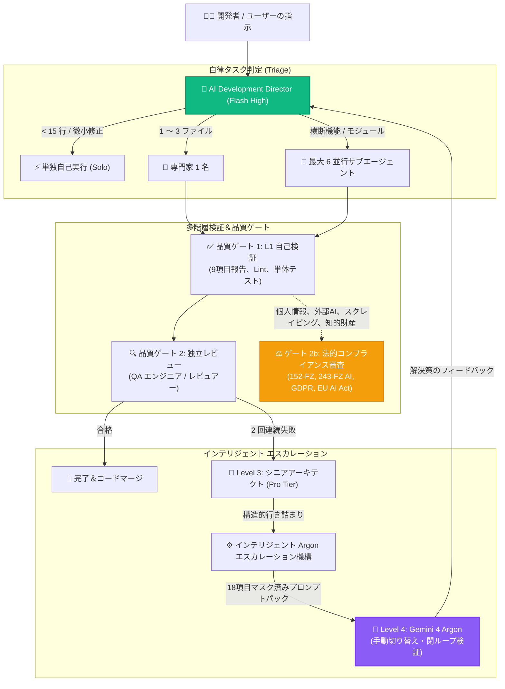

<div align="center">


# Antigravity Apex

### Google Antigravity 向け次世代マルチエージェント管制センター＆リアルタイムテレメトリダッシュボード

[](https://github.com/fen3211/antigravity-apex/stargazers)
[](https://github.com/fen3211/antigravity-apex/releases/latest/download/Antigravity-Apex-Setup.exe)
[](LICENSE)
[](https://nodejs.org/)
[](https://react.dev/)
[](https://www.typescriptlang.org/)
[](https://sqlite.org/wal.html)
[-10B981.svg)](tests/)
[](https://codespaces.new/fen3211/antigravity-apex)
[](#-refero--vercel-デザインシステム)

<p align="center">
  <a href="README.md">English</a> •
  <a href="README.ru.md">Русский</a> •
  <a href="README.es.md">Español</a> •
  <a href="README.fr.md">Français</a> •
  <a href="README.pt.md">Português</a> •
  <a href="README.zh.md">简体中文</a> •
  <a href="README.ja.md">日本語</a> •
  <a href="README.de.md">Deutsch</a>
</p>

<p align="center">
  <a href="#-1クリックインストール">⚡ 1クリックインストール</a> •
  <a href="#-主要機能">主要機能</a> •
  <a href="#-ui-ギャラリー">UI ギャラリー</a> •
  <a href="#-17-の専門ロールプール">17の専門ロール</a> •
  <a href="#-アーキテクチャと並行性">アーキテクチャ</a> •
  <a href="#-argon-l4-閉ループエスカレーション">Argon エスカレーション</a> •
  <a href="#-システム診断-doctor">システム診断</a>
</p>

> 🌟 **オープンソース開発を応援してください！**
> **Antigravity Apex** がお役に立ちましたら、ぜひ **[GitHubでスター（Star）を付けてください！](https://github.com/fen3211/antigravity-apex/stargazers)** わずか1秒の操作が開発継続の力となり、より多くの開発者に自律型マルチエージェントオーケストレーションの可能性を届けます。

</div>

---

## 概要

**Antigravity Apex** は、**AI Development Director** フレームワークを活用した **Google Antigravity** マルチエージェントシステム運用のための、エンタープライズグレードのリアルタイム管制センター兼プロセス監視スイートです。

洗練された **Refero / Vercel** エンジニアリングデザイン言語で構築され、明暗（Paper Light / Obsidian Dark）テーマにネイティブ対応。開発責任者、システムアーキテクト、エンジニアに向けて、リアルタイムな可観測性、最大6並列サブエージェントの決定論的並行制御、多層検証ゲート、そして自律的な Level 4 Argon エスカレーション機構を提供します。

---

## ⚡ 1クリックインストール

お好みの方法で、**ワンクリックまたは1行のコマンド**から Antigravity Apex を即座に起動できます：

### 方法 0: Windows 専用スタンドアロン .EXE インストーラー（CLI・Git 不要）
GitHub Releases からビルド済み Windows インストーラーをダウンロードして実行するだけです：

👉 **[Antigravity-Apex-Setup.exe (v1.0.0) をダウンロード](https://github.com/fen3211/antigravity-apex/releases/latest/download/Antigravity-Apex-Setup.exe)**

ダブルクリックするだけで、Node.js の検出、プロジェクトのセットアップ、17 の専門エージェントの `~/.gemini` への展開、診断ドクターの実行、そして既定ブラウザでのダッシュボード起動までが自動で行われます！

---

### 方法 1: Windows 1クリック デスクトップランチャー（CLI 不要）
リポジトリをダウンロードまたはクローンした場合：
1. ルートディレクトリの [`setup.cmd`](setup.cmd)（または [`setup.bat`](setup.bat)）をダブルクリックします。
2. ランチャーが自動的に以下の処理を実行します：
   - **Node.js 18+** および **Git** の存在確認（不足時は導入を案内）。
   - サーバー・クライアントの全依存パッケージのインストール（`npm install`）。
   - 暗号学的に安全な API トークンを含む `.env` を `.env.example` から自動生成。
   - **17のエージェント定義・オーケストレーションルール・Skills** を `~/.gemini/config/plugins/ai-director` へ一括配置。
   - システム診断 **Doctor**（`npm run doctor`、全19項目合格）を実行。
   - サーバーを起動し、**既定ブラウザで `http://127.0.0.1:5173/` を自動オープン**！

> **日々の起動**：次回からは [`start.cmd`](start.cmd) をダブルクリックするだけで一瞬で起動します。

---

### 方法 2: Linux & macOS 1クリック Shell ランチャー
```bash
chmod +x setup.sh && ./setup.sh
```
> **日々の起動**：`./start.sh` を実行するだけです。

---

### 方法 3: ターミナル 1行コマンドでのリモートインストール（クローン不要）
ターミナルから直接スクリプトを実行して起動します：

**Windows (PowerShell)**:
```powershell
irm https://raw.githubusercontent.com/fen3211/antigravity-apex/main/scripts/get.ps1 | iex
```

**Linux & macOS (Bash)**:
```bash
curl -fsSL https://raw.githubusercontent.com/fen3211/antigravity-apex/main/scripts/get.sh | bash
```

---

### 方法 4: アプリ画面からの 1クリック セットアップ＆同期（Web UI）
ダッシュボード画面を開いている場合：
- トップナビゲーションバーの **`⚡ 1-Click Setup`**、または **Agents** 画面の **`1-Click Sync Antigravity`** ボタンをクリックします。
- システムが `backups/` 配下にタイムスタンプ付きバックアップを作成し、17のエージェント・ルール（`AGENTS.md`）・スキルを `~/.gemini` へ同期。WebSocket で進行状況をリアルタイム表示し、エージェント一覧を即座に更新します！

---

### 方法 5: クラウド環境での 1クリック 起動（GitHub Codespaces）
ローカル環境を汚さずにクラウドコンテナ上で体験できます：

[](https://codespaces.new/fen3211/antigravity-apex)

---

## 📸 UI ギャラリー

<div align="center">
  
  <p><em>ダークテーマ — ミッションコントロール、リアルタイム並行監視、アクティブサブエージェント</em></p>
</div>

<details>
<summary><b>🔍 クリックして全スクリーンショットを展開（Argon エスカレーション、ワークフロー、モーダル、ライトテーマ）</b></summary>
<br>

| インテリジェント Argon エスカレーションセンター | 18項目プロンプトパックと裁定モーダル |
| :---: | :---: |
|  |  |

| リアルタイム オーケストレーション（ダークモード） | ライトテーマ ミッションコントロール |
| :---: | :---: |
|  |  |

| タスク作成モーダル（ダークモード） |
| :---: |
|  |

</details>

---

## 🎯 主要機能

### 1. 17ロール構成の標準専門エージェントプール
17の専門特化AIロールへタスクを動的配分。通常実装にはコスト効率抜群の **Gemini 3.8 Flash** を、複雑なアーキテクチャやセキュリティ監査には **Pro-tier** を、重大な技術的行き詰まりには閉ループの **Gemini 4 Argon** を割り当てます。

### 2. 高スループット並行処理＆プロセスツリー完全監視
- **動的並行制御**：最大6つのサブエージェントを同時並行実行（`MAX_CONCURRENT_SUBAGENTS = 6`）。インテリジェントな FIFO キューマネージャーがメモリ飽和を防ぎ、スレッド過負荷を抑制。
- **プロセスツリー監視**：stdout/stderr のリアルタイムストリーミング、タイムアウト制御、クロスプラットフォームのツリー強制終了（Windows: `taskkill /T /F`、Unix: プロセスグループ `kill -9`）によりゾンビプロセスの発生を完全に遮断。

### 3. インテリジェント Level 4 Argon エスカレーション機構
- **自律的デッドロック検知**：同一アプローチの連続失敗（2回連続失敗）、エージェント間の見解矛盾、アルゴリズムの行き詰まりを感度モード（`conservative`, `balanced`, `aggressive`）に応じて自動検出。
- **18項目マスク済みプロンプトパック**：ローカルパス（`C:\Users\username` $\to$ `~`）や各種 API トークン（`AIza...`, `sk-...` 等）を自動正規表現サニタイズした高品質プロンプトパックを合成。
- **スパム防止・重複記憶**：SHA-256 署名重複排除と5分間のクールダウンにより、タスク再試行時の冗長なエスカレーション連発を防止。
- **閉ループ裁定フロー**：オペレーターが Gemini 4 Argon でプロンプトパックを実行し、裁定結果を画面に入力。Director が解決方針を解析して Flash 専門家へ再配分します。

### 4. 多層品質管理＆法的コンプライアンスゲート（Gate 2b）
- **品質ゲート 1（L1 自己検証）**：自動テスト、Lint チェック、**技術専門家 9項目レポート** の必須検証。
- **品質ゲート 2（L2 独立レビュー）**：QA エンジニアおよびコードレビュアーによる独立差分レビュー。
- **品質ゲート 2b（法的コンプライアンス）**：ロシア連邦（`RU`）および EU（`EU_NL`）の法規監査（152-FZ、156-FZ 単独同意、23-FZ データローカライズ、243-FZ AI 規制、民法第4部著作権、GDPR/UAVG、EU AI Act）。**非ブロッキング分離性**（安全な UI スタイルやテスト実装を止めずに、違法なサブタスクのみをピンポイント遮断）。

### 5. ゼロディスクリード増分ストリーミング取り込み
- `JsonlStreamReader` が 64 KB のチャンクバッファを用いて Antigravity のリアルタイムログ（`~/.gemini/antigravity/brain/**/transcript.jsonl`）を増分読み込み。
- マルチバイト UTF-8 分割安全保護：日本語マルチバイト文字や絵文字がバッファ境界で分断されても欠損しません。
- Inode と作成時刻（birthtime）追跡により、ログファイルのローテーションや再作成を瞬時に感知。
- SQLite トランザクションによる完全なイベント重複排除。

### 6. Refero / Vercel デザインシステム＆動的テーマ切り替え
- 開発者のためのデュアルテーマ設計：ペーパーホワイト（`#FAFAFA`）とオブシディアンブラック（`#0A0A0A`）。
- `localStorage` と OS の `prefers-color-scheme` に連動した永続的なテーマ同期。
- インライン Head スクリプトによる画面チラつき（FOUT）の完全防止。
- WCAG 2.1 AA 準拠のコントラスト比、キーボードフォーカスリング（focus-visible）、モバイル対応ドロワー完備。

---

## 👥 17の専門ロールプール

| # | ロール ID | 表示名 | 推奨モデル | 主要領域と担当責務 |
|---|---|---|---|---|
| 1 | `director` | **ディレクター / 統括リーダー** | Gemini 3.8 Flash High | 全体統括、タスク判定（15行未満は単独、1〜3ファイルは専門家1名、大規模は最大6並行）、品質ゲート裁定 |
| 2 | `senior-architect` | **シニアアーキテクト** | Gemini Pro | レベル3エスカレーション、並行処理競合、デッドロック解析、システムスケーラビリティ設計 |
| 3 | `researcher` | **リサーチャー** | Gemini Flash | コードベース探索、依存関係分析、外部 API ドキュメント調査（読み取り専用サンドボックス） |
| 4 | `frontend-developer` | **フロントエンドエンジニア** | Gemini Flash | React 19、Next.js、TypeScript、Tailwind CSS、アニメーション、レスポンシブ UI |
| 5 | `backend-developer` | **バックエンドエンジニア** | Gemini Flash | Node.js、Python、Express、REST API、WebSocket 配信、サーバーアーキテクチャ |
| 6 | `ui-ux-designer` | **UI/UX デザイナー** | Gemini Flash | Refero/Vercel デザインシステム、視覚階層、人間工学、AI テンプレート感の排除 |
| 7 | `qa-engineer` | **QA テストエンジニア** | Gemini Flash | 単体・統合・E2E（Playwright）テスト自動化、エッジケース検証、デグレ防止 |
| 8 | `code-reviewer` | **コードレビュアー** | Gemini Flash | 独立した差分レビュー、アンチパターン検出、アーキテクチャ整合性の検証 |
| 9 | `legal-compliance` | **法務コンプライアンス兼テクニカルライター** | Gemini Flash | ゲート2b 法務審査（152-FZ、243-FZ AI、GDPR、EU AI Act、OSSライセンス）および高品質技術文書の執筆 |
| 10 | `security-engineer` | **セキュリティエンジニア** | Gemini Flash / Pro | OWASP Top 10、SQLi/XSS/SSRF 対策、Prompt Injection 防御、認証トークン監査 |
| 11 | `devops-engineer` | **DevOps エンジニア** | Gemini Flash / Pro | GitHub Actions、CI/CD パイプライン、Docker、回復性向上、バックアップ、プロセス監視 |
| 12 | `product-manager` | **プロダクトマネージャー** | Gemini Flash | 要求分解、ユーザーストーリー策定、受入基準（Acceptance Criteria）定義、MVP 範囲設定 |
| 13 | `ai-evaluation-engineer` | **AI 評価エンジニア** | Gemini Flash / Pro | モデル出力評価、プロンプト評価スイート、ハルシネーション検出、レイテンシ・トークン最適化 |
| 14 | `performance-engineer` | **パフォーマンスエンジニア** | Gemini Flash / Pro | Core Web Vitals（LCP/CLS/INP）最適化、バンドルサイズ解析、メモリリーク診断、SQL 最適化 |
| 15 | `accessibility-specialist` | **アクセシビリティ専門家** | Gemini Flash | WCAG 2.1/2.2 AA/AAA 準拠、スクリーンリーダー対応、セマンティック HTML、キーボード操作性 |
| 16 | `database-specialist` | **データベーススペシャリスト** | Gemini Flash / Pro | スキーマ設計、正規化、インデックス最適化、トランザクション、SQLite WAL 設定、競合回避 |
| 17 | `data-engineer` | **データエンジニア** | Gemini Flash / Pro | ETL/ELT パイプライン構築、JSON/JSONL ストリーム処理、重複排除、テレメトリ品質管理 |

---

## 🏛 アーキテクチャと並行性



---

## 🩺 システム診断 (`doctor`)

Antigravity Apex には、包括的な診断ドクターツールが標準搭載されています。環境の健全性、Antigravity との接続、データベース整合性をいつでも確認できます：

```bash
npm run doctor
```

```text
======================================================================
       ANTIGRAVITY APEX - SYSTEM DIAGNOSTICS & HEALTH CHECK           
======================================================================

=== 1. Runtime & Environment ===
  [✓] Node.js v24.20.0 (Required >= 18.0.0)
  [✓] npm v11.19.0
  [✓] git version 2.55.0

=== 2. Project Configuration ===
  [✓] package.json valid (antigravity-apex v1.0.0)
  [✓] node_modules directory present
  [✓] .env configured with persistent API key

=== 3. AI Director Instructions & Rules ===
  [✓] GEMINI.md verified
  [✓] AGENTS.md verified (max 6 concurrency rule)

=== 4. 17 Specialized Agent Definitions ===
  [✓] All 17 agent definitions verified

=== 5. Orchestration Skills ===
  [✓] director-orchestration skill verified
  [✓] argon-escalation skill verified

=== 6. Antigravity Runtime & CLI Bridge ===
  [✓] Antigravity CLI: 1.4.7
  [✓] Brain transcripts & presence locks active
  [✓] Director Knowledge Base connected

=== 7. Database Health & Persistence ===
  [✓] SQLite database integrity check passed
  [✓] SQLite WAL journal mode active
  [✓] All required tables present (tasks, events, settings, model_usage, escalations)

=======================================================================
Diagnostic Summary: 19 Passed, 0 Warnings, 0 Failures
Result: EXCELLENT! All system and agent components are fully verified.
=======================================================================
```

---

## 📂 プロジェクト構成

```text
antigravity-apex/
├── .github/                       # GitHub Actions CI/CD、Issue・PR テンプレート
│   ├── assets/hero-banner.svg     # 公式ダークグラス ヒーローバナー
│   ├── workflows/ci.yml           # マルチ OS 向け自動テストワークフロー
│   └── workflows/release.yml      # 自動リリース作成パイプライン
├── agent-config/                  # Antigravity 連携用エージェント定義元
│   ├── agents/                    # 17の専門エージェント Markdown 定義
│   ├── rules/                     # 運用ルール (AGENTS.md, GEMINI.md)
│   ├── skills/                    # スキル (director-orchestration, argon-escalation)
│   └── templates/                 # プロンプトパック・エージェント用テンプレート
├── client/                        # React 19 + TypeScript + Vite フロントエンド
│   └── src/
│       ├── components/            # Refero スタイル UI コンポーネント（明暗両対応）
│       │   ├── Modals/            # EscalationDetailModal, ArgonVerdictModal 等
│       │   ├── Header.tsx         # ヘッダー、1-Click 同期、テーマ切り替え
│       │   ├── EscalationCenter.tsx # Level 4 Argon エスカレーション画面
│       │   └── Overview.tsx       # ミッションコントロール＆サブエージェント監視
│       └── services/api.ts        # REST API / WebSocket クライアント
├── server/                        # Node.js + Express + WebSocket バックエンド
│   └── src/
│       ├── db/database.ts         # SQLite WAL スキーマ定義・マイグレーション
│       ├── routes/api.ts          # REST エンドポイント＆トークン認証
│       └── services/
│           ├── escalation-manager.ts # インテリジェント Argon エスカレーション管理
│           ├── process-supervisor.ts # プロセスツリー管理・タイムアウト強制終了
│           ├── antigravity-bridge.ts # Antigravity 稼働セッション連携
│           └── antigravity-installer.ts # プログラムによる一括配置・同期サービス
├── scripts/                       # インストーラーと診断ツール
│   ├── get.ps1                    # 1行リモートインストーラー (Windows)
│   ├── get.sh                     # 1行リモートインストーラー (Unix/macOS)
│   ├── install.ps1                # PowerShell 設定インストールスクリプト
│   ├── install.sh                 # Bash 設定インストールスクリプト
│   └── doctor.js                  # 19項目のシステム診断スクリプト
├── setup.cmd                      # Windows デスクトップ 1クリック セットアップ
├── setup.bat                      # Windows デスクトップ 1クリック セットアップ
├── setup.sh                       # Unix/macOS デスクトップ 1クリック セットアップ
├── start.cmd                      # Windows 高速起動ランチャー
├── start.sh                       # Unix/macOS 高速起動ランチャー
└── docs/                          # 技術ドキュメント一式
```

---

## 📚 ドキュメント一覧

詳細な技術解説は [`docs/`](docs/) ディレクトリをご覧ください：

- [**AGENTS.ja.md**](docs/AGENTS.ja.md) — 全17専門ロールの定義、責任範囲、指示仕様。
- [**ARCHITECTURE.ja.md**](docs/ARCHITECTURE.ja.md) — バックエンド、データベース、WebSocket、監視機構の構造。
- [**ORCHESTRATION.md**](docs/ORCHESTRATION.md) — AI Development Director 運用ガイド＆Argon エスカレーション規程。
- [**INSTALLATION.ja.md**](docs/INSTALLATION.ja.md) — インストール、環境設定、バックアップ＆リストアの詳細。
- [**GETTING_STARTED.ja.md**](docs/GETTING_STARTED.ja.md) — 最初の5分間で学ぶクイックスタートガイド。
- [**CONFIGURATION.ja.md**](docs/CONFIGURATION.ja.md) — 環境変数、ディレクトリパス、認証トークン設定。
- [**TROUBLESHOOTING.ja.md**](docs/TROUBLESHOOTING.ja.md) — トラブルシューティング、エラー対処、診断手順。
- [**FAQ.ja.md**](docs/FAQ.ja.md) — よくある質問と回答。

---

## 🛡 セキュリティとプライバシー

Antigravity Apex は強固なエンタープライズセキュリティを実装しています：
- **ローカルループバック分離**：既定で `127.0.0.1` にバインドし、不正な外部アクセスを遮断。
- **タイミング攻撃耐性認証**：`crypto.timingSafeEqual` による固定時間比較でトークンを安全に検証。
- **エスカレーションパックの自動サニタイズ**：絶対パス（`C:\Users\username` $\to$ `~`）や各種秘密鍵（`AIza...`, `sk-...`, `ghp-...`）を自動マスク。
- **パストラバーサル防御**：知識ベースやログファイル読み込み時の相対パス脱出を厳格に阻止。
- **本番デプロイの絶対禁止**：エージェントおよびスクリプトによる未承認の本番デプロイは固く禁じられています。

脆弱性報告に関しては [セキュリティポリシー (SECURITY.md)](SECURITY.md) をご覧ください。

---

## 🤝 コントリビューション

コミュニティからの貢献を歓迎します！PR を作成する前に [CONTRIBUTING.md](CONTRIBUTING.md) および [行動規範 (CODE_OF_CONDUCT.md)](CODE_OF_CONDUCT.md) をお読みください。

```bash
# PR 作成前にテストスイートを実行
npm test

# システム診断を実行
npm run doctor
```

---

## ⭐ リポジトリにスターを付けよう

**Antigravity Apex** と Google Antigravity の連携ソリューションを気に入っていただけたら、**ぜひ GitHub でスターをお願いします！** ⭐

<div align="center">

[](https://github.com/fen3211/antigravity-apex/stargazers)

*スターの1つ1つが Antigravity コミュニティを広げ、機能開発のモチベーションになります！*

</div>

---

## 📄 ライセンス

本プロジェクトは **MIT ライセンス** のもとで公開されています。詳細は [`LICENSE`](LICENSE) をご覧ください。
