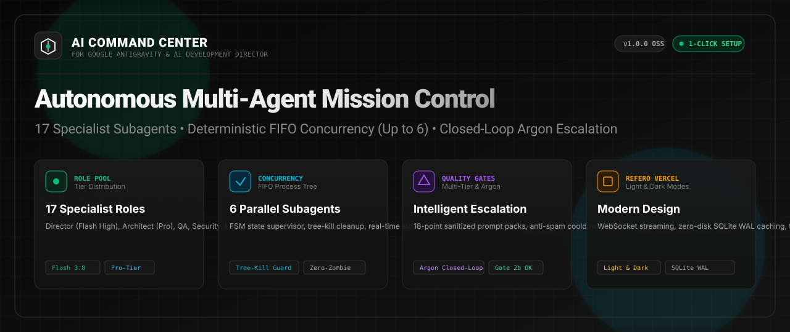
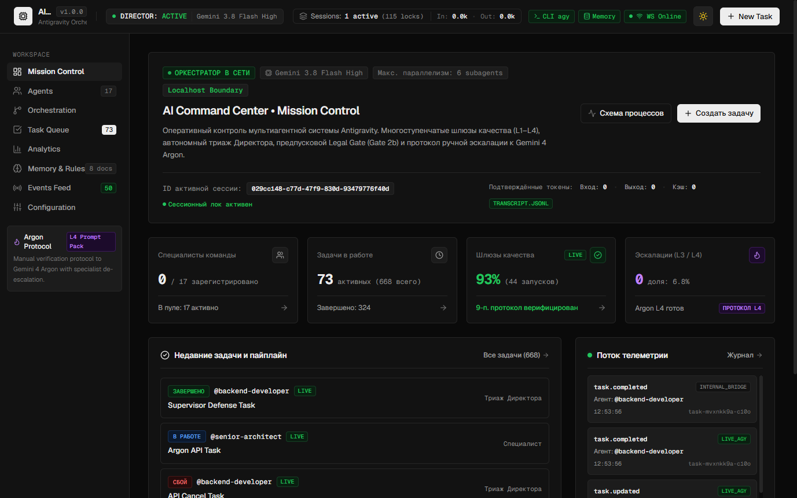
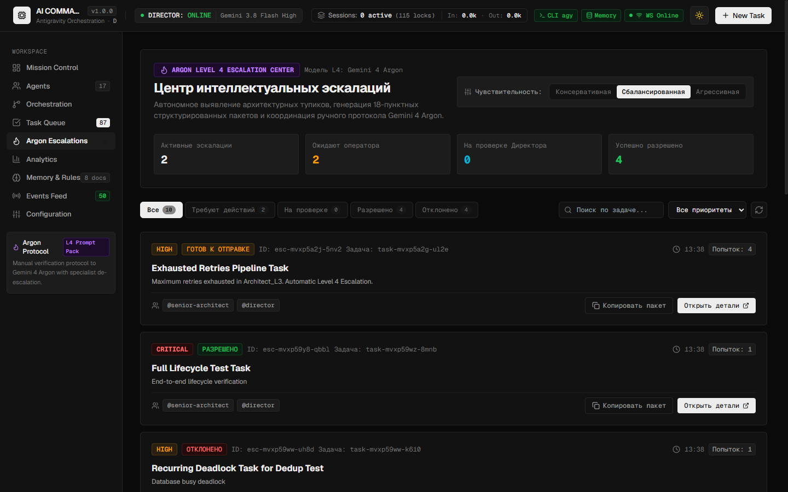
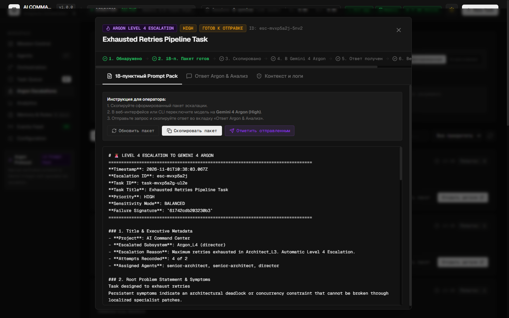
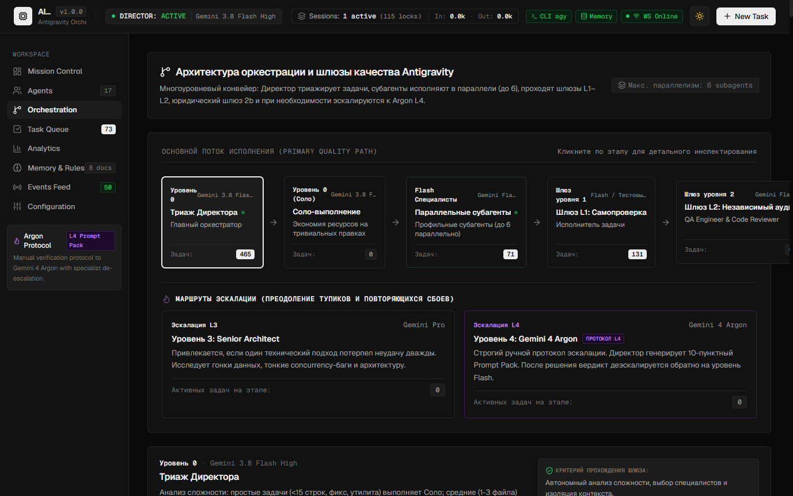
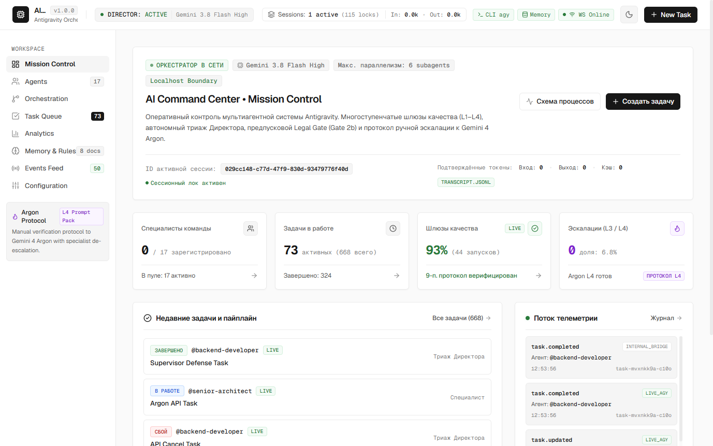
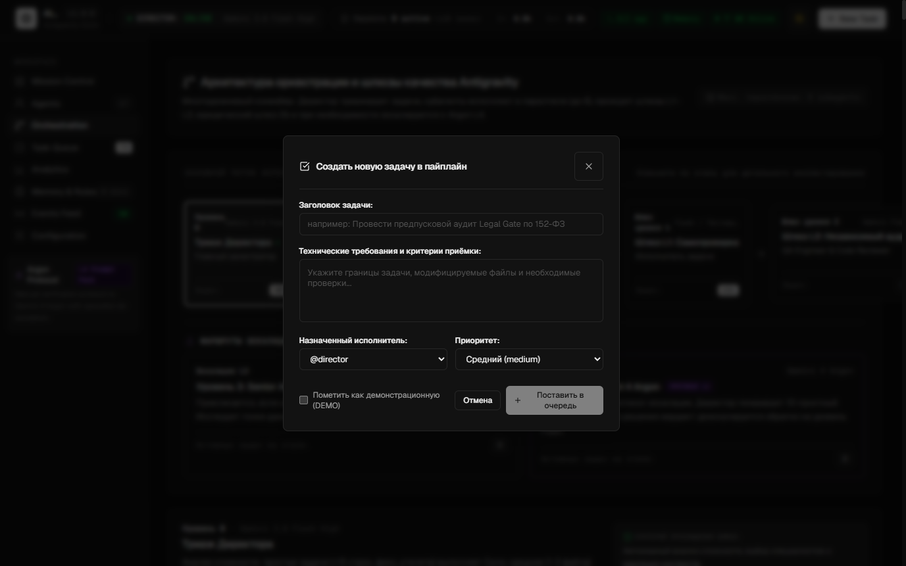
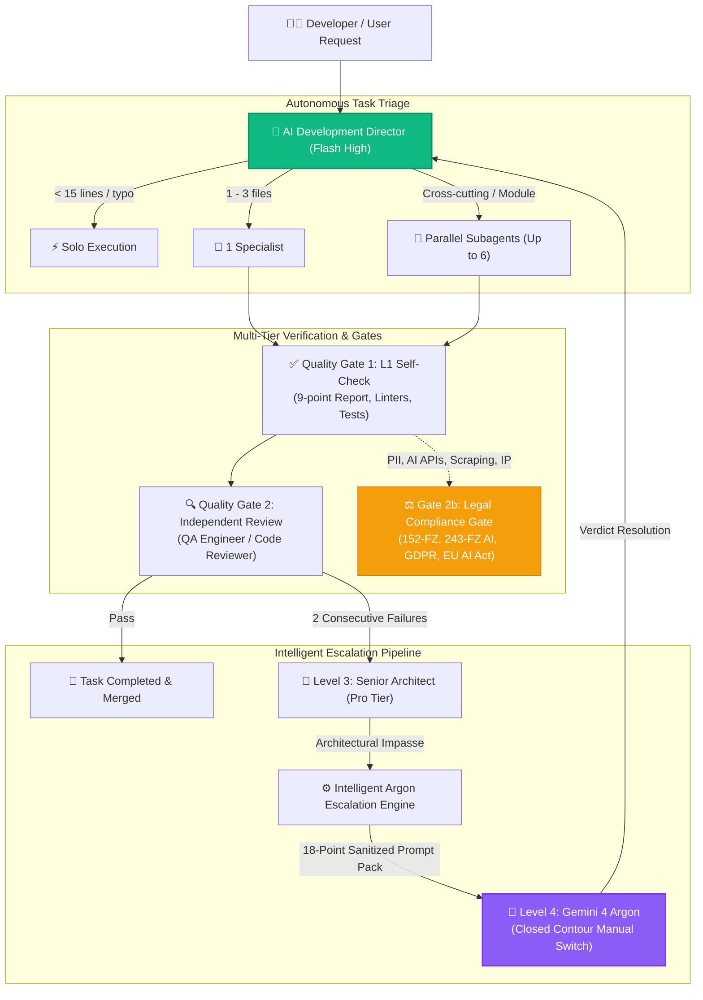

<div align="center">



# Antigravity Apex

### Next-Generation Multi-Agent Mission Control & Telemetry Dashboard for Google Antigravity

[](https://github.com/fen3211/antigravity-apex/stargazers)
[](https://github.com/fen3211/antigravity-apex/releases/latest/download/Antigravity-Apex-Setup.exe)
[](LICENSE)
[](https://nodejs.org/)
[](https://react.dev/)
[](https://www.typescriptlang.org/)
[](https://sqlite.org/wal.html)
[-10B981.svg)](tests/)
[](https://codespaces.new/fen3211/antigravity-apex)
[](#-refero-vercel-design-system)

<p align="center">
  <a href="#-one-click-installation">⚡ 1-Click Install</a> •
  <a href="#-key-features">Key Features</a> •
  <a href="#-interface-gallery">UI Gallery</a> •
  <a href="#-17-role-specialist-pool">17-Role Specialist Pool</a> •
  <a href="#-architecture--concurrency">Architecture</a> •
  <a href="#-closed-contour-argon-escalation">Argon Escalation</a> •
  <a href="#-system-diagnostics-doctor">System Doctor</a> •
</p>

<p align="center">
  🌐 <b>Languages:</b>
  <a href="README.md">English</a> •
  <a href="README.ru.md">Русский</a> •
  <a href="README.es.md">Español</a> •
  <a href="README.fr.md">Français</a> •
  <a href="README.pt.md">Português</a> •
  <a href="README.zh.md">简体中文</a> •
  <a href="README.ja.md">日本語</a> •
  <a href="README.de.md">Deutsch</a>
</p>

> 🌟 **Support Open Source Innovation!**
> If you find **Antigravity Apex** useful, please **[give it a star on GitHub!](https://github.com/fen3211/antigravity-apex/stargazers)** It takes literally 1 second, keeps active development running, and helps more developers discover autonomous multi-agent orchestration for Google Antigravity.

</div>

---

## Overview

**Antigravity Apex** is a production-grade, real-time mission control dashboard and operational supervisor for **Google Antigravity** multi-agent systems powered by the **AI Development Director** framework.

Built strictly in a clean **Refero / Vercel** engineering aesthetic with native light and dark modes, it provides engineering directors, systems architects, and developers with real-time observability, deterministic concurrency control (up to 6 parallel subagents), multi-tier verification gates, and autonomous Level 4 Argon escalation.

---

## ⚡ One-Click Installation

Choose your preferred way to install and launch Antigravity Apex with **literally a single click or command**:

### Method 0: Standalone Windows .EXE Installer (Zero CLI & Zero Git)
Simply download and run our compiled native Windows installer from GitHub Releases:

👉 **[Download Antigravity-Apex-Setup.exe (v1.0.0)](https://github.com/fen3211/antigravity-apex/releases/latest/download/Antigravity-Apex-Setup.exe)**

Double-click to install. It automatically verifies Node.js, clones/configures the project, deploys the 17 agents into `~/.gemini`, runs the diagnostic doctor, and pops up the dashboard in your default browser!

---

### Method 1: Windows 1-Click Desktop Launcher (Zero CLI)
If you cloned or downloaded the repository:
1. Double-click [`setup.cmd`](setup.cmd) (or [`setup.bat`](setup.bat)).
2. The launcher automatically:
   - Verifies **Node.js 18+** and **Git** (guides you if missing).
   - Installs all dependencies (`npm install` for server and client).
   - Generates your `.env` from `.env.example` with a secure persistent API token.
   - Deploys the complete **17-Agent Suite, Orchestration Rules, and Skills** into `~/.gemini/config/plugins/ai-director`.
   - Runs the diagnostic **Doctor** (`npm run doctor` with 19/19 checks).
   - Launches the dev servers and **automatically opens your default browser at `http://127.0.0.1:5173/`**!

> **Daily use**: Double-click [`start.cmd`](start.cmd) for instantaneous 1-click startup.

---

### Method 2: Linux & macOS 1-Click Shell Launcher
```bash
chmod +x setup.sh && ./setup.sh
```
> **Daily use**: Run `./start.sh`.

---

### Method 3: Remote Terminal One-Liner (No Prior Cloning Required)
Install and run Antigravity Apex anywhere directly from your terminal:

**Windows (PowerShell)**:
```powershell
irm https://raw.githubusercontent.com/fen3211/antigravity-apex/main/scripts/get.ps1 | iex
```

**Linux & macOS (Bash)**:
```bash
curl -fsSL https://raw.githubusercontent.com/fen3211/antigravity-apex/main/scripts/get.sh | bash
```

---

### Method 4: In-App 1-Click Setup & Sync (Web UI)
Already inside the dashboard? 
- Click the **`⚡ 1-Click Setup`** button in the top navigation bar or the **`1-Click Sync Antigravity`** button on the **Agents** page.
- The system automatically creates a timestamped backup in `backups/`, copies all 17 agent definitions, rules (`AGENTS.md`), and skills into `~/.gemini`, streams live progress over WebSocket, and updates your agents roster instantly!

---

### Method 5: 1-Click Cloud Workspace (GitHub Codespaces)
Run Antigravity Apex in a dedicated cloud container with zero local setup:

[](https://codespaces.new/fen3211/antigravity-apex)

---

## 📸 Interface Gallery

<div align="center">
  
  <p><em>Dark Theme — Mission Control, Real-Time Concurrency Supervisor &amp; Active Subagents</em></p>
</div>

<details>
<summary><b>🔍 Click to expand full screenshot gallery (Argon Escalation, Workflow, Modals & Light Mode)</b></summary>
<br>

| Intelligent Argon Escalation Center | 18-Point Prompt Pack & Verdict Modal |
| :---: | :---: |
|  |  |

| Live Orchestration Workflow (Dark Mode) | Light Theme Mission Control |
| :---: | :---: |
|  |  |

| Task Creation Modal (Dark Mode) |
| :---: |
|  |

</details>

---

## 🎯 Key Features

### 1. 17-Role Canonical Specialist Pool
Dynamic allocation across 17 specialized AI roles, allocating cost-efficient **Gemini 3.8 Flash** models for standard implementation, reserved **Pro-tier** models for complex architecture and security audits, and closed-contour **Gemini 4 Argon** for critical impasses.

### 2. High-Throughput Concurrency & Process Tree Supervision
- **Dynamic Concurrency Control**: Execute up to 6 parallel subagents simultaneously (`MAX_CONCURRENT_SUBAGENTS = 6`), with an intelligent FIFO queue manager that prevents memory saturation and enforces thread throttling.
- **Process Tree Supervisor**: Complete execution monitoring with stdout/stderr real-time streaming, timeout enforcement, and guaranteed tree-kill termination (`taskkill /T /F` on Windows, `kill -9` process groups on Unix) to eliminate orphaned zombie processes.

### 3. Intelligent Level 4 Argon Escalation Engine
- **Autonomous Impasse Detection**: Automatically detects repeated diagnostic failures (2 consecutive failed attempts), agent contradictions, and deadlocks across sensitivity modes (`conservative`, `balanced`, `aggressive`).
- **18-Point Prompt Pack Generator**: Synthesizes a structured 18-point Markdown prompt pack with automated sanitization of system paths (`C:\Users\username` $\to$ `~`) and sensitive tokens.
- **Anti-Spam & Rejection Memory**: SHA-256 signature deduplication with a 5-minute cooldown prevents rapid task restarts from flooding the system with redundant escalations.
- **Closed-Loop Verdict Resolution**: Operator executes the sealed prompt pack in Gemini 4 Argon, pastes the verdict into the modal, and the AI Director parses recommendations and routes execution back to Flash specialists.

### 4. Multi-Tier Quality & Legal Governance (Gate 2b)
- **Quality Gate 1 (L1 Self-Check)**: Automated test execution, linting, and mandatory validation of **9-point Subagent Reports**.
- **Quality Gate 2 (L2 Independent Verification)**: Independent validation by QA Engineers and Code Reviewers.
- **Quality Gate 2b (Legal Gate)**: Automated compliance evaluation across Russian (`RU`) and European (`EU_NL`) jurisdictions, auditing 152-FZ, 156-FZ, 23-FZ localization, 243-FZ AI regulation, Part IV Civil Code copyright, GDPR/UAVG, and EU AI Act with a **non-blocking invariant** (blocking risky sub-tasks without stalling safe UI/test development).

### 5. Zero-Disk-Read Incremental Stream Ingestion
- `JsonlStreamReader` engine reads live Antigravity transcripts (`~/.gemini/antigravity/brain/**/transcript.jsonl`) incrementally using chunked 64 KB buffers.
- Multi-byte UTF-8 boundary safety preserving Cyrillic characters and emojis across buffer splits.
- Inode and birthtime tracking to identify file rotations, truncations, or replacements instantly.
- Atomic SQLite transactions guarantee zero duplicate event insertions.

### 6. Refero Vercel Design System & Dynamic Light/Dark Themes
- Dual-mode engineering interface: Paper White (`#FAFAFA`) light theme & Obsidian Black (`#0A0A0A`) dark theme.
- Persistent theme switching via `localStorage` and system `prefers-color-scheme` detection.
- Zero-flash-of-unstyled-theme (FOUT) inline head bootstrap.
- WCAG 2.1 AA accessible contrast ratios, focus-visible keyboard navigation, and responsive mobile drawer.

---

## 👥 17-Role Specialist Pool

| # | Role ID | Display Name | Tier / Model | Primary Domain & Responsibilities |
|---|---|---|---|---|
| 1 | `director` | **Director / Lead Orchestrator** | Gemini 3.8 Flash High | Central coordination, task triage (<15 lines solo, 1-3 files single specialist, complex parallel), quality gates governance |
| 2 | `senior-architect` | **Senior Architect** | Gemini Pro | Level 3 escalation, subtle concurrency/race conditions, data locks, system scalability |
| 3 | `researcher` | **Researcher** | Gemini Flash | Codebase exploration, dependencies, API docs analysis (read-only sandbox) |
| 4 | `frontend-developer` | **Frontend Developer** | Gemini Flash | React, Next.js, TypeScript, Tailwind CSS, UI animations, responsive layouts |
| 5 | `backend-developer` | **Backend Developer** | Gemini Flash | Node.js, Python, Express, REST APIs, WebSocket streaming, server architecture |
| 6 | `ui-ux-designer` | **UI/UX Designer** | Gemini Flash | Refero/Vercel design systems, visual hierarchy, ergonomics, anti-AI-slop audit |
| 7 | `qa-engineer` | **QA Engineer** | Gemini Flash | Unit, integration, E2E automated test suites, edge case validation, regression defense |
| 8 | `code-reviewer` | **Code Reviewer** | Gemini Flash | Independent diff audits, anti-patterns, architectural compliance, code polish |
| 9 | `legal-compliance` | **Legal Advisor & Tech Writer** | Gemini Flash | Legal Gate 2b (152-FZ, 243-FZ AI, GDPR, EU AI Act, licenses) and authoritative technical documentation |
| 10 | `security-engineer` | **Security Engineer** | Gemini Flash / Pro | OWASP Top 10, SQLi, XSS, SSRF, prompt injection protection, token audit |
| 11 | `devops-engineer` | **DevOps Engineer** | Gemini Flash / Pro | GitHub Actions, CI/CD, Docker, platform resilience, backups, process supervisor |
| 12 | `product-manager` | **Product Manager** | Gemini Flash | Requirements breakdown, User Stories, Acceptance Criteria, MVP scoping |
| 13 | `ai-evaluation-engineer` | **AI Evaluation Engineer** | Gemini Flash / Pro | Model outputs, prompt eval suites, latency and token cost optimization |
| 14 | `performance-engineer` | **Performance Engineer** | Gemini Flash / Pro | Core Web Vitals (LCP, CLS, INP), bundle size profiling, CPU/memory leaks, SQL tuning |
| 15 | `accessibility-specialist` | **Accessibility Specialist** | Gemini Flash | WCAG 2.1/2.2 AA/AAA compliance, screen readers, semantic HTML, keyboard focus rings |
| 16 | `database-specialist` | **Database Specialist** | Gemini Flash / Pro | Schemas, normalization, migrations, indexes, transactions, lock contention |
| 17 | `data-engineer` | **Data Engineer** | Gemini Flash / Pro | ETL/ELT pipelines, JSON/JSONL streaming ingestion, deduplication, telemetry quality |

---

## 🏛 Architecture & Concurrency



---

## 🩺 System Diagnostics (`doctor`)

Antigravity Apex comes equipped with a comprehensive built-in diagnostic doctor. Run it anytime to check system health, Antigravity connections, and database integrity:

```bash
npm run doctor
```

```text
======================================================================
       ANTIGRAVITY APEX - SYSTEM DIAGNOSTICS & HEALTH CHECK           
======================================================================

=== 1. Runtime & Environment ===
  [✓] Node.js v24.20.0 (Required >= 18.0.0)
  [✓] npm v11.19.0
  [✓] git version 2.55.0

=== 2. Project Configuration ===
  [✓] package.json valid (antigravity-apex v1.0.0)
  [✓] node_modules directory present
  [✓] .env configured with persistent API key

=== 3. AI Director Instructions & Rules ===
  [✓] GEMINI.md verified
  [✓] AGENTS.md verified (max 6 concurrency rule)

=== 4. 17 Specialized Agent Definitions ===
  [✓] All 17 agent definitions verified

=== 5. Orchestration Skills ===
  [✓] director-orchestration skill verified
  [✓] argon-escalation skill verified

=== 6. Antigravity Runtime & CLI Bridge ===
  [✓] Antigravity CLI: 1.4.7
  [✓] Brain transcripts & presence locks active
  [✓] Director Knowledge Base connected

=== 7. Database Health & Persistence ===
  [✓] SQLite database integrity check passed
  [✓] SQLite WAL journal mode active
  [✓] All required tables present (tasks, events, settings, model_usage, escalations)

=======================================================================
Diagnostic Summary: 19 Passed, 0 Warnings, 0 Failures
Result: EXCELLENT! All system and agent components are fully verified.
=======================================================================
```

---

## 📂 Project Structure

```text
antigravity-apex/
├── .github/                       # GitHub Actions CI/CD, issue & PR templates
│   ├── assets/hero-banner.svg     # Official GitHub dark-glass hero banner
│   ├── workflows/ci.yml           # Cross-platform multi-OS test workflow
│   └── workflows/release.yml      # Automated GitHub releases
├── agent-config/                  # Source definitions for Antigravity integration
│   ├── agents/                    # 17 Specialist Agent markdown definitions
│   ├── rules/                     # Orchestration rules (AGENTS.md, GEMINI.md)
│   ├── skills/                    # Skills (director-orchestration, argon-escalation)
│   └── templates/                 # Prompt pack, agent, and rules templates
├── client/                        # React 19 + TypeScript + Vite frontend
│   └── src/
│       ├── components/            # Refero-styled components (Light & Dark)
│       │   ├── Modals/            # EscalationDetailModal, ArgonVerdictModal, etc.
│       │   ├── Header.tsx         # Top bar with 1-Click Sync & theme toggle
│       │   ├── EscalationCenter.tsx # Level 4 Argon Escalation Center
│       │   └── Overview.tsx       # Mission Control & active subagents
│       └── services/api.ts        # REST API & WebSocket client
├── server/                        # Node.js + Express + WebSocket backend
│   └── src/
│       ├── db/database.ts         # SQLite WAL schema & migrations
│       ├── routes/api.ts          # REST endpoints & token authentication
│       └── services/
│           ├── escalation-manager.ts # Intelligent Argon Escalation Engine
│           ├── process-supervisor.ts # Process tree lifecycle & timeout guard
│           ├── antigravity-bridge.ts # Live Antigravity session telemetry
│           └── antigravity-installer.ts # Programmatic 1-click sync service
├── scripts/                       # Installers & diagnostics
│   ├── get.ps1                    # Remote one-liner installer (Windows)
│   ├── get.sh                     # Remote one-liner installer (Unix/macOS)
│   ├── install.ps1                # PowerShell agent installer
│   ├── install.sh                 # Bash agent installer
│   └── doctor.js                  # 19-check diagnostic engine
├── setup.cmd                      # 1-Click Windows Desktop Setup & Launch
├── setup.bat                      # 1-Click Windows Desktop Setup & Launch
├── setup.sh                       # 1-Click Unix/macOS Desktop Setup & Launch
├── start.cmd                      # 1-Click Quick Launcher (Windows)
├── start.sh                       # 1-Click Quick Launcher (Unix/macOS)
└── docs/                          # Comprehensive technical documentation
```

---

## 📚 Documentation Index

For in-depth guides, see the [`docs/`](docs/) directory:

- [**AGENTS.md**](docs/AGENTS.md) — Detailed specifications of all 17 agent roles, duties, and prompts.
- [**ARCHITECTURE.md**](docs/ARCHITECTURE.md) — Backend, database, WebSocket event streams, and supervisor internals.
- [**ORCHESTRATION.md**](docs/ORCHESTRATION.md) — Operational runbook for AI Development Director & Argon escalation.
- [**INSTALLATION.md**](docs/INSTALLATION.md) — Comprehensive installation, backup, and restore reference.
- [**GETTING_STARTED.md**](docs/GETTING_STARTED.md) — First steps and quick tutorial.
- [**CONFIGURATION.md**](docs/CONFIGURATION.md) — Environment variables, paths, and token auth.
- [**TROUBLESHOOTING.md**](docs/TROUBLESHOOTING.md) — Resolving common errors and diagnostic tips.
- [**FAQ.md**](docs/FAQ.md) — Frequently asked questions.

---

## 🛡 Security & Privacy

Antigravity Apex implements enterprise-grade security controls:
- **Local Loopback Isolation**: Default binding to `127.0.0.1` prevents unauthorized LAN/WAN access.
- **Timing-Safe Token Authentication**: Cryptographically secure token verification using `crypto.timingSafeEqual` prevents timing attacks.
- **Sanitized Escalation Packs**: System paths (`C:\Users\username` $\to$ `~`) and sensitive tokens (`AIza...`, `sk-...`, `ghp-...`) are automatically stripped before prompt pack generation.
- **Path Traversal Protection**: Strictly validates all knowledge base and transcript access paths against traversal attacks.
- **Zero Production Deployment**: Agents and scripts are strictly forbidden from executing non-sanctioned production deployments.

Read our complete [Security Policy](SECURITY.md) for vulnerability reporting.

---

## 🤝 Contributing

Contributions are welcome! Please read [CONTRIBUTING.md](CONTRIBUTING.md) and our [Code of Conduct](CODE_OF_CONDUCT.md) before submitting pull requests.

```bash
# Run full test suite before submitting PR
npm test

# Verify system diagnostics
npm run doctor
```

---

## ⭐ Star the Project

If you love what we're building with **Antigravity Apex** and Google Antigravity, **give this repo a star!** ⭐

<div align="center">

[](https://github.com/fen3211/antigravity-apex/stargazers)

*Every single star helps elevate the Antigravity developer community and motivates us to build more awesome features!*

</div>

---

## 📄 License

Distributed under the **MIT License**. See [`LICENSE`](LICENSE) for details.
