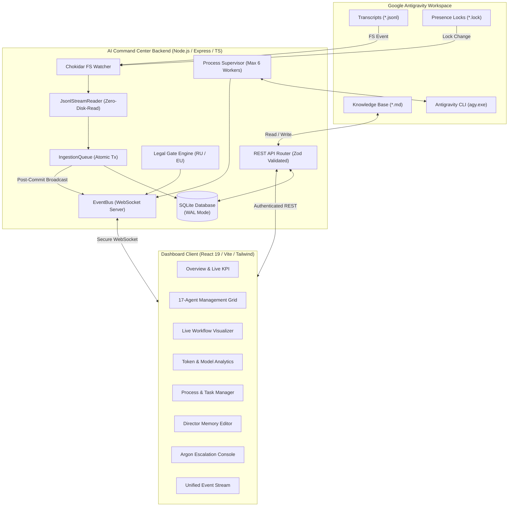

<div align="center">

# AI Command Center

### Multi-Agent Orchestration & Telemetry Dashboard for Google Antigravity

[](LICENSE)
[](https://nodejs.org/)
[](https://react.dev/)
[](https://www.typescriptlang.org/)
[](https://sqlite.org/wal.html)
[-success.svg)](tests/)
[](SECURITY.md)

<p align="center">
  <a href="#quick-start">Quick Start</a> •
  <a href="#key-features">Key Features</a> •
  <a href="#architecture">Architecture</a> •
  <a href="#17-specialist-pool">17-Role Specialist Pool</a> •
  <a href="#configuration">Configuration</a> •
  <a href="#security">Security</a> •
  <a href="#docs">Documentation</a> •
  <a href="README.ru.md">Русская версия</a>
</p>

</div>

---

## Overview

**AI Command Center** is a high-performance, real-time management dashboard and operational supervisor designed for **Google Antigravity** multi-agent systems and the **AI Development Director** framework.

Crafted in an ultra-modern **Refero / Vercel** engineering aesthetic with native light and dark modes, it gives engineering directors, architects, and developers complete visibility, granular concurrency control, and multi-tier quality governance over autonomous subagents.

## Interface Preview

<div align="center">
  
  <p><em>Dark Theme — Mission Control & Concurrency Supervisor (Refero Vercel Style)</em></p>
</div>

<details>
<summary><b>View Additional Screenshots (Light Mode, Orchestration, New Task Modal)</b></summary>
<br>

| Light Theme Overview | Dark Orchestration Workflow |
| :---: | :---: |
|  |  |

| Task Creation Modal (Dark Mode) |
| :---: |
|  |

</details>

```
                      ┌──────────────────────────────────────┐
                      │    AI Development Director (Flash)   │
                      └──────────────────┬───────────────────┘
                                         │
                 ┌───────────────────────┴───────────────────────┐
                 ▼                                               ▼
     ┌───────────────────────┐                       ┌───────────────────────┐
     │  Specialist Subagents │                       │  Gate 2b: Legal Gate  │
     │  (Up to 6 Concurrent) │                       │  (RF & EU Compliance) │
     └───────────┬───────────┘                       └───────────────────────┘
                 │
                 ▼
     ┌───────────────────────┐
     │ Quality Gate 1 & 2    │◄─── Tests, Linters, Code Reviews
     └───────────┬───────────┘
                 │
           (2 Failures)
                 ▼
     ┌───────────────────────┐
     │ Level 3: Architect    │◄─── Gemini Pro Tier
     └───────────┬───────────┘
                 │
          (Blocker Impasse)
                 ▼
     ┌────────────────────────────────────────────────────────┐
     │  Level 4: Gemini 4 Argon Escalation (Closed Contour)   │
     │  Isolated Prompt Pack -> Manual Switch -> Verdict      │
     └────────────────────────────────────────────────────────┘
```

---

## Key Features

### 1. 17-Role Specialist Pool
Comprehensive coordination across 17 specialized AI roles, allocating cost-efficient **Gemini 3.8 Flash** models for standard development, reserved **Pro-tier** models for complex architecture and security audits, and closed-contour **Gemini 4 Argon** for critical impasses.

### 2. High-Throughput Concurrency & Process Supervision
- **Dynamic Concurrency Control**: Execute up to 6 parallel subagents simultaneously (`MAX_CONCURRENT_SUBAGENTS = 6`), with an intelligent queue manager that prevents memory saturation and enforces thread throttling.
- **Process Tree Supervisor**: Complete execution monitoring with stdout/stderr real-time streaming, timeout enforcement, and guaranteed tree-kill termination (`taskkill /T /F` on Windows) to eliminate orphaned processes.

### 3. Closed-Contour Level 4 Argon Escalation
- Automated detection of two consecutive failed attempts per approach.
- Synthesizes an isolated 10-point **Argon Prompt Pack** containing minimal reproduction context (20–50 lines), failure proof, and architectural diagnostic questions.
- Operators review and execute the prompt within a sealed contour, routing the architectural verdict back to Flash specialists for code execution.

### 4. Multi-Tier Quality & Legal Governance (Gate 2b)
- **Quality Gate 1 (L1 Self-Check)**: Automated test execution, linting, and mandatory validation of **9-point Subagent Reports**.
- **Quality Gate 2 (L2 Independent Verification)**: Independent validation by QA Engineers and Code Reviewers.
- **Quality Gate 2b (Legal Gate)**: Automated compliance evaluation across Russian (`RU`) and European (`EU_NL`) jurisdictions, auditing 152-FZ, 156-FZ, 23-FZ localization, 243-FZ AI regulation, Part IV Civil Code copyright, GDPR/UAVG, and EU AI Act. Operates with a **non-blocking invariant** (blocking risky sub-tasks without stalling safe UI/test development).

### 5. Zero-Disk-Read Incremental Stream Ingestion
- `JsonlStreamReader` engine reads live Antigravity transcripts (`~/.gemini/antigravity/brain/**/transcript.jsonl`) incrementally using chunked 64 KB buffers.
- Multi-byte UTF-8 boundary safety preserving Cyrillic characters and emojis across buffer splits.
- Inode and birthtime tracking to identify file rotations, truncations, or replacements instantly.
- Atomic SQLite transactions guarantee zero duplicate event insertions.

### 6. Live Presence & Telemetry
- Real-time watcher tracking Antigravity active locks (`~/.gemini/antigravity/presence/*.lock`).
- Accurate separation of confirmed **LIVE** token consumption and projected **ESTIMATED** metrics.
- Direct memory explorer and editor for the Director Knowledge Base (`~/.gemini/antigravity/knowledge/ai-director/`).

### 7. Refero Vercel Design System & Dynamic Light/Dark Themes
- Dual-mode engineering interface: Paper White (`#FAFAFA`) light theme & Obsidian Black (`#0A0A0A`) dark theme.
- Persistent theme switching via `localStorage` and system `prefers-color-scheme` detection.
- Zero-flash-of-unstyled-theme (FOUT) inline head bootstrap.
- WCAG 2.1 AA accessible contrast ratios, focus-visible keyboard navigation, and micro-interactions.

---

## Quick Start (3 Commands)

### Prerequisites
- **Node.js** >= 18.0.0 (tested on Node v20 LTS and v24)
- **npm** >= 9.0.0
- Windows 10/11, macOS, or modern Linux distribution
- *(Optional)* Google Antigravity CLI (`agy.exe`)

```bash
# 1. Clone repository
git clone https://github.com/your-org/ai-command-center.git
cd ai-command-center

# 2. Install dependencies (server + client)
npm install && npm --prefix client install

# 3. Launch Development Environment
npm run dev
```

> **Windows Quick Launch**: Double-click [`start.cmd`](start.cmd) in the project root to start both server and client automatically.

Access points:
- **Frontend Dashboard**: [http://127.0.0.1:5173](http://127.0.0.1:5173)
- **Backend API & Health**: [http://127.0.0.1:3001/health](http://127.0.0.1:3001/health)
- **WebSocket Telemetry Stream**: `ws://127.0.0.1:3001/ws`

---

## Verification & Testing

Verify that your installation satisfies all system invariants:

```bash
# Run the complete test suite (20 system tests, 9 supervisor tests, 16 legal scenarios)
npm test
```

Expected output:
```
ALL 20 SYSTEM, SECURITY & INGESTION TESTS PASSED! ✓
ALL 9 PROCESS SUPERVISOR & EXECUTION BRIDGE TESTS PASSED! ✓
ALL 16 LEGAL & COMPLIANCE SCENARIOS PASSED WITH 100% SUCCESS RATE ✓
```

---

## Architecture

AI Command Center is built with an event-driven, reactive architecture designed for zero disk churn and near-zero latency:



---

## 17-Role Specialist Pool

| # | Role ID | Display Name | Default Model Tier | Primary Domain |
|---|---------|--------------|--------------------|----------------|
| 1 | `director` | AI Development Director | Gemini 3.8 Flash High | Master coordinator, task triage, model routing & quality arbiter |
| 2 | `researcher` | Researcher | Gemini Flash | Codebase analysis, documentation research, dependency investigation |
| 3 | `frontend-developer` | Frontend Developer | Gemini Flash | React 19, Next.js, TypeScript, UI ergonomics, micro-interactions |
| 4 | `backend-developer` | Backend Developer | Gemini Flash | Node.js, Express, Python, API endpoints, schema validation, auth |
| 5 | `ui-ux-designer` | UI/UX Designer | Gemini Flash | Liquid Dark Glass design systems, wireframing, layout hierarchy |
| 6 | `qa-engineer` | QA Engineer | Gemini Flash | Unit, integration, E2E automation, edge-case and regression testing |
| 7 | `code-reviewer` | Code Reviewer | Gemini Flash | Independent diff review, security defect detection, anti-patterns |
| 8 | `senior-architect` | Senior Architect | Gemini Pro | Complex architectural refactoring, race condition resolution, L3 escalation |
| 9 | `legal-compliance` | Legal Advisor & Tech Writer | Gemini Flash | RF & EU compliance (152-FZ, 243-FZ, GDPR) + comprehensive technical docs |
| 10 | `security-engineer` | Security Engineer | Gemini Flash / Pro | OWASP Top 10, DevSecOps, secret leak prevention, prompt injection audit |
| 11 | `devops-engineer` | DevOps & SRE | Gemini Flash / Pro | CI/CD pipelines, Docker containers, monitoring, automated backups |
| 12 | `product-manager` | Product Manager | Gemini Flash | User stories, Acceptance Criteria, backlog prioritization, MVP scoping |
| 13 | `ai-evaluation-engineer` | AI Evaluation Engineer | Gemini Flash / Pro | Model benchmarking, hallucination tracking, prompt evals, cost audit |
| 14 | `performance-engineer` | Performance Engineer | Gemini Flash / Pro | Core Web Vitals (LCP, CLS, INP), memory leak profiling, SQL optimization |
| 15 | `accessibility-specialist`| Accessibility Specialist | Gemini Flash | WCAG 2.1/2.2 AA/AAA, keyboard navigation, screen readers, semantic HTML |
| 16 | `database-specialist` | Database Specialist | Gemini Flash / Pro | Schema normalization, indexing, migrations, WAL tuning, locks analysis |
| 17 | `data-engineer` | Data Engineer | Gemini Flash / Pro | ETL/ELT pipelines, streaming data, JSONL parsing, data deduplication |

---

## Configuration

Configuration parameters are loaded from environment variables or `.env`:

| Variable | Default Value | Description |
|----------|---------------|-------------|
| `PORT` | `3001` | HTTP and WebSocket server port |
| `HOST` | `127.0.0.1` | Loopback binding address |
| `NODE_ENV` | `development` | Environment mode (`development` or `production`) |
| `COMMAND_CENTER_API_KEY` | *(Auto-generated)* | 32-byte cryptographic hex token for API & WS authentication |
| `ANTIGRAVITY_DIR` | `~/.gemini/antigravity` | Base directory of Google Antigravity |
| `KNOWLEDGE_DIR` | `~/.gemini/antigravity/knowledge/ai-director` | Director memory & protocol markdown storage |
| `PRESENCE_DIR` | `~/.gemini/antigravity/presence` | Active agent presence lock files directory |
| `BRAIN_DIR` | `~/.gemini/antigravity/brain` | Subagent execution transcripts directory |
| `AGY_CLI_PATH` | `%LOCALAPPDATA%\agy\bin\agy.exe` | Path to Antigravity CLI binary |
| `DB_PATH` | `./command_center.sqlite` | SQLite database file location |

---

## Security

AI Command Center operates under strict security invariants:
1. **Loopback Binding**: Bound to `127.0.0.1` by default to prevent external network exposure.
2. **CORS Origin Whitelist**: Unauthorized web origins cannot invoke dashboard endpoints.
3. **Timing-Safe Auth**: Token comparisons utilize `crypto.timingSafeEqual` to thwart timing attacks.
4. **Command Injection Prevention**: Subprocess arguments are validated against strict whitelists with shell metacharacters rejected.
5. **Path Traversal Protection**: Filename parameters enforce `/^[a-zA-Z0-9_-]+\.md$/`.
6. **WebSocket Boundaries**: Frame sizes capped at 64 KB with active ping-pong heartbeat.

Read the complete [Security Policy](SECURITY.md) for vulnerability reporting guidelines.

---

## Documentation

Explore detailed guides in the [`docs/`](docs/) directory:
- [Getting Started Guide](docs/GETTING_STARTED.md)
- [Installation Guide](docs/INSTALLATION.md)
- [Configuration Reference](docs/CONFIGURATION.md)
- [System Architecture](docs/ARCHITECTURE.md)
- [17-Agent Pool Specification](docs/AGENTS.md)
- [Orchestration & Quality Gates](docs/ORCHESTRATION.md)
- [Antigravity Integration Guide](docs/ANTIGRAVITY.md)
- [Troubleshooting & Diagnostics](docs/TROUBLESHOOTING.md)
- [Frequently Asked Questions (FAQ)](docs/FAQ.md)

---

## Roadmap

- [x] Initial open-source release v1.0.0
- [x] 17-agent specialist pool with model routing
- [x] Process Supervisor with tree-kill lifecycle and 6-agent concurrency
- [x] Closed-loop Level 4 Argon Escalation with Prompt Pack generator
- [x] Gate 2b Legal & Compliance engine (RU & EU)
- [ ] Multi-tenant workspace support
- [ ] Exportable PDF & HTML executive audit reports
- [ ] Docker containerized one-click deployment package
- [ ] Native dark/light mode toggle

---

## Contributing

We welcome community contributions! Please read our [Contributing Guidelines](CONTRIBUTING.md) and [Code of Conduct](CODE_OF_CONDUCT.md) before opening pull requests.

---

## License

This project is licensed under the **MIT License** — see the [LICENSE](LICENSE) file for details.

Developed by the **AI Development Director** and the Google Antigravity multi-agent community.
