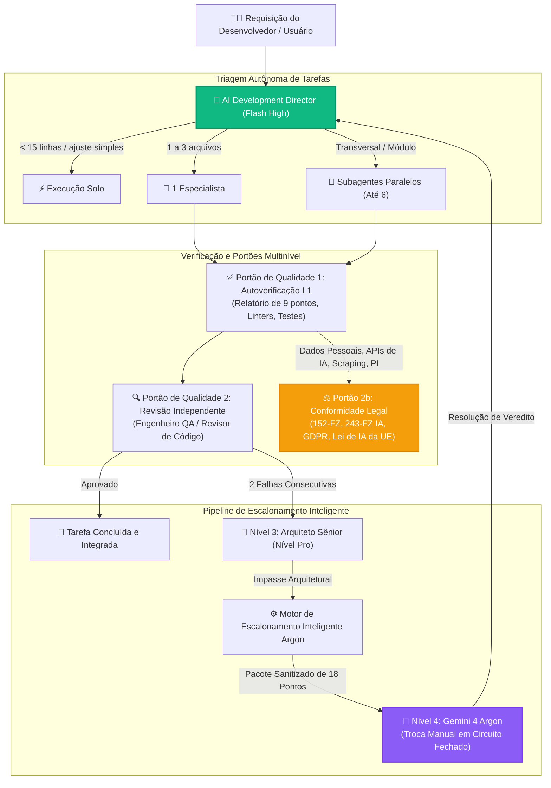

<div align="center">


# Antigravity Apex

### Painel de Telemetria e Centro de Controle Multiagente de Próxima Geração para o Google Antigravity

[](https://github.com/fen3211/antigravity-apex/stargazers)
[](https://github.com/fen3211/antigravity-apex/releases/latest/download/Antigravity-Apex-Setup.exe)
[](LICENSE)
[](https://nodejs.org/)
[](https://react.dev/)
[](https://www.typescriptlang.org/)
[](https://sqlite.org/wal.html)
[-10B981.svg)](tests/)
[](https://codespaces.new/fen3211/antigravity-apex)
[](#-sistema-de-design-refero--vercel)

<p align="center">
  <a href="#-instalação-em-1-clique">⚡ Instalação em 1 Clique</a> •
  <a href="#-principais-recursos">Principais Recursos</a> •
  <a href="#-galeria-da-interface">Galeria UI</a> •
  <a href="#-grupo-de-17-especialistas">17 Especialistas</a> •
  <a href="#-arquitetura-e-concorrência">Arquitetura</a> •
  <a href="#-escalonamento-inteligente-para-gemini-4-argon">Escalonamento Argon</a> •
  <a href="#-diagnóstico-do-sistema-doctor">Doctor do Sistema</a>
</p>

<p align="center">
  🌐 <b>Idiomas:</b>
  <a href="README.md">English</a> •
  <a href="README.ru.md">Русский</a> •
  <a href="README.es.md">Español</a> •
  <a href="README.fr.md">Français</a> •
  <a href="README.pt.md"><b>Português</b></a> •
  <a href="README.zh.md">简体中文</a> •
  <a href="README.ja.md">日本語</a> •
  <a href="README.de.md">Deutsch</a>
</p>

> 🌟 **Apoie a Inovação Open Source!**
> Se você acha o **Antigravity Apex** útil, por favor **[deixe uma estrela no GitHub!](https://github.com/fen3211/antigravity-apex/stargazers)** Leva apenas 1 segundo, mantém o desenvolvimento ativo e ajuda outros desenvolvedores a descobrirem a orquestração multiagente autônoma para o Google Antigravity.

</div>

---

## Visão Geral

O **Antigravity Apex** é um painel de controle de missão e supervisor operacional em tempo real de nível de produção para sistemas multiagente do **Google Antigravity**, impulsionado pelo framework **AI Development Director**.

Construído rigorosamente sob a estética de engenharia limpa inspirada no **Refero / Vercel** com suporte nativo a temas claro e escuro, ele fornece a diretores de tecnologia, arquitetos de sistemas e desenvolvedores observabilidade em tempo real, controle de concorrência determinístico (até 6 subagentes simultâneos), portões de verificação multinível e escalonamento autônomo de Nível 4 para o Gemini 4 Argon.

---

## ⚡ Instalação em 1 Clique

Escolha o método de sua preferência para instalar e iniciar o Antigravity Apex com **literalmente um único clique ou comando**:

### Método 0: Instalador .EXE Autônomo para Windows (Sem CLI e Sem Git)
Basta baixar e executar nosso instalador nativo compilado para Windows a partir dos lançamentos no GitHub:

👉 **[Baixar Antigravity-Apex-Setup.exe (v1.0.0)](https://github.com/fen3211/antigravity-apex/releases/latest/download/Antigravity-Apex-Setup.exe)**

Dê um duplo clique para instalar. Ele verifica automaticamente o Node.js, clona e configura o projeto, implanta os 17 agentes em `~/.gemini`, executa o diagnóstico do doctor e abre o painel no seu navegador padrão!

---

### Método 1: Inicializador de Desktop em 1 Clique para Windows (Sem CLI)
Se você clonou ou baixou o repositório:
1. Dê um duplo clique em [`setup.cmd`](setup.cmd) (ou [`setup.bat`](setup.bat)).
2. O inicializador cuida de tudo automaticamente:
   - Verifica **Node.js 18+** e **Git** (orienta você caso não estejam instalados).
   - Instala todas as dependências (`npm install` para servidor e cliente).
   - Gera o arquivo `.env` a partir do `.env.example` com um token de API seguro e persistente.
   - Implanta a suíte completa de **17 Agentes, Regras de Orquestração e Habilidades** em `~/.gemini/config/plugins/ai-director`.
   - Executa o diagnóstico **Doctor** (`npm run doctor` com 19/19 verificações aprovadas).
   - Inicia os servidores de desenvolvimento e **abre automaticamente seu navegador em `http://127.0.0.1:5173/`**!

> **No dia a dia**: Dê um duplo clique em [`start.cmd`](start.cmd) para uma inicialização instantânea em 1 clique.

---

### Método 2: Inicializador Shell em 1 Clique para Linux e macOS
```bash
chmod +x setup.sh && ./setup.sh
```
> **No dia a dia**: Execute `./start.sh`.

---

### Método 3: Comando Remoto de Terminal em Linha Única (Sem necessidade de clonar antes)
Instale e execute o Antigravity Apex em qualquer lugar diretamente pelo terminal:

**Windows (PowerShell)**:
```powershell
irm https://raw.githubusercontent.com/fen3211/antigravity-apex/main/scripts/get.ps1 | iex
```

**Linux e macOS (Bash)**:
```bash
curl -fsSL https://raw.githubusercontent.com/fen3211/antigravity-apex/main/scripts/get.sh | bash
```

---

### Método 4: Configuração e Sincronização em 1 Clique na Interface (Web UI)
Já está com o painel aberto?
- Clique no botão **`⚡ 1-Click Setup`** na barra superior de navegação ou no botão **`1-Click Sync Antigravity`** na página de **Agents**.
- O sistema cria automaticamente um backup com carimbo de data/hora em `backups/`, copia todas as 17 definições de agentes, regras (`AGENTS.md`) e habilidades para `~/.gemini`, transmite o progresso em tempo real via WebSocket e atualiza o catálogo de agentes na hora!

---

### Método 5: Ambiente em Nuvem em 1 Clique (GitHub Codespaces)
Execute o Antigravity Apex em um contêiner cloud dedicado, sem necessidade de configuração local:

[](https://codespaces.new/fen3211/antigravity-apex)

---

## 📸 Galeria da Interface

<div align="center">
  
  <p><em>Tema Escuro — Centro de Missão, Supervisor de Concorrência em Tempo Real e Subagentes Ativos</em></p>
</div>

<details>
<summary><b>🔍 Clique para expandir a galeria completa (Escalonamento Argon, Fluxo de Trabalho, Modais e Modo Claro)</b></summary>
<br>

| Centro de Escalonamento Inteligente Argon | Pacote de Prompts de 18 Pontos e Modal de Veredito |
| :---: | :---: |
|  |  |

| Fluxo de Orquestração em Tempo Real (Tema Escuro) | Centro de Missão em Tema Claro |
| :---: | :---: |
|  |  |

| Modal de Criação de Tarefas (Tema Escuro) |
| :---: |
|  |

</details>

---

## 🎯 Principais Recursos

### 1. Grupo Canônico de 17 Especialistas
Alocação dinâmica entre 17 papéis especializados de IA, utilizando modelos rápidos e de baixo custo **Gemini 3.8 Flash** para implementação padrão, modelos reservados **Pro-tier** para arquitetura complexa e auditorias de segurança, e o circuito fechado do **Gemini 4 Argon** para impasses algorítmicos críticos.

### 2. Alta Concorrência e Supervisão da Árvore de Processos
- **Controle de Concorrência Dinâmico**: Execute até 6 subagentes paralelamente (`MAX_CONCURRENT_SUBAGENTS = 6`), com um gerenciador de fila FIFO inteligente que previne saturação de memória e respeita os limites de requisições de API.
- **Supervisor de Árvore de Processos**: Monitoramento abrangente de execução com streaming em tempo real de stdout/stderr, limites de tempo de execução e finalização garantida em árvore (`taskkill /T /F` no Windows, grupos de processos `kill -9` no Unix) para eliminar processos órfãos ou zumbis.

### 3. Motor Inteligente de Escalonamento de Nível 4 para Argon
- **Detecção Autônoma de Impasses**: Identifica automaticamente falhas consecutivas de diagnóstico (2 tentativas com falha), contradições entre agentes e deadlocks de acordo com os níveis de sensibilidade (`conservative`, `balanced`, `aggressive`).
- **Gerador de Pacote de Prompts de 18 Pontos**: Sintetiza um pacote estruturado em Markdown com sanitização automática de caminhos do sistema (`C:\Users\username` $\to$ `~`) e mascaramento de tokens confidenciais.
- **Memória Antispam e de Rejeição**: Desduplicação por assinatura SHA-256 com intervalo de resfriamento de 5 minutos, impedindo reinícios em massa de sobrecarregarem o sistema com escalonamentos redundantes.
- **Resolução de Veredito em Circuito Fechado**: O operador executa o pacote lacrado no Gemini 4 Argon, cola o veredito no modal e o AI Director analisa as recomendações e redireciona a execução de volta aos especialistas Flash.

### 4. Governança Legal e de Qualidade Multinível (Gate 2b)
- **Portão de Qualidade 1 (Autoverificação L1)**: Execução automatizada de testes, linters e validação obrigatória do **Relatório de Subagente de 9 Pontos**.
- **Portão de Qualidade 2 (Verificação Independente L2)**: Validação independente realizada por Engenheiros de QA e Revisores de Código.
- **Portão de Qualidade 2b (Portão Legal)**: Avaliação automatizada de conformidade legal nas jurisdições da Federação Russa (`RU`) e União Europeia (`EU_NL`), abrangendo a 152-FZ, 156-FZ, localização primária conforme 23-FZ, regulação de IA 243-FZ, direitos autorais da Parte IV do Código Civil, GDPR/UAVG e a Lei de IA da UE com um **invariante não bloqueante** (bloqueando somente a subtarefa em risco sem travar o desenvolvimento seguro de UI ou testes).

### 5. Ingestão Incremental de Fluxos sem Releitura de Disco
- O motor `JsonlStreamReader` consome as transcrições em tempo real do Antigravity (`~/.gemini/antigravity/brain/**/transcript.jsonl`) incrementalmente por meio de buffers de 64 KB.
- Segurança em limites de caracteres multibyte UTF-8, preservando caracteres cirílicos e emojis durante quebras de blocos.
- Rastreamento de inodes e data de criação para detectar rotações, truncamentos ou substituições de arquivos instantaneamente.
- Transações atômicas no SQLite garantem duplicidade zero de eventos.

### 6. Sistema de Design Refero Vercel e Temas Dinâmicos Claro/Escuro
- Interface de engenharia em modo duplo: tema claro Paper White (`#FAFAFA`) e tema escuro Obsidian Black (`#0A0A0A`).
- Alternância de temas persistente via `localStorage` e detecção automática do `prefers-color-scheme` do sistema operacional.
- Inicialização inline no cabeçalho para eliminar qualquer oscilação de carregamento de estilo (FOUT).
- Taxas de contraste em conformidade com a WCAG 2.1 AA, navegação por teclado com anéis de foco visíveis e menu lateral responsivo para dispositivos móveis.

---

## 👥 Grupo de 17 Especialistas

| # | ID do Papel | Nome de Exibição | Nível / Modelo | Domínio Principal e Responsabilidades |
|---|---|---|---|---|
| 1 | `director` | **Diretor / Líder Orquestrador** | Gemini 3.8 Flash High | Coordenação central, triagem de tarefas (<15 linhas solo, 1 a 3 arquivos especialista único, complexas em paralelo), governança de portões de qualidade |
| 2 | `senior-architect` | **Arquiteto Sênior** | Gemini Pro | Escalonamento de Nível 3, condições de corrida sutis, travamentos de dados e escalabilidade de sistemas |
| 3 | `researcher` | **Pesquisador** | Gemini Flash | Exploração da base de código, análise de dependências, documentação de APIs e frameworks (sandbox somente leitura) |
| 4 | `frontend-developer` | **Desenvolvedor Frontend** | Gemini Flash | React, Next.js, TypeScript, Tailwind CSS, animações de interface e layouts responsivos |
| 5 | `backend-developer` | **Desenvolvedor Backend** | Gemini Flash | Node.js, Python, Express, APIs REST, fluxos de WebSocket e arquitetura de servidores |
| 6 | `ui-ux-designer` | **Designer UI/UX** | Gemini Flash | Sistemas de design Refero/Vercel, hierarquia visual, ergonomia e auditoria anti-padrões genéricos de IA |
| 7 | `qa-engineer` | **Engenheiro de QA** | Gemini Flash | Suítes de testes automatizados (unitários, integração e E2E), validação de casos extremos e regressões |
| 8 | `code-reviewer` | **Revisor de Código** | Gemini Flash | Auditoria independente de diffs, identificação de antipadrões, conformidade arquitetônica e polimento |
| 9 | `legal-compliance` | **Consultor Legal e Redator Técnico** | Gemini Flash | Portão Legal 2b (152-FZ, 243-FZ IA, GDPR, Lei de IA da UE, licenças) e documentação técnica definitiva |
| 10 | `security-engineer` | **Engenheiro de Segurança** | Gemini Flash / Pro | OWASP Top 10, SQLi, XSS, SSRF, proteção contra injeções de prompt e auditoria de segredos |
| 11 | `devops-engineer` | **Engenheiro de DevOps** | Gemini Flash / Pro | GitHub Actions, CI/CD, Docker, resiliência de plataformas, rotinas de backup e supervisão de processos |
| 12 | `product-manager` | **Gerente de Produto** | Gemini Flash | Detalhamento de requisitos, Histórias de Usuário, Critérios de Aceitação e delimitação de MVP |
| 13 | `ai-evaluation-engineer` | **Engenheiro de Avaliação de IA** | Gemini Flash / Pro | Qualidade de respostas de IA, suítes de avaliação de prompts, otimização de latência e consumo de tokens |
| 14 | `performance-engineer` | **Engenheiro de Performance** | Gemini Flash / Pro | Core Web Vitals (LCP, CLS, INP), perfilamento de bundles, vazamentos de CPU/memória e otimização SQL |
| 15 | `accessibility-specialist` | **Especialista em Acessibilidade** | Gemini Flash | Conformidade WCAG 2.1/2.2 AA/AAA, leitores de tela, HTML semântico e navegação por teclado |
| 16 | `database-specialist` | **Especialista em Banco de Dados** | Gemini Flash / Pro | Modelagem de esquemas, normalização, migrações, índices, transações e contenção de locks |
| 17 | `data-engineer` | **Engenheiro de Dados** | Gemini Flash / Pro | Pipelines ETL/ELT, streaming JSON/JSONL, desduplicação e integridade de telemetria |

---

## 🏛 Arquitetura e Concorrência



---

## 🩺 Diagnóstico do Sistema (`doctor`)

O Antigravity Apex inclui um utilitário completo de diagnóstico integrado. Execute-o quando desejar para validar a integridade do sistema, conexões com o Antigravity e o banco de dados:

```bash
npm run doctor
```

```text
======================================================================
       ANTIGRAVITY APEX - DIAGNÓSTICO DO SISTEMA E ESTADO DE SAÚDE    
======================================================================

=== 1. Ambiente e Runtime ===
  [✓] Node.js v24.20.0 (Necessário >= 18.0.0)
  [✓] npm v11.19.0
  [✓] git versão 2.55.0

=== 2. Configuração do Projeto ===
  [✓] package.json válido (antigravity-apex v1.0.0)
  [✓] Diretório node_modules presente
  [✓] .env configurado com token de API persistente

=== 3. Instruções e Regras do AI Director ===
  [✓] GEMINI.md verificado
  [✓] AGENTS.md verificado (regra de concorrência máxima de 6 agentes)

=== 4. Definições dos 17 Agentes Especialistas ===
  [✓] Todas as 17 definições de agentes verificadas

=== 5. Habilidades de Orquestração ===
  [✓] Habilidade director-orchestration verificada
  [✓] Habilidade argon-escalation verificada

=== 6. Ambiente Antigravity e Ponte CLI ===
  [✓] Antigravity CLI: 1.4.7
  [✓] Transcrições do brain e travas de presença ativas
  [✓] Base de Conhecimento do Director conectada

=== 7. Integridade do Banco de Dados e Persistência ===
  [✓] Verificação de integridade do banco de dados SQLite aprovada
  [✓] Modo de diário WAL do SQLite ativo
  [✓] Todas as tabelas necessárias presentes (tasks, events, settings, model_usage, escalations)

=======================================================================
Resumo do Diagnóstico: 19 Aprovados, 0 Avisos, 0 Falhas
Resultado: EXCELENTE! Todos os componentes do sistema estão verificados.
=======================================================================
```

---

## 📂 Estrutura do Projeto

```text
antigravity-apex/
├── .github/                       # GitHub Actions CI/CD, modelos de issues e PR
│   ├── assets/hero-banner.svg     # Banner oficial dark-glass do GitHub
│   ├── workflows/ci.yml           # Pipeline de testes multiplataforma
│   └── workflows/release.yml      # Lançamentos automatizados no GitHub Releases
├── agent-config/                  # Definições de origem para integração com o Antigravity
│   ├── agents/                    # Arquivos markdown dos 17 agentes especialistas
│   ├── rules/                     # Regras de orquestração (AGENTS.md, GEMINI.md)
│   ├── skills/                    # Habilidades (director-orchestration, argon-escalation)
│   └── templates/                 # Modelos para pacotes de prompt, agentes e regras
├── client/                        # Frontend com React 19 + TypeScript + Vite
│   └── src/
│       ├── components/            # Componentes com estilo Refero (Claro e Escuro)
│       │   ├── Modals/            # EscalationDetailModal, ArgonVerdictModal, etc.
│       │   ├── Header.tsx         # Barra superior com sincronização em 1 clique e tema
│       │   ├── EscalationCenter.tsx # Centro de Escalonamento de Nível 4 para Argon
│       │   └── Overview.tsx       # Controle de Missão e subagentes ativos
│       └── services/api.ts        # Cliente para API REST e WebSocket
├── server/                        # Backend Node.js + Express + WebSocket
│   └── src/
│       ├── db/database.ts         # Esquema e migrações SQLite em modo WAL
│       ├── routes/api.ts          # Endpoints REST e autenticação por token
│       └── services/
│           ├── escalation-manager.ts # Motor Inteligente de Escalonamento para Argon
│           ├── process-supervisor.ts # Ciclo de vida da árvore de processos e controle de timeout
│           ├── antigravity-bridge.ts # Telemetria de sessões em tempo real do Antigravity
│           └── antigravity-installer.ts # Serviço programático de sincronização em 1 clique
├── scripts/                       # Scripts de instalação e diagnóstico
│   ├── get.ps1                    # Instalador remoto em linha única (Windows)
│   ├── get.sh                     # Instalador remoto em linha única (Unix/macOS)
│   ├── install.ps1                # Instalador de agentes em PowerShell
│   ├── install.sh                 # Instalador de agentes em Bash
│   └── doctor.js                  # Motor de diagnóstico com 19 verificações
├── setup.cmd                      # Configuração e inicialização em 1 clique para Windows
├── setup.bat                      # Configuração e inicialização em 1 clique para Windows
├── setup.sh                       # Configuração e inicialização em 1 clique para Unix/macOS
├── start.cmd                      # Inicializador rápido em 1 clique (Windows)
├── start.sh                       # Inicializador rápido em 1 clique (Unix/macOS)
└── docs/                          # Documentação técnica completa
```

---

## 📚 Índice de Documentação

Para acessar os guias completos, consulte o diretório [`docs/`](docs/):

- [**AGENTS.pt.md**](docs/AGENTS.pt.md) — Especificação detalhada dos 17 papéis, atribuições e prompts.
- [**ARCHITECTURE.pt.md**](docs/ARCHITECTURE.pt.md) — Backend, banco de dados, fluxos de eventos WebSocket e arquitetura do supervisor.
- [**ORCHESTRATION.md**](docs/ORCHESTRATION.md) — Manual operacional do AI Development Director e escalonamento para Argon.
- [**INSTALLATION.pt.md**](docs/INSTALLATION.pt.md) — Referência completa para instalação, backups e restauração.
- [**GETTING_STARTED.pt.md**](docs/GETTING_STARTED.pt.md) — Primeiros passos e tutorial rápido de introdução.
- [**CONFIGURATION.pt.md**](docs/CONFIGURATION.pt.md) — Variáveis de ambiente, caminhos e autenticação por token.
- [**TROUBLESHOOTING.pt.md**](docs/TROUBLESHOOTING.pt.md) — Resolução de problemas frequentes e dicas de diagnóstico.
- [**FAQ.pt.md**](docs/FAQ.pt.md) — Perguntas frequentes.

---

## 🛡 Segurança e Privacidade

O Antigravity Apex adota controles de segurança de nível corporativo:
- **Isolamento em Loopback Local**: O vínculo exclusivo com `127.0.0.1` bloqueia acessos externos via LAN ou Internet.
- **Autenticação Imune a Ataques Temporais**: Validação criptográfica segura com `crypto.timingSafeEqual`.
- **Sanitização de Pacotes de Escalonamento**: Caminhos de sistema do usuário (`C:\Users\username` $\to$ `~`) e chaves sensíveis (`AIza...`, `sk-...`, `ghp-...`) são mascarados antes da criação do prompt pack.
- **Proteção contra Path Traversal**: Validação rigorosa de todos os caminhos para bases de conhecimento e transcrições.
- **Proibição de Implantação em Produção**: Agentes e scripts são terminantemente proibidos de realizar deploys automáticos em ambientes de produção.

Consulte nossa [Política de Segurança](SECURITY.md) para relatar vulnerabilidades de forma responsável.

---

## 🤝 Como Contribuir

Contribuições são muito bem-vindas! Por favor, leia o [CONTRIBUTING.md](CONTRIBUTING.md) e nosso [Código de Conduta](CODE_OF_CONDUCT.md) antes de enviar solicitações de pull request.

```bash
# Execute a suíte de testes completa antes de submeter uma PR
npm test

# Valide os diagnósticos do sistema
npm run doctor
```

---

## ⭐ Apoie o Projeto

Se você gostou do que criamos com o **Antigravity Apex** e o Google Antigravity, **deixe uma estrela neste repositório!** ⭐

<div align="center">

[](https://github.com/fen3211/antigravity-apex/stargazers)

*Cada estrela ajuda a comunidade de desenvolvedores do Antigravity a crescer e nos incentiva a continuar inovando!*

</div>

---

## 📄 Licença

Distribuído sob a **Licença MIT**. Veja [`LICENSE`](LICENSE) para mais informações.
