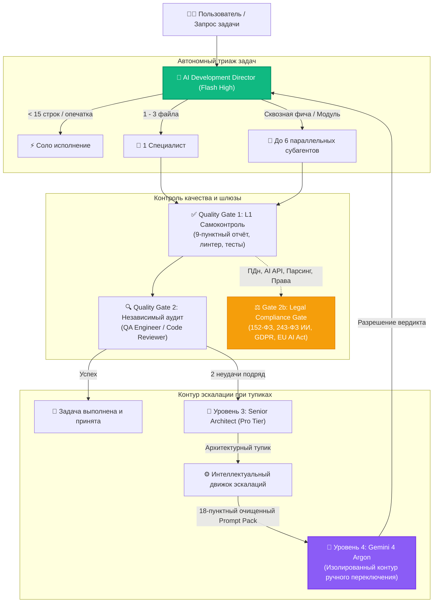

<div align="center">


# Antigravity Apex

### Центр управления мультиагентной системой и телеметрии для Google Antigravity

[](https://github.com/fen3211/antigravity-apex/stargazers)
[](https://github.com/fen3211/antigravity-apex/releases/latest/download/Antigravity-Apex-Setup.exe)
[](LICENSE)
[](https://nodejs.org/)
[](https://react.dev/)
[](https://www.typescriptlang.org/)
[](https://sqlite.org/wal.html)
[-10B981.svg)](tests/)
[](https://codespaces.new/fen3211/antigravity-apex)
[](#-интерфейс-в-стиле-refero--vercel)

<p align="center">
  <a href="#-установка-одной-кнопкой-1-click">⚡ Установка одной кнопкой</a> •
  <a href="#-ключевые-возможности">Возможности</a> •
  <a href="#-галерея-интерфейса">Интерфейс</a> •
  <a href="#-пул-из-17-специалистов">17 специалистов</a> •
  <a href="#-архитектура-и-параллелизм">Архитектура</a> •
  <a href="#-эскалация-к-gemini-4-argon">Эскалация Argon</a> •
  <a href="#-диагностика-системы-doctor">Диагностика Doctor</a> •
</p>

<p align="center">
  🌐 <b>Языки:</b>
  <a href="README.md">English</a> •
  <a href="README.ru.md">Русский</a> •
  <a href="README.es.md">Español</a> •
  <a href="README.fr.md">Français</a> •
  <a href="README.pt.md">Português</a> •
  <a href="README.zh.md">简体中文</a> •
  <a href="README.ja.md">日本語</a> •
  <a href="README.de.md">Deutsch</a>
</p>

> 🌟 **Поддержите проект звездой на GitHub!**
> Если вам полезен **Antigravity Apex**, пожалуйста, **[поставьте звезду нашему репозиторию](https://github.com/fen3211/antigravity-apex/stargazers)**! Это займет ровно одну секунду, мотивирует развивать Antigravity-экосистему и помогает другим разработчикам находить готовые инструменты для мультиагентной оркестрации.

</div>

---

## О проекте

**Antigravity Apex** — это высокопроизводительный центр управления, диспетчер задач и супервизор процессов реального времени для мультиагентных систем **Google Antigravity** под управлением **AI Development Director**.

Интерфейс спроектирован в инженерной эстетике **Refero / Vercel** с нативной поддержкой светлой и тёмной тем. Продукт предоставляет лидам разработки, системным архитекторам и инженерам полную прозрачность исполнения, детерминированный контроль параллелизма (до 6 параллельных субагентов), многоступенчатые шлюзы верификации и автономную эскалацию к Gemini 4 Argon.

---

## ⚡ Установка одной кнопкой (1-Click)

Выберите наиболее удобный способ установки и запуска — **буквально в один клик или в одну команду**:

### Способ 0: Автономный Windows .EXE установщик (Без консоли и без Git)
Просто скачайте скомпилированный нативный установщик из раздела GitHub Releases:

👉 **[Скачать Antigravity-Apex-Setup.exe (v1.0.0)](https://github.com/fen3211/antigravity-apex/releases/latest/download/Antigravity-Apex-Setup.exe)**

Запустите скачанный файл двойным кликом. Он автоматически проверит Node.js, скачает или подготовит репозиторий, установит 17 специализированных агентов в `~/.gemini`, выполнит диагностику Doctor, запустит сервер и откроет дашборд в вашем браузере!

---

### Способ 1: Windows 1-Click лаунчер на рабочем столе (Без консоли)
Если репозиторий уже скачан или клонирован:
1. Дважды кликните по [`setup.cmd`](setup.cmd) (или [`setup.bat`](setup.bat)).
2. Лаунчер автоматически:
   - Проверяет наличие **Node.js 18+** и **Git** (даст подсказку, если не установлены).
   - Устанавливает все зависимости (`npm install` для сервера и клиента).
   - Создаёт файл `.env` из шаблона с постоянным криптографическим токеном.
   - Развертывает полный комплект **17 агентов, правил Director и навыков** в `~/.gemini/config/plugins/ai-director`.
   - Запускает диагностику **Doctor** (`npm run doctor` — 19/19 проверок).
   - Запускает сервер и клиент и **автоматически открывает браузер по адресу `http://127.0.0.1:5173/`**!

> **Для ежедневного запуска**: Дважды кликните по [`start.cmd`](start.cmd) для мгновенного старта.

---

### Способ 2: Linux & macOS 1-Click лаунчер
```bash
chmod +x setup.sh && ./setup.sh
```
> **Для ежедневного запуска**: Запустите `./start.sh`.

---

### Способ 3: Однострочник в терминале (Без предварительного клонирования)
Установите и запустите проект с нуля одной строкой:

**Windows (PowerShell)**:
```powershell
irm https://raw.githubusercontent.com/fen3211/antigravity-apex/main/scripts/get.ps1 | iex
```

**Linux & macOS (Bash)**:
```bash
curl -fsSL https://raw.githubusercontent.com/fen3211/antigravity-apex/main/scripts/get.sh | bash
```

---

### Способ 4: Кнопка «1-Click Setup» прямо в веб-интерфейсе
Уже открыли дашборд?
- Нажмите кнопку **`⚡ 1-Click Setup`** в шапке или кнопку **`1-Click Sync Antigravity`** в разделе **Агенты**.
- Сервер автоматически создаст резервную копию в `backups/`, развернёт определения 17 специалистов, правила (`AGENTS.md`) и навыки в `~/.gemini`, передаст статус в реальном времени через WebSocket и обновит список ролей.

---

### Способ 5: Облачный запуск в один клик (GitHub Codespaces)
Запустите Antigravity Apex в изолированном контейнере без установки на компьютер:

[](https://codespaces.new/fen3211/antigravity-apex)

---

## 📸 Галерея интерфейса

<div align="center">
  
  <p><em>Тёмная тема — Mission Control, супервизор параллелизма и активные субагенты (стиль Refero / Vercel)</em></p>
</div>

<details>
<summary><b>🔍 Нажмите, чтобы открыть полную галерею экранов (Эскалация Argon, воркфлоу, модальные окна и светлая тема)</b></summary>
<br>

| Центр эскалаций к Gemini 4 Argon | 18-пунктный Prompt Pack и модальное окно вердикта |
| :---: | :---: |
|  |  |

| Визуализация оркестрации (Dark Mode) | Светлая тема Mission Control |
| :---: | :---: |
|  |  |

| Модальное окно создания задачи (Dark Mode) |
| :---: |
|  |

</details>

---

## 🎯 Ключевые возможности

### 1. Канонический пул из 17 ролей специалистов
Грамотное распределение задач между 17 ролями: экономные и быстрые модели **Gemini 3.8 Flash** для типовой разработки, выделенные **Pro-tier** модели для сложной системной архитектуры и аудита безопасности, а также закрытый контур **Gemini 4 Argon** для критических тупиков.

### 2. Высокопроизводительный параллелизм и супервизор процессов
- **Управление параллелизмом**: Одновременное выполнение до 6 параллельных субагентов (`MAX_CONCURRENT_SUBAGENTS = 6`) с детерминированной FIFO-очередью, предотвращающей переполнение памяти и троттлинг потоков.
- **Супервизор дерева процессов**: Полный контроль за жизненным циклом с потоковым выводом stdout/stderr в реальном времени, контролем таймаутов и гарантированным завершением дерева процессов (`taskkill /T /F` в Windows, `kill -9` для групп процессов в Unix) для исключения процессов-зомби.

### 3. Интеллектуальный движок эскалации к Gemini 4 Argon
- **Автономное обнаружение тупиков**: Фиксация двух последовательных неудачных попыток в рамках одного подхода, противоречий в отчётах агентов и циклических блокировок в режимах чувствительности (`conservative`, `balanced`, `aggressive`).
- **Генератор 18-пунктных Prompt Pack**: Формирование структурированного промпта с автоматической очисткой путей (`C:\Users\username` $\to$ `~`) и маскированием секретов.
- **Анти-спам и память отклонений**: Дедупликация сигнатур по хэшу SHA-256 с 5-минутным кулдауном для защиты базы данных от спама при быстрых перезапусках задач.
- **Замкнутый контур резолюции**: Инженер выполняет промпт в изолированном окне Gemini 4 Argon, вставляет вердикт в модальное окно дашборда, а Director автоматически разбирает рекомендации и передает конкретные шаги Flash-специалистам.

### 4. Многоступенчатый контроль качества и Legal Gate (2b)
- **Quality Gate 1 (L1 Самоконтроль)**: Автоматизированные тесты, линтеры и проверка 9-пунктных отчётов субагентов.
- **Quality Gate 2 (L2 Независимый контроль)**: Проверка результатов выделенными ролями `qa-engineer` и `code-reviewer`.
- **Gate 2b (Юридический шлюз)**: Автоматизированная оценка по законодательству РФ (`RU`) и ЕС (`EU_NL`): 152-ФЗ, 156-ФЗ, 23-ФЗ локализация, 243-ФЗ регулирование ИИ, Часть IV ГК РФ авторское право, GDPR/UAVG и EU AI Act. Работает по **неблокирующему инварианту** (блокирует рискованную операцию без остановки безопасной верстки и тестов).

### 5. Потоковый парсинг логов без нагрузки на диск
- Движок `JsonlStreamReader` инкрементально считывает живые транскрипты Antigravity (`~/.gemini/antigravity/brain/**/transcript.jsonl`) буферами по 64 КБ.
- Корректная обработка многобайтовых символов UTF-8 (кириллица и эмодзи) на границах чанков.
- Отслеживание inode и времени создания для мгновенной реакции на ротацию файлов логов.
- Атомарные транзакции SQLite исключают дублирование событий.

### 6. Интерфейс в стиле Refero / Vercel
- Две полноценные темы: Бумажно-белая (`#FAFAFA`) и Обсидианово-чёрная (`#0A0A0A`).
- Сохранение темы в `localStorage` и поддержка системных настроек `prefers-color-scheme`.
- Отсутствие мерцания при загрузке (Zero FOUT).
- Доступность по стандарту WCAG 2.1 AA, поддержка навигации с клавиатуры и адаптивное мобильное меню.

---

## 👥 Пул из 17 специалистов

| # | ID роли | Название роли | Уровень модели | Специализация и ключевые обязанности |
|---|---|---|---|---|
| 1 | `director` | **Director / Lead Orchestrator** | Gemini 3.8 Flash High | Центральная координация, триаж задач (<15 строк соло, 1-3 файла одному агенту, сложные параллельно), контроль шлюзов качества |
| 2 | `senior-architect` | **Senior Architect** | Gemini Pro | L3-эскалация, сложные архитектурные решения, гонки данных, масштабируемость |
| 3 | `researcher` | **Researcher** | Gemini Flash | Исследование кодовой базы, документации, зависимостей (только чтение) |
| 4 | `frontend-developer` | **Frontend Developer** | Gemini Flash | React, Next.js, TypeScript, Tailwind CSS, анимации интерфейса, адаптивность |
| 5 | `backend-developer` | **Backend Developer** | Gemini Flash | Node.js, Python, Express, REST API, WebSocket потоки, серверная логика |
| 6 | `ui-ux-designer` | **UI/UX Designer** | Gemini Flash | Дизайн-системы Refero/Vercel, эргономика, визуальная иерархия, отсев шаблонов |
| 7 | `qa-engineer` | **QA Engineer** | Gemini Flash | Unit, интеграционные и E2E тесты, проверка граничных условий, защита от регрессий |
| 8 | `code-reviewer` | **Code Reviewer** | Gemini Flash | Независимый аудит изменений, антипаттерны, архитектурная чистота, код-стайл |
| 9 | `legal-compliance` | **Legal Advisor & Tech Writer** | Gemini Flash | Предпусковой Legal Gate 2b (152-ФЗ, 243-ФЗ ИИ, GDPR, EU AI Act, лицензии) и техническая документация |
| 10 | `security-engineer` | **Security Engineer** | Gemini Flash / Pro | OWASP Top 10, поиск SQLi/XSS/SSRF, защита от prompt-инъекций, аудит токенов |
| 11 | `devops-engineer` | **DevOps Engineer** | Gemini Flash / Pro | GitHub Actions, CI/CD, Docker, надежность супервизора, автоматические бекапы |
| 12 | `product-manager` | **Product Manager** | Gemini Flash | Анализ требований, формулирование User Stories и критериев приёмки, MVP |
| 13 | `ai-evaluation-engineer` | **AI Evaluation Engineer** | Gemini Flash / Pro | Тестирование качества ответов моделей, бенчмарки промптов, оптимизация затрат |
| 14 | `performance-engineer` | **Performance Engineer** | Gemini Flash / Pro | Core Web Vitals (LCP, CLS, INP), профилирование CPU и памяти, оптимизация SQL |
| 15 | `accessibility-specialist` | **Accessibility Specialist** | Gemini Flash | Доступность WCAG 2.1/2.2 AA/AAA, клавиатурная навигация, контрастность, экранные дикторы |
| 16 | `database-specialist` | **Database Specialist** | Gemini Flash / Pro | Схемы SQLite/PostgreSQL, нормализация, транзакции ACID, индексы, миграции, lock contention |
| 17 | `data-engineer` | **Data Engineer** | Gemini Flash / Pro | ETL/ELT пайплайны, парсинг JSON/JSONL, дедупликация, качество потоков телеметрии |

---

## 🏛 Архитектура и параллелизм



---

## 🩺 Диагностика системы (`doctor`)

Команда `npm run doctor` проверяет готовность окружения, целостность SQLite и подключение к Antigravity:

```bash
npm run doctor
```

```text
=======================================================================
       ANTIGRAVITY APEX - SYSTEM DIAGNOSTICS & HEALTH CHECK           
======================================================================

=== 1. Runtime & Environment ===
  [✓] Node.js v24.20.0 (Требуется >= 18.0.0)
  [✓] npm v11.19.0
  [✓] git version 2.55.0

=== 2. Project Configuration ===
  [✓] package.json корректен (antigravity-apex v1.0.0)
  [✓] Папка node_modules присутствует
  [✓] .env настроен с постоянным ключом API

=== 3. AI Director Instructions & Rules ===
  [✓] GEMINI.md проверен
  [✓] AGENTS.md проверен (правило макс. 6 параллельных субагентов)

=== 4. 17 Specialized Agent Definitions ===
  [✓] Все 17 определений агентов на месте

=== 5. Orchestration Skills ===
  [✓] Навык director-orchestration проверен
  [✓] Навык argon-escalation проверен

=== 6. Antigravity Runtime & CLI Bridge ===
  [✓] Antigravity CLI активен: 1.4.7
  [✓] Транскрипты brain и presence locks активны
  [✓] База знаний Director подключена

=== 7. Database Health & Persistence ===
  [✓] Целостность SQLite базы подтверждена
  [✓] Режим WAL активен (busy_timeout=5000ms)
  [✓] Все таблицы созданы (tasks, events, settings, model_usage, escalations)

=======================================================================
Диагностика: 19 пройдено, 0 предупреждений, 0 ошибок
Результат: ВСЕ СИСТЕМЫ РАБОТАЮТ ШТАТНО!
=======================================================================
```

---

## 📂 Структура проекта

```text
antigravity-apex/
├── .github/                       # GitHub Actions CI/CD, шаблоны Issue и PR
│   ├── assets/hero-banner.svg     # Официальный баннер репозитория
│   ├── workflows/ci.yml           # Кроссплатформенный CI воркфлоу
│   └── workflows/release.yml      # Автоматический релиз на GitHub
├── agent-config/                  # Исходные файлы конфигурации для Antigravity
│   ├── agents/                    # Определения 17 специалистов (.md)
│   ├── rules/                     # Правила оркестрации (AGENTS.md, GEMINI.md)
│   ├── skills/                    # Навыки (director-orchestration, argon-escalation)
│   └── templates/                 # Шаблоны промпт-паков, правил и агентов
├── client/                        # Фронтенд на React 19 + TypeScript + Vite
│   └── src/
│       ├── components/            # Компоненты в стиле Refero (Светлая и Тёмная темы)
│       │   ├── Modals/            # EscalationDetailModal, ArgonVerdictModal и др.
│       │   ├── Header.tsx         # Шапка с кнопкой 1-Click Setup и сменой темы
│       │   ├── EscalationCenter.tsx # Центр эскалаций к Gemini 4 Argon
│       │   └── Overview.tsx       # Панель Mission Control и активные процессы
│       └── services/api.ts        # Клиент REST API и WebSocket шины
├── server/                        # Бэкенд на Node.js + Express + WebSocket
│   └── src/
│       ├── db/database.ts         # Схема SQLite WAL и индексы
│       ├── routes/api.ts          # Эндпоинты API и авторизация
│       └── services/
│           ├── escalation-manager.ts # Движок эскалаций Argon
│           ├── process-supervisor.ts # Супервизор процессов и защита от зомби
│           ├── antigravity-bridge.ts # Телеметрия живых сессий Antigravity
│           └── antigravity-installer.ts # Сервис синхронизации в один клик
├── scripts/                       # Скрипты установки и диагностики
│   ├── get.ps1                    # Удаленный однострочник установки (Windows)
│   ├── get.sh                     # Удаленный однострочник установки (Unix/macOS)
│   ├── install.ps1                # PowerShell установщик агентов
│   ├── install.sh                 # Bash установщик агентов
│   └── doctor.js                  # Диагностический инструмент на 19 проверок
├── setup.cmd                      # Лаунчер 1-Click установки для Windows
├── setup.bat                      # Лаунчер 1-Click установки для Windows
├── setup.sh                       # Лаунчер 1-Click установки для Unix/macOS
├── start.cmd                      # Быстрый запуск для Windows
├── start.sh                       # Быстрый запуск для Unix/macOS
└── docs/                          # Подробная техническая документация
```

---

## 📚 Документация

Подробные технические руководства находятся в каталоге [`docs/`](docs/):

- [**AGENTS.md**](docs/AGENTS.md) — Подробное описание всех 17 ролей специалистов, системных промптов и регламентов.
- [**ARCHITECTURE.md**](docs/ARCHITECTURE.md) — Устройство бэкенда, SQLite WAL, WebSocket шины и супервизора.
- [**ORCHESTRATION.md**](docs/ORCHESTRATION.md) — Операционный регламент AI Development Director и протокол Argon.
- [**INSTALLATION.md**](docs/INSTALLATION.md) — Полное руководство по установке, резервным копиям и восстановлению.
- [**GETTING_STARTED.md**](docs/GETTING_STARTED.md) — Первые шаги и быстрый старт.
- [**CONFIGURATION.md**](docs/CONFIGURATION.md) — Переменные окружения, пути и настройки авторизации.
- [**TROUBLESHOOTING.md**](docs/TROUBLESHOOTING.md) — Диагностика и устранение неполадок.
- [**FAQ.md**](docs/FAQ.md) — Часто задаваемые вопросы.

---

## 🛡 Безопасность

- **Изоляция Loopback**: Привязка по умолчанию к `127.0.0.1` предотвращает несанкционированный доступ из локальной сети или интернета.
- **Timing-Safe авторизация**: Проверка токенов через `crypto.timingSafeEqual` защищает от тайминг-атак.
- **Очистка конфиденциальных данных**: Системные пути (`C:\Users\username` $\to$ `~`) и секреты (`AIza...`, `sk-...`) автоматически маскируются при создании промпт-паков.
- **Защита от Path Traversal**: Строгая валидация путей к файлам базы знаний и транскриптам.
- **Запрет несанкционированного деплоя**: Агентам и скриптам категорически запрещено выполнять релизы на production-серверы без подтверждения оператора.

Подробнее в документе [SECURITY.md](SECURITY.md).

---

## ⭐ Поддержите проект звездой!

Если вам нравится **Antigravity Apex** и возможности мультиагентной оркестрации Google Antigravity, **поставьте проекту звезду на GitHub!** ⭐

<div align="center">

[](https://github.com/fen3211/antigravity-apex/stargazers)

*Каждая звезда помогает развивать сообщество Antigravity и ускоряет выход новых фичей!*

</div>

---

## 📄 Лицензия

Проект распространяется под открытой лицензией **MIT License**. Подробности в файле [`LICENSE`](LICENSE).
