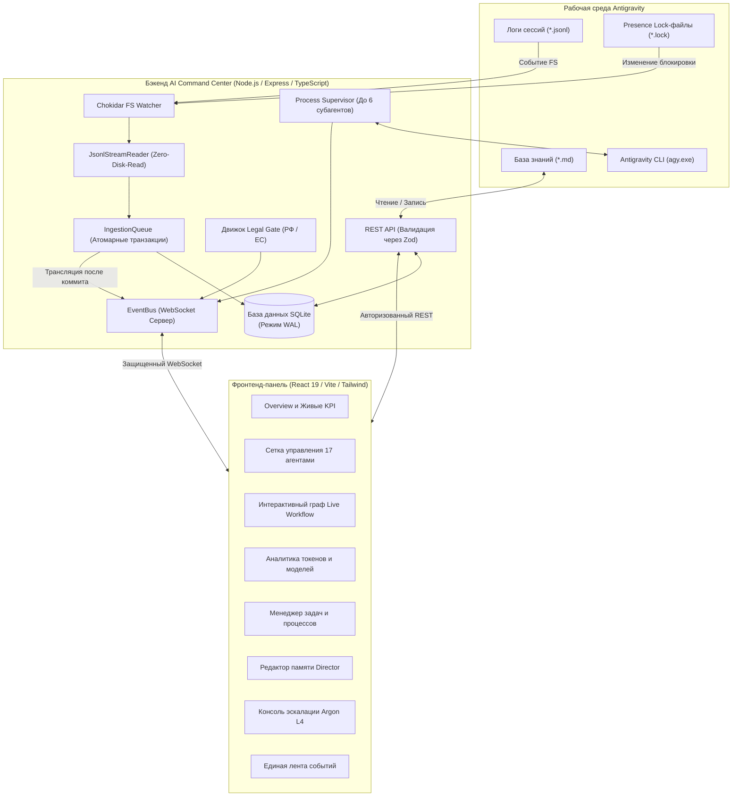

<div align="center">

# AI Command Center

### Панель мониторинга, управления и телеметрии мультиагентной системы Google Antigravity

[](LICENSE)
[](https://nodejs.org/)
[](https://react.dev/)
[](https://www.typescriptlang.org/)
[](https://sqlite.org/wal.html)
[-success.svg)](tests/)
[](SECURITY.md)

<p align="center">
  <a href="#быстрый-запуск-за-3-команды">Быстрый запуск</a> •
  <a href="#ключевые-возможности">Ключевые возможности</a> •
  <a href="#архитектура-системы">Архитектура</a> •
  <a href="#пул-из-17-специалистов">Пул 17 специалистов</a> •
  <a href="#конфигурация">Конфигурация</a> •
  <a href="#безопасность">Безопасность</a> •
  <a href="#документация">Документация</a> •
  <a href="README.md">English Version</a>
</p>

</div>

---

## О проекте

**AI Command Center** — это локальная панель оперативного контроля, мониторинга и маршрутизации задач мультиагентной системы **Google Antigravity** и фреймворка **AI Development Director**.

Интерфейс спроектирован в инженерной эстетике **Refero / Vercel** с полноценной поддержкой светлой и тёмной тем, без визуального шума и шаблонных элементов. Система предоставляет техническим директорам, системным архитекторам и разработчикам полный обзор работы субагентов в реальном времени, строгий контроль параллелизма и многоступенчатый аудит качества.

## Демонстрация интерфейса

<div align="center">
  
  <p><em>Тёмная тема — Mission Control и контроль параллелизма (стиль Refero / Vercel)</em></p>
</div>

<details>
<summary><b>Дополнительные скриншоты (Светлая тема, граф оркестрации, модальное окно создания задачи)</b></summary>
<br>

| Светлая тема Mission Control | Тёмная тема графа оркестрации |
| :---: | :---: |
|  |  |

| Создание задачи (Тёмная тема) |
| :---: |
|  |

</details>

```
                      ┌──────────────────────────────────────┐
                      │    AI Development Director (Flash)   │
                      └──────────────────┬───────────────────┘
                                         │
                 ┌───────────────────────┴───────────────────────┐
                 ▼                                               ▼
     ┌───────────────────────┐                       ┌───────────────────────┐
     │  Субагенты-эксперты   │                       │  Gate 2b: Юрист (РФ)  │
     │  (до 6 параллельно)   │                       │  (152-ФЗ, 243-ФЗ ИИ)  │
     └───────────┬───────────┘                       └───────────────────────┘
                 │
                 ▼
     ┌───────────────────────┐
     │ Quality Gate 1 и 2    │◄─── Тесты, линтеры, независимый код-ревью
     └───────────┬───────────┘
                 │
           (2 провала подряд)
                 ▼
     ┌───────────────────────┐
     │ Level 3: Архитектор   │◄─── Gemini Pro Tier
     └───────────┬───────────┘
                 │
          (Повторный тупик)
                 ▼
     ┌────────────────────────────────────────────────────────┐
     │  Level 4: Эскалация к Gemini 4 Argon (Закрытый контур) │
     │  Изолированный Prompt Pack -> Ручной переключатель     │
     └────────────────────────────────────────────────────────┘
```

---

## Ключевые возможности

### 1. Пул специалистов из 17 ролей
Координация работы 17 специализированных ролей: базовая разработка выполняется экономичной и быстрой моделью **Gemini 3.8 Flash**, сложные архитектурные задачи и глубокие аудиты маршрутизируются на **Gemini Pro**, а критические тупики разрешаются в закрытом контуре флагманской **Gemini 4 Argon**.

### 2. Высокопроизводительный параллелизм и супервизор процессов
- **Управление параллелизмом**: Конфигурируемый запуск до 6 параллельных субагентов (`MAX_CONCURRENT_SUBAGENTS = 6`), стандартный лимит — 3, максимум 2 ресурсоёмкие модели уровня Pro. Очередь задач с автоматическим выгрузкой при освобождении слотов.
- **Process Tree Supervisor**: Мониторинг запущенных процессов, потоковая трансляция `stdout`/`stderr` по WebSocket в реальном времени, контроль таймаутов и гарантированное завершение всего дерева процессов (`taskkill /T /F` на Windows) без зависших дочерних процессов.

### 3. Закрытый контур эскалации к Gemini 4 Argon (Level 4)
- Автоматическая фиксация лимита в 2 неудачные попытки на подход.
- Генерация изолированного 10-пунктного пакета эскалации (**Argon Prompt Pack**) с минимальным контекстом воспроизведения (20–50 строк), доказательствами ошибок и целевым архитектурным вопросом.
- Ручное переключение модели оператором в закрытом контуре с обратной деэскалацией вердикта (`POST /api/control/argon-verdict`) профильным Flash-специалистам для кодовой реализации.

### 4. Многоступенчатые Quality Gates и Юридический шлюз (Gate 2b)
- **Gate 1 (L1 Self-Check)**: Автоматическая проверка тестов, линтера, сборки и строгая валидация обязательного **9-пунктного отчета субагента**.
- **Gate 2 (L2 Independent Verification)**: Независимая проверка QA-инженером (`qa-engineer`) и ревьюером кода (`code-reviewer`).
- **Gate 2b (Legal Gate)**: Автоматизированный аудит соответствия законодательству РФ (`RU`: 152-ФЗ, 156-ФЗ изолированные согласия, 23-ФЗ первичная локализация баз данных, 149-ФЗ реестр ОРИ, 243-ФЗ регулирование ИИ с разделением сроков 01.09.2026 и 01.03.2027, Ч. IV ГК РФ авторское право, 38-ФЗ/479-ФЗ маркировка рекламы и 3% сбор, ЗоЗПП / 69-ФЗ запрет темных паттернов и предпроставленных галочек, 54-ФЗ онлайн-кассы) и праву ЕС (`EU_NL`: GDPR/UAVG, EU AI Act).
- **Неблокирующий инвариант**: Вердикт `BLOCKED_RED` блокирует только конкретную рискованную подзадачу, не останавливая разработку безопасных смежных компонентов (UI, стили, тесты).

### 5. Потоковый инкрементальный ридер (Zero-Disk-Read)
- Движок `JsonlStreamReader` инкрементально считывает логи Antigravity (`~/.gemini/antigravity/brain/**/transcript.jsonl`) буферами по 64 КБ без повторного сканирования файла с начала.
- Полная безопасность на границах байтов многобайтового UTF-8 (корректное сохранение кириллицы и эмодзи при разделении буферов).
- Отслеживание inode, размера файла, времени создания (`birthtime`) и модификации (`mtime`) для мгновенного определения ротации, усечения или пересоздания лога.
- Атомарные транзакции SQLite гарантируют отсутствие дубликатов событий.

### 6. Активное присутствие и телеметрия Antigravity
- Реактивный наблюдатель через `chokidar` отслеживает активные сессии (`~/.gemini/antigravity/presence/*.lock`).
- Четкое разделение подтвержденных фактических токенов (бейдж **LIVE**) и прогнозных аналитических данных (бейдж **ESTIMATED**).
- Встроенный редактор глобальной памяти Director (`~/.gemini/antigravity/knowledge/ai-director/`).

### 7. Дизайн-система Refero / Vercel и динамическая смена тем (Light/Dark)
- Два режима: светлая бумага (`#FAFAFA`) и инженерный обсидиан (`#0A0A0A`).
- Бесшовное переключение темы с сохранением в `localStorage` и автоматическим определением системных предпочтений `prefers-color-scheme`.
- Встроенный скрипт защиты от мерцания в `<head>` (Zero FOUT / Anti-Flash).
- Строгое соответствие WCAG 2.1 AA по контрастности, фокусные рамки (`focus-visible`) и микро-анимации.

---

## Быстрый запуск за 3 команды

### Системные требования:
- **Node.js** >= 18.0.0 (протестировано на Node.js v20 и v24)
- **npm** >= 9.0.0
- Windows 10/11, macOS или Linux
- *(Опционально)* Google Antigravity CLI (`agy.exe`)

```bash
# 1. Клонирование репозитория
git clone https://github.com/your-org/ai-command-center.git
cd ai-command-center

# 2. Установка зависимостей сервера и клиента
npm install && npm --prefix client install

# 3. Запуск сервера и интерфейса
npm run dev
```

> **Быстрый старт на Windows**: Запустите файл [`start.cmd`](start.cmd) двойным кликом мыши в корне репозитория.

Точки подключения:
- **Панель управления (UI)**: [http://127.0.0.1:5173](http://127.0.0.1:5173)
- **Health-чек API**: [http://127.0.0.1:3001/health](http://127.0.0.1:3001/health)
- **WebSocket-поток событий**: `ws://127.0.0.1:3001/ws`

---

## Тестирование и верификация

Перед развертыванием запустите полный комплекс автоматических тестов:

```bash
npm test
```

Результаты верификации:
```
ALL 20 SYSTEM, SECURITY & INGESTION TESTS PASSED! ✓
ALL 9 PROCESS SUPERVISOR & EXECUTION BRIDGE TESTS PASSED! ✓
ALL 16 LEGAL & COMPLIANCE SCENARIOS PASSED WITH 100% SUCCESS RATE ✓
```

---

## Архитектура системы

AI Command Center построен по реактивной событийно-ориентированной архитектуре:



---

## Пул из 17 специалистов

| # | Идентификатор | Роль | Модель | Компетенция |
|---|---------------|------|--------|-------------|
| 1 | `director` | AI Development Director | Gemini 3.8 Flash High | Главный оркестратор, триаж задач, маршрутизация моделей и арбитр качества |
| 2 | `researcher` | Researcher | Gemini Flash | Исследование кодовой базы, документации, зависимостей и архитектуры |
| 3 | `frontend-developer` | Frontend Developer | Gemini Flash | React 19, Next.js, TypeScript, UI-кинематика, адаптивность и эргономика |
| 4 | `backend-developer` | Backend Developer | Gemini Flash | Node.js, Express, Python, API, валидация схем, авторизация и БД |
| 5 | `ui-ux-designer` | UI/UX Designer | Gemini Flash | Дизайн-системы Liquid Dark Glass, эргономика, визуальная иерархия |
| 6 | `qa-engineer` | QA Engineer | Gemini Flash | Автоматизированные тесты (Unit/Интеграция/E2E), регрессии, граничные случаи |
| 7 | `code-reviewer` | Code Reviewer | Gemini Flash | Независимый аудит безопасности diff-ов, выявление скрытых дефектов |
| 8 | `senior-architect` | Senior Architect | Gemini Pro | Сложные рефакторинги, устранение race conditions, эскалация Level 3 |
| 9 | `legal-compliance` | Legal Advisor & Tech Writer | Gemini Flash | Юридический комплаенс (РФ/ЕС: 152-ФЗ, 243-ФЗ, GDPR) + техническая документация |
| 10 | `security-engineer` | Security Engineer | Gemini Flash / Pro | OWASP Top 10, DevSecOps, утечки секретов, защита от prompt-инъекций |
| 11 | `devops-engineer` | DevOps & SRE | Gemini Flash / Pro | CI/CD, GitHub Actions, Docker, логирование, бекапы и отказоустойчивость |
| 12 | `product-manager` | Product Manager | Gemini Flash | Анализ требований, User Stories, Acceptance Criteria, определение MVP |
| 13 | `ai-evaluation-engineer`| AI Evaluation Engineer | Gemini Flash / Pro | Оценка качества AI, эвалы промптов, бенчмаркинг, учет токенов |
| 14 | `performance-engineer` | Performance Engineer | Gemini Flash / Pro | Core Web Vitals (LCP, CLS, INP), профилирование CPU/памяти, тюнинг SQL |
| 15 | `accessibility-specialist`| Accessibility Specialist| Gemini Flash | Доступность WCAG 2.1/2.2 AA/AAA, screen readers, ARIA, семантика HTML |
| 16 | `database-specialist` | Database Specialist | Gemini Flash / Pro | Схемы БД, индексы, миграции, транзакции, анализ блокировок в SQLite/PostgreSQL |
| 17 | `data-engineer` | Data Engineer | Gemini Flash / Pro | ETL/ELT пайплайны, потоковая обработка JSON/JSONL, дедупликация данных |

---

## Конфигурация

Все параметры системы настраиваются через переменные окружения или файл `.env`:

| Переменная | Значение по умолчанию | Описание |
|------------|-----------------------|----------|
| `PORT` | `3001` | Порт HTTP и WebSocket сервера |
| `HOST` | `127.0.0.1` | Локальный адрес привязки (loopback) |
| `NODE_ENV` | `development` | Режим работы (`development` или `production`) |
| `COMMAND_CENTER_API_KEY` | *(Автогенерация)* | 32-байтный hex-ключ для авторизации REST API и WebSocket |
| `ANTIGRAVITY_DIR` | `~/.gemini/antigravity` | Корневой каталог среды Antigravity |
| `KNOWLEDGE_DIR` | `~/.gemini/antigravity/knowledge/ai-director` | Каталог базы знаний и регламентов Director |
| `PRESENCE_DIR` | `~/.gemini/antigravity/presence` | Каталог lock-файлов активных сессий |
| `BRAIN_DIR` | `~/.gemini/antigravity/brain` | Каталог логов и артефактов сессий |
| `AGY_CLI_PATH` | `%LOCALAPPDATA%\agy\bin\agy.exe` | Путь к исполняемому файлу Antigravity CLI |
| `DB_PATH` | `./command_center.sqlite` | Расположение файла базы данных SQLite |

---

## Безопасность

AI Command Center защищен комплексом встроенных механизмов безопасности:
1. **Привязка к Loopback (`127.0.0.1`)**: Исключает доступ к панели из внешней локальной сети без явной перенастройки.
2. **Белый список CORS**: Сторонние скрипты из других вкладок браузера не могут слать запросы к API панели.
3. **Timing-Safe авторизация**: Сравнение ключей API выполняется функцией `crypto.timingSafeEqual`, предотвращая тайминг-атаки.
4. **Защита от инъекций команд**: Все вызовы Antigravity CLI валидируются по строгому регулярному выражению с блокировкой метасимволов шелла (`&`, `|`, `;`, `$`, `>`, `<`).
5. **Защита от Path Traversal**: Доступ к файлам памяти строго ограничен маской `/^[a-zA-Z0-9_-]+\.md$/`.
6. **Ограничение WebSocket**: Максимальный размер сообщения ограничен 64 КБ с автоматическим отключением нарушителей.

Подробности описаны в [Политике безопасности](SECURITY.md).

---

## Полная документация

Подробные технические руководства находятся в каталоге [`docs/`](docs/):
- [Быстрый старт (Getting Started)](docs/GETTING_STARTED.md)
- [Руководство по установке (Installation)](docs/INSTALLATION.md)
- [Справочник конфигурации (Configuration)](docs/CONFIGURATION.md)
- [Архитектурный регламент (Architecture)](docs/ARCHITECTURE.md)
- [Спецификация 17 агентов (Agents)](docs/AGENTS.md)
- [Оркестрация и Quality Gates (Orchestration)](docs/ORCHESTRATION.md)
- [Интеграция с Antigravity (Antigravity)](docs/ANTIGRAVITY.md)
- [Диагностика и устранение неполадок (Troubleshooting)](docs/TROUBLESHOOTING.md)
- [Часто задаваемые вопросы (FAQ)](docs/FAQ.md)

---

## Лицензия

Проект распространяется под открытой лицензией **MIT** — подробности см. в файле [LICENSE](LICENSE).

Разработано в роли **AI Development Director** для мультиагентной системы Google Antigravity.
