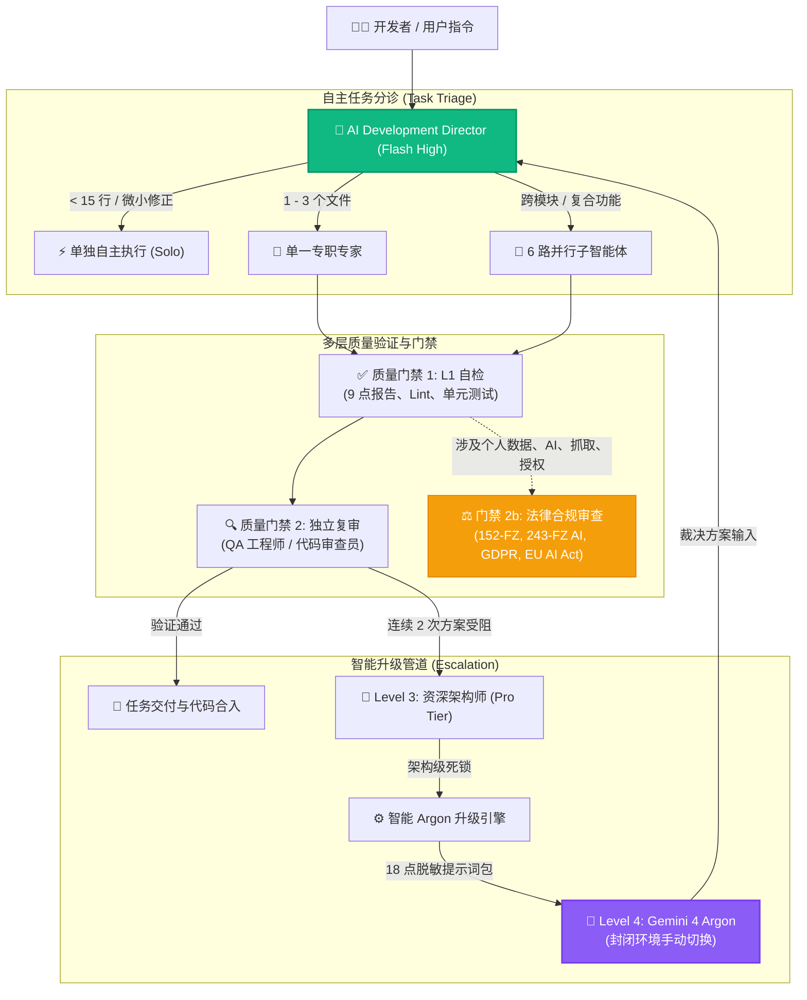

<div align="center">


# Antigravity Apex

### 面向 Google Antigravity 的下一代多智能体任务指挥中心与遥测仪表盘

[](https://github.com/fen3211/antigravity-apex/stargazers)
[](https://github.com/fen3211/antigravity-apex/releases/latest/download/Antigravity-Apex-Setup.exe)
[](LICENSE)
[](https://nodejs.org/)
[](https://react.dev/)
[](https://www.typescriptlang.org/)
[](https://sqlite.org/wal.html)
[-10B981.svg)](tests/)
[](https://codespaces.new/fen3211/antigravity-apex)
[](#-refero--vercel-设计系统)

<p align="center">
  <a href="README.md">English</a> •
  <a href="README.ru.md">Русский</a> •
  <a href="README.es.md">Español</a> •
  <a href="README.fr.md">Français</a> •
  <a href="README.pt.md">Português</a> •
  <a href="README.zh.md">简体中文</a> •
  <a href="README.ja.md">日本語</a> •
  <a href="README.de.md">Deutsch</a>
</p>

<p align="center">
  <a href="#-一键安装">⚡ 一键安装</a> •
  <a href="#-核心特性">核心特性</a> •
  <a href="#-界面展示">界面展示</a> •
  <a href="#-17-角色专家池">17 角色专家池</a> •
  <a href="#-架构与高并发">系统架构</a> •
  <a href="#-argon-l4-闭环升级">Argon 升级</a> •
  <a href="#-系统自检-doctor">系统自检</a>
</p>

> 🌟 **支持开源创新！**
> 如果您觉得 **Antigravity Apex** 对您有所帮助，请在 **[GitHub 上点亮一颗 Star！](https://github.com/fen3211/antigravity-apex/stargazers)** 仅需 1 秒钟，就能持续激励我们迭代开发，并帮助更多开发者发现 Google Antigravity 的自主多智能体编排力量。

</div>

---

## 概述

**Antigravity Apex** 是专为 **Google Antigravity** 多智能体系统打造的企业级实时指挥调度中心与运维监视器，由 **AI Development Director** 编排框架强力驱动。

系统采用纯粹的 **Refero / Vercel** 工程美学设计，原生支持明亮（Paper Light）与深色（Obsidian Dark）模式，为研发总监、系统架构师和工程师提供实时遥测洞察、确定性并发管理（最多支持 6 个并行子智能体）、多层质量与法规门禁，以及自主的 Level 4 Argon 升级管道。

---

## ⚡ 一键安装

只需一次点击或一行命令即可安装并运行 Antigravity Apex：

### 方式 0: Windows 独立安装程序 .EXE（零 CLI、零 Git）
直接从 GitHub Releases 下载并运行编译好的原生 Windows 安装包：

👉 **[下载 Antigravity-Apex-Setup.exe (v1.0.0)](https://github.com/fen3211/antigravity-apex/releases/latest/download/Antigravity-Apex-Setup.exe)**

双击运行即可。程序会自动校验 Node.js、克隆/配置项目、将 17 个智能体定义部署至 `~/.gemini`、执行环境诊断 doctor，并在默认浏览器中自动弹出控制台！

---

### 方式 1: Windows 桌面一键启动器（零 CLI）
如果您已克隆或下载了源码仓库：
1. 双击运行 [`setup.cmd`](setup.cmd)（或 [`setup.bat`](setup.bat)）。
2. 启动器将自动完成：
   - 校验 **Node.js 18+** 与 **Git**（若缺失会给出安装引导）。
   - 安装服务端与客户端全部依赖（`npm install`）。
   - 基于 `.env.example` 自动生成包含安全持久化 API Token 的 `.env`。
   - 将完整的 **17 个智能体套件、编排规则与技能（Skills）** 部署到 `~/.gemini/config/plugins/ai-director`。
   - 执行诊断程序 **Doctor**（`npm run doctor`，全项 19/19 校验通过）。
   - 启动本地开发服务，并**自动在默认浏览器中打开 `http://127.0.0.1:5173/`**！

> **日常启动**：双击 [`start.cmd`](start.cmd) 即可秒级开启。

---

### 方式 2: Linux & macOS 一键 Shell 启动器
```bash
chmod +x setup.sh && ./setup.sh
```
> **日常启动**：直接运行 `./start.sh`。

---

### 方式 3: 终端一行命令远程安装（无需预先克隆）
直接在终端中粘贴执行一键脚本：

**Windows (PowerShell)**:
```powershell
irm https://raw.githubusercontent.com/fen3211/antigravity-apex/main/scripts/get.ps1 | iex
```

**Linux & macOS (Bash)**:
```bash
curl -fsSL https://raw.githubusercontent.com/fen3211/antigravity-apex/main/scripts/get.sh | bash
```

---

### 方式 4: 网页端应用内一键设置与同步（Web UI）
已经在仪表盘界面中？
- 点击顶部导航栏的 **`⚡ 1-Click Setup`** 按钮，或进入 **Agents** 页面点击 **`1-Click Sync Antigravity`**。
- 系统会在 `backups/` 中创建带时间戳的配置备份，将 17 个智能体、规则（`AGENTS.md`）和技能复制到 `~/.gemini`，通过 WebSocket 实时推送进度，并瞬时刷新智能体列表！

---

### 方式 5: 云端工作区一键启动（GitHub Codespaces）
在无需任何本地配置的专属云端容器中体验 Antigravity Apex：

[](https://codespaces.new/fen3211/antigravity-apex)

---

## 📸 界面展示

<div align="center">
  
  <p><em>深色主题 — 任务指挥中心、实时并发监视器与活跃子智能体状态</em></p>
</div>

<details>
<summary><b>🔍 点击展开查看完整截图画廊（Argon 升级、执行工作流、弹窗与明亮模式）</b></summary>
<br>

| 智能 Argon 升级中心 | 18 点提示词包与决策裁决弹窗 |
| :---: | :---: |
|  |  |

| 实时编排工作流（深色模式） | 明亮主题任务控制中心 |
| :---: | :---: |
|  |  |

| 任务创建弹窗（深色模式） |
| :---: |
|  |

</details>

---

## 🎯 核心特性

### 1. 17 角色标准专家资源池
基于 17 个专业 AI 角色的动态分工体系：使用性价比极高的 **Gemini 3.8 Flash** 处理日常任务，为复杂架构与深度安全审计保留 **Pro-tier** 模型，并在面临关键技术死锁时启用封闭轮廓的 **Gemini 4 Argon**。

### 2. 高吞吐并发与进程树全生命周期监管
- **动态并发管控**：最多支持 6 个子智能体并行运行（`MAX_CONCURRENT_SUBAGENTS = 6`），具备智能 FIFO 队列管理机制，防止系统内存耗尽并进行线程限流。
- **进程树监视器**：全生命周期执行追踪，实时流式推送 stdout/stderr 输出，执行超时强制防护，并通过跨平台进程树强制终止（Windows: `taskkill /T /F`，Unix: 进程组 `kill -9`）彻底杜绝僵尸进程。

### 3. 智能 Level 4 Argon 闭环升级引擎
- **自主僵局识别**：自动捕捉连续诊断失败（同一方案连续 2 次失败）、智能体结论冲突与算法死锁，支持三种灵敏度（`conservative`、`balanced`、`aggressive`）。
- **18 点脱敏提示词包生成器**：自动合成结构化的 Markdown 提示词包，对系统真实路径（`C:\Users\username` $\to$ `~`）及敏感密钥令牌进行自动化正则脱敏。
- **防刷屏与重复记忆机制**：基于 SHA-256 签名去重和 5 分钟冷却窗口，防止任务快速重试引发冗余升级轰炸。
- **闭环裁决落地**：操作人员在 Gemini 4 Argon 中运行密封提示词包，将诊断结论粘贴回控制台，AI Director 解析指导方案并重新分派给 Flash 专家执行落地。

### 4. 多级质量与法律合规门禁（Gate 2b）
- **质量门禁 1（L1 自检）**：自动化测试运行、代码规范检查与**技术子智能体 9 点报告**强制验证。
- **质量门禁 2（L2 独立复核）**：由 QA 工程师与代码审查员进行独立 diff 评审。
- **质量门禁 2b（法律合规门禁）**：自动化合规审核涵盖俄罗斯联邦（`RU`）与欧盟（`EU_NL`）法律，重点审计 152-FZ、156-FZ、23-FZ 数据本地化、243-FZ 人工智能法规、民法典第四部分著作权、GDPR/UAVG 及欧盟 AI Act。具备**非阻塞隔离特性**（仅阻断违规操作，不影响安全的前端样式与测试开发）。

### 5. 零磁盘全量读取增量流式摄入
- `JsonlStreamReader` 引擎以 64 KB 分块缓冲区增量读取 Antigravity 实时运行记录（`~/.gemini/antigravity/brain/**/transcript.jsonl`）。
- UTF-8 多字节截断保护：跨缓冲区边界完美保持中文字符与 Emoji 完整性。
- Inode 与文件创建时间（birthtime）追踪：毫秒级识别日志轮转、截断或文件重建。
- SQLite 原子事务保证事件零重复写入。

### 6. Refero / Vercel 设计系统与动态明暗主题
- 双模工程化界面：纸白明亮主题（Paper White `#FAFAFA`）与黑曜石深色主题（Obsidian Black `#0A0A0A`）。
- 主题状态通过 `localStorage` 与系统 `prefers-color-scheme` 自动持久化同步。
- 页面 Head 内联无闪烁加载（Zero-FOUT）。
- 符合 WCAG 2.1 AA 级对比度要求，支持键盘全功能导航（focus-visible）与自适应移动端抽屉栏。

---

## 👥 17 角色专家池

| # | 角色标识 (Role ID) | 展示名称 | 模型等级 | 核心领域与核心职责 |
|---|---|---|---|---|
| 1 | `director` | **总指挥 / 编排主管** | Gemini 3.8 Flash High | 全局协同、任务分诊（<15行独立执行、1-3文件单专家、大型任务拆解并行）、质量与合规仲裁 |
| 2 | `senior-architect` | **资深系统架构师** | Gemini Pro | 3级升级处理、底层并发竞态、死锁调查、数据一致性与系统可扩展性设计 |
| 3 | `researcher` | **技术调研员** | Gemini Flash | 探索代码仓库、分析依赖关系、阅读外部 API 文档（严格只读沙箱） |
| 4 | `frontend-developer` | **前端开发专家** | Gemini Flash | React 19、Next.js、TypeScript、Tailwind CSS、UI 交互动画、多端响应式布局 |
| 5 | `backend-developer` | **后端开发专家** | Gemini Flash | Node.js、Python、Express、REST API、WebSocket 流式服务、服务器架构 |
| 6 | `ui-ux-designer` | **UI/UX 设计师** | Gemini Flash | Refero/Vercel 设计规范、视觉层级、人机工效学、杜绝粗糙的 AI 模板设计 |
| 7 | `qa-engineer` | **测试保障工程师** | Gemini Flash | 编写单元、集成及 E2E 自动化测试用例，验证边界条件与防范代码回退 |
| 8 | `code-reviewer` | **代码审查员** | Gemini Flash | 独立审计 Git Diff、识别代码坏味道与反模式、架构合规性与代码规范把控 |
| 9 | `legal-compliance` | **法务合规与技术作家** | Gemini Flash | 法律门禁 Gate 2b（152-FZ、243-FZ AI、GDPR、EU AI Act、开源许可）与权威技术文档撰写 |
| 10 | `security-engineer` | **网络安全工程师** | Gemini Flash / Pro | OWASP Top 10、SQLi/XSS/SSRF 防护、Prompt 注入防御、凭据与密钥安全审计 |
| 11 | `devops-engineer` | **DevOps 运维工程师** | Gemini Flash / Pro | GitHub Actions、CI/CD 自动化、Docker 容器化、系统容灾、备份管理与进程监控 |
| 12 | `product-manager` | **产品经理** | Gemini Flash | 需求拆解、撰写 User Story、验收标准（Acceptance Criteria）、定义 MVP 边界 |
| 13 | `ai-evaluation-engineer` | **AI 评测工程师** | Gemini Flash / Pro | 评估模型输出质量、构建提示词评测集、幻觉检测、延迟与 Token 成本调优 |
| 14 | `performance-engineer` | **性能优化工程师** | Gemini Flash / Pro | Core Web Vitals（LCP/CLS/INP）优化、打包体积分析、排查 CPU/内存泄漏、SQL 调优 |
| 15 | `accessibility-specialist` | **无障碍化专家 (a11y)** | Gemini Flash | WCAG 2.1/2.2 AA/AAA 规范、屏幕阅读器支持、语义化 HTML、键盘焦点环与对比度 |
| 16 | `database-specialist` | **数据库专家** | Gemini Flash / Pro | 关系型模式设计、范式化、索引调优、事务一致性、SQLite WAL 配置与死锁防范 |
| 17 | `data-engineer` | **数据流工程师** | Gemini Flash / Pro | ETL/ELT 流水线开发、JSON/JSONL 流式摄入、事件去重与遥测数据质量治理 |

---

## 🏛 架构与高并发



---

## 🩺 系统自检 (`doctor`)

Antigravity Apex 内置了全方位的健康自检引擎。您可以在任何时候运行它来排查环境配置、Antigravity 联通性与数据库完整性：

```bash
npm run doctor
```

```text
======================================================================
       ANTIGRAVITY APEX - SYSTEM DIAGNOSTICS & HEALTH CHECK           
======================================================================

=== 1. Runtime & Environment ===
  [✓] Node.js v24.20.0 (Required >= 18.0.0)
  [✓] npm v11.19.0
  [✓] git version 2.55.0

=== 2. Project Configuration ===
  [✓] package.json valid (antigravity-apex v1.0.0)
  [✓] node_modules directory present
  [✓] .env configured with persistent API key

=== 3. AI Director Instructions & Rules ===
  [✓] GEMINI.md verified
  [✓] AGENTS.md verified (max 6 concurrency rule)

=== 4. 17 Specialized Agent Definitions ===
  [✓] All 17 agent definitions verified

=== 5. Orchestration Skills ===
  [✓] director-orchestration skill verified
  [✓] argon-escalation skill verified

=== 6. Antigravity Runtime & CLI Bridge ===
  [✓] Antigravity CLI: 1.4.7
  [✓] Brain transcripts & presence locks active
  [✓] Director Knowledge Base connected

=== 7. Database Health & Persistence ===
  [✓] SQLite database integrity check passed
  [✓] SQLite WAL journal mode active
  [✓] All required tables present (tasks, events, settings, model_usage, escalations)

=======================================================================
Diagnostic Summary: 19 Passed, 0 Warnings, 0 Failures
Result: EXCELLENT! All system and agent components are fully verified.
=======================================================================
```

---

## 📂 项目结构

```text
antigravity-apex/
├── .github/                       # GitHub Actions CI/CD、Issue 与 PR 模板
│   ├── assets/hero-banner.svg     # 官方暗色高亮头图 Banner
│   ├── workflows/ci.yml           # 跨平台多 OS 自动化测试工作流
│   └── workflows/release.yml      # GitHub Releases 自动化打包流程
├── agent-config/                  # 面向 Antigravity 的原始集成定义
│   ├── agents/                    # 17 个专职智能体的 Markdown 定义文件
│   ├── rules/                     # 编排调度规范 (AGENTS.md, GEMINI.md)
│   ├── skills/                    # 技能库 (director-orchestration, argon-escalation)
│   └── templates/                 # 提示词包、智能体与规范模板
├── client/                        # React 19 + TypeScript + Vite 前端工程
│   └── src/
│       ├── components/            # Refero 风格 UI 组件（明暗双色）
│       │   ├── Modals/            # EscalationDetailModal, ArgonVerdictModal 等弹窗
│       │   ├── Header.tsx         # 顶栏导航、1-Click 同步按钮与主题切换
│       │   ├── EscalationCenter.tsx # 4 级 Argon 智能升级控制中心
│       │   └── Overview.tsx       # 任务控制大屏与并行子智能体监控
│       └── services/api.ts        # REST API 与 WebSocket 客户端封装
├── server/                        # Node.js + Express + WebSocket 后端服务
│   └── src/
│       ├── db/database.ts         # SQLite WAL 数据库结构与迁移逻辑
│       ├── routes/api.ts          # REST 接口与 Token 鉴权中间件
│       └── services/
│           ├── escalation-manager.ts # 智能 Argon 升级管理引擎
│           ├── process-supervisor.ts # 进程树监管与超时终结守护
│           ├── antigravity-bridge.ts # Antigravity 实时会话与日志摄入
│           └── antigravity-installer.ts # 编排配置一键同步部署服务
├── scripts/                       # 安装与健康自检脚本
│   ├── get.ps1                    # 远程一行命令安装器 (Windows)
│   ├── get.sh                     # 远程一行命令安装器 (Unix/macOS)
│   ├── install.ps1                # PowerShell 智能体配置安装脚本
│   ├── install.sh                 # Bash 智能体配置安装脚本
│   └── doctor.js                  # 19 项全自动系统自检引擎
├── setup.cmd                      # Windows 桌面一键安装与启动脚本
├── setup.bat                      # Windows 桌面一键安装与启动脚本
├── setup.sh                       # Unix/macOS 桌面一键安装与启动脚本
├── start.cmd                      # Windows 快速启动脚本
├── start.sh                       # Unix/macOS 快速启动脚本
└── docs/                          # 详尽的技术文档中心
```

---

## 📚 文档中心

深入了解各项机制，请参阅 [`docs/`](docs/) 目录下的技术专著：

- [**AGENTS.zh.md**](docs/AGENTS.zh.md) — 17 个专业智能体角色的完整规范、职责边界与工作指令。
- [**ARCHITECTURE.zh.md**](docs/ARCHITECTURE.zh.md) — 后端架构、数据库设计、WebSocket 事件流与进程监视器原理。
- [**ORCHESTRATION.md**](docs/ORCHESTRATION.md) — AI Development Director 调度手册与 Argon 升级运行规范。
- [**INSTALLATION.zh.md**](docs/INSTALLATION.zh.md) — 详尽的安装部署、备份与恢复技术手册。
- [**GETTING_STARTED.zh.md**](docs/GETTING_STARTED.zh.md) — 5 分钟极速上手入门指南。
- [**CONFIGURATION.zh.md**](docs/CONFIGURATION.zh.md) — 环境变量、文件系统路径与 Token 鉴权参考。
- [**TROUBLESHOOTING.zh.md**](docs/TROUBLESHOOTING.zh.md) — 常见故障排查、诊断技巧与恢复流程。
- [**FAQ.zh.md**](docs/FAQ.zh.md) — 常见问题与解答。

---

## 🛡 安全与隐私

Antigravity Apex 遵循企业级严苛安全基线：
- **本地回路隔离 (Loopback)**：默认绑定 `127.0.0.1`，避免局域网或公网非授权访问。
- **恒定时间 Token 鉴权**：利用 Node.js `crypto.timingSafeEqual` 进行抗时序攻击的强校验。
- **升级包自动脱敏**：生成升级提示词包时，系统路径（如 `C:\Users\username` $\to$ `~`）与敏感 API 密钥（`AIza...`, `sk-...`, `ghp-...`）会被自动正则过滤。
- **路径穿越防御**：对知识库文件访问和日志解析执行严格的相对路径越界拦截。
- **生产发布红线**：智能体与运行脚本被严格禁止执行未获明确授权的生产环境发布。

详细安全规范请参阅 [安全政策 (SECURITY.md)](SECURITY.md)。

---

## 🤝 参与贡献

欢迎社区共同建设！在提交 Pull Request 之前，请先阅读 [CONTRIBUTING.md](CONTRIBUTING.md) 与 [行为准则 (CODE_OF_CONDUCT.md)](CODE_OF_CONDUCT.md)。

```bash
# 提交前运行完整的测试套件
npm test

# 执行系统全项自检
npm run doctor
```

---

## ⭐ 给项目点个 Star

如果您认同我们在 **Antigravity Apex** 与 Google Antigravity 生态上的创新努力，**请为本仓库点亮一颗 Star！** ⭐

<div align="center">

[](https://github.com/fen3211/antigravity-apex/stargazers)

*每一颗 Star 都是推动 Antigravity 开发者生态向前发展的重要动力！*

</div>

---

## 📄 开源许可证

本项目基于 **MIT 许可证** 开源。详见 [`LICENSE`](LICENSE) 文件。
