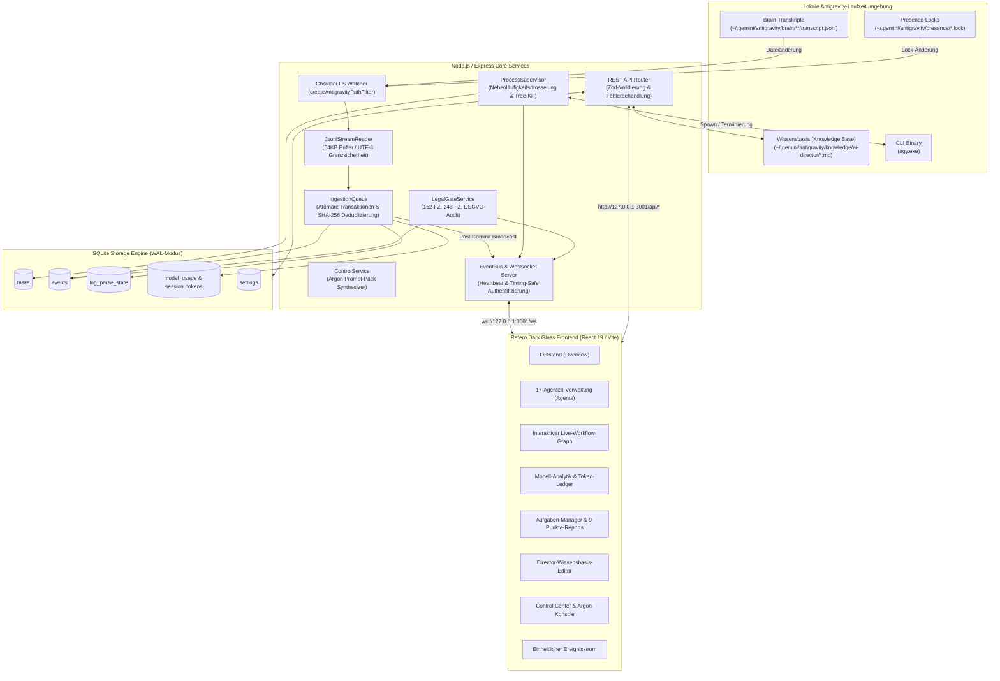
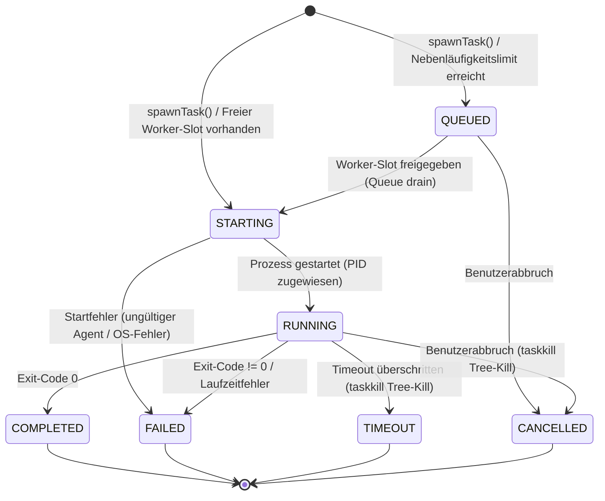

[English](ARCHITECTURE.md) • [Русский](ARCHITECTURE.ru.md) • [简体中文](ARCHITECTURE.zh.md) • [日本語](ARCHITECTURE.ja.md) • [Deutsch](ARCHITECTURE.de.md)

# Systemarchitektur

Dieses Dokument beschreibt die Architektur, die internen Interaktionen der Backend-Dienste und das Design der SQLite-Datenspeicherung von **Antigravity Apex**.

---

## 1. Übergeordnete Systemarchitektur

Antigravity Apex verbindet die lokale **Google Antigravity** Multi-Agenten-Laufzeitumgebung über ein ereignisgesteuertes, ressourcenschonendes Backend mit einem modernen Dashboard:



---

## 2. Zentrale Backend-Dienste

### 2.1 JsonlStreamReader (Zero-Disk-Read Engine)
Implementiert in [`server/src/services/jsonl-stream-reader.ts`](../server/src/services/jsonl-stream-reader.ts).

Herkömmliche Log-Parser lesen bei jeder Dateiänderung die gesamte Datei ab Zeile 0 neu ein. Bei wachsenden Protokollen führt dies zu hoher CPU- und I/O-Last. `JsonlStreamReader` löst dies durch:
- **Byte-Offset-Verfolgung**: Speichert den exakten Datei-Offset (`last_offset`) in der SQLite-Tabelle `log_parse_state`.
- **64-KB-Chunked Streaming**: Liest nur die neu angehängten Daten in 64-KB-Puffern mittels nativer File-Deskriptoren (`fs.readSync`).
- **UTF-8-Grenzsicherheit**: Wird ein Multi-Byte-Zeichen oder Emoji an der 64-KB-Puffergrenze getrennt, wird die unvollständige Sequenz zwischengespeichert und mit dem nächsten Chunk zusammengefügt.
- **Erkennung von Dateirotation & Kürzung**: Vergleicht Dateigröße, Inode und Erstellungszeit. Bei Kürzung oder Neuerstellung wird der Offset sauber auf 0 zurückgesetzt.

### 2.2 IngestionQueue & Post-Commit Broadcast
Implementiert in [`server/src/services/ingestion-queue.ts`](../server/src/services/ingestion-queue.ts).

- **Deterministische Deduplizierung**: Errechnet einen SHA-256-Hash aus unveränderlichen Attributen (`conversation_id:step_number:type`). Bereits vorhandene Ereignisse werden ignoriert.
- **Atomare Transaktionen**: Alle Datenbankeinfügungen (`events`, `session_token_usage`, `log_parse_state`) werden in einer einzigen SQLite-Transaktion ausgeführt (`db.transaction(...)`).
- **Post-Commit Invariante**: Ereignisse werden erst **nach** erfolgreichem Commit der Transaktion über den WebSocket `EventBus` gesendet. Clients erhalten niemals ungespeicherte Geister-Events.

### 2.3 ProcessSupervisor (Prozessbaum-Lebenszyklus)
Implementiert in [`server/src/services/process-supervisor.ts`](../server/src/services/process-supervisor.ts).

- **Nebenläufigkeitsgrenzen**: Drosselt die Ausführung auf `maxConcurrentAgents` (Standard: 3, Maximum: 6). Überschüssige Aufgaben warten im Status `QUEUED` und rücken automatisch nach.
- **Echtzeit-Stream-Multiplexing**: Leitet `stdout` und `stderr` direkt als WebSocket-Events (`task.updated`) weiter, um eine flüssige Konsolenausgabe im Browser zu gewährleisten.
- **Garantierte Baumterminierung**: Bei Timeouts oder Benutzerabbrüchen beendet der Supervisor den gesamten Prozessbaum (Windows: `taskkill /pid <PID> /T /F`, Unix: `kill -9 -<PGID>`), um verwaiste Zombie-Prozesse auszuschließen.

#### Process Supervisor Zustandsautomat (FSM)



### 2.4 LegalGateService (Quality Gate 2b)
Implementiert in [`server/src/services/legal-gate.ts`](../server/src/services/legal-gate.ts).

Automatisiert gesetzliche Compliance-Prüfungen für die Rechtsräume Russische Föderation (`RU`) und Europäische Union (`EU_NL`):
- **10 Jurisdiktionskriterien**: Unternehmenssitz, Staatsangehörigkeit der Gründer, Datenbankstandort, Zielgruppe, Zahlungsabwicklung, behördliche Register, Vertriebskanäle, Drittanbieter-Integrationen, anwendbares Recht, Werbegebiet.
- **Gesetzliche Grundlagen**: 152-FZ, 156-FZ getrennte Einwilligung, 23-FZ primäre Datenlokalisierung, 149-FZ Informationsverbreitung, 243-FZ KI-Regulierung (Übergangsregelung: Art. 8–10 Kennzeichnung & Training ab 01.03.2027), Teil IV ZGB Urheberrecht, 38-FZ/479-FZ Werberecht, DSGVO/UAVG und EU AI Act.
- **Nicht-blockierende Isolation**: Bei einem `BLOCKED_RED`-Ergebnis wird ausschließlich die rechtswidrige Unteroperation blockiert; sichere parallele Arbeiten (UI-Design, Barrierefreiheit, Unit-Tests) werden nicht angehalten.

### 2.5 ControlService & Level-4-Argon-Eskalation
Implementiert in [`server/src/services/control.ts`](../server/src/services/control.ts).

Setzt das Eskalationsprotokoll des AI Development Director um:
- **Fehlversuchsbegrenzung**: Scheitert ein Ansatz zweimal hintereinander, wird die Aufgabe gesperrt.
- **Argon Prompt-Pack Synthese**: Erstellt ein 18-Punkte Markdown-Paket mit Problemstellung, Nachweisen beider Fehlversuche, 20–50 Zeilen minimalem Reproduktionsbeispiel und Umschaltanweisungen.
- **Closed-Loop-Auflösung**: Nach manueller Eingabe des Argon-Urteils deeskaliert der Director die Aufgabe an Flash-Spezialisten zur Implementierung.

---

## 3. Datenbankarchitektur (SQLite WAL)

Die Datenbank wird über `better-sqlite3` in [`server/src/db/database.ts`](../server/src/db/database.ts) verwaltet:

### WAL-Modus & Parallelitäts-Pragmas
```sql
PRAGMA journal_mode = WAL;
PRAGMA foreign_keys = ON;
PRAGMA busy_timeout = 5000;
```
- **WAL-Modus**: Ermöglicht gleichzeitige Lesezugriffe ohne Blockierung von Schreibtransaktionen.
- **Busy Timeout (5000 ms)**: Verhindert `SQLITE_BUSY`-Fehler bei Spitzenlasten.

### Wichtige Datenbanktabellen

| Tabellenname | Primärschlüssel | Beschreibung |
|--------------|-----------------|--------------|
| `events` | `id` (TEXT) | Alle System-, Agenten-, Aufgaben- und Rechtsereignisse als JSON |
| `tasks` | `id` (TEXT) | Verwaltete Aufgaben, Status, Retry-Zähler und 9-Punkte-Reports |
| `log_parse_state` | `file_path` (TEXT) | Byte-Offsets, Inodes, mtimes und Zeilenzähler pro Protokolldatei |
| `session_token_usage` | `conversation_id` (TEXT) | Token-Aufschlüsselung (`input`, `output`, `cache_read`) pro Sitzung |
| `model_usage` | `tier` (TEXT) | Aggregierte Ausführungszahlen, Erfolgsquoten und Token-Ausgaben |
| `settings` | `key` (TEXT) | Dynamische Laufzeit-Konfigurationsschlüssel und -werte |
| `escalations` | `id` (TEXT) | Autonome Level-4-Argon-Eskalationen, Signaturen und Urteile |

---

## 4. Frontend-Architektur (React 19 & Liquid Dark Glass)

Der Frontend-Client basiert auf **React 19**, **TypeScript** und **Tailwind CSS v3**:

- **Design-Richtung**: Apple Pro Tools Dark-Glass-Ästhetik mit dezentem Umgebungslicht (`backdrop-blur-deep`, `bg-neutral-900/80`, `border-neutral-800`).
- **Echtzeit-Synchronisation**: `App.tsx` unterhält eine permanente WebSocket-Verbindung zu `/ws`. Eingehende Ereignisse aktualisieren das Task-Board und KPI-Zähler verzögerungsfrei.
- **Keine Konsolenfehler**: Strikte Null-Prüfungen, Error-Boundaries und geprüfte Typen halten die Browser-Konsole fehlerfrei.
