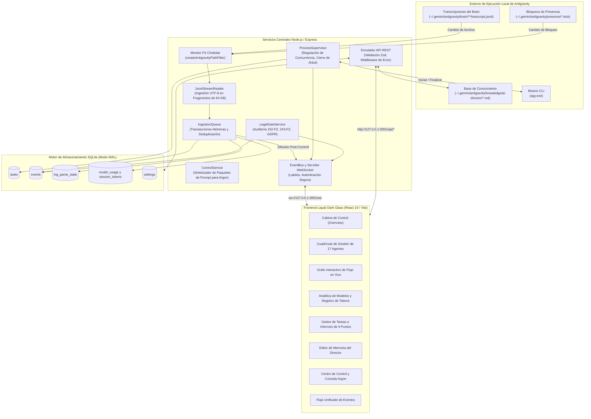
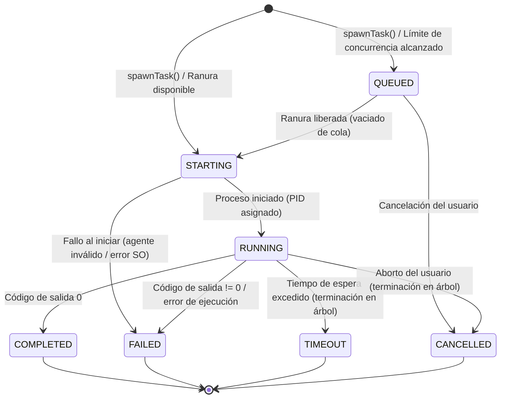

[English](ARCHITECTURE.md) • [Русский](ARCHITECTURE.ru.md) • [Español](ARCHITECTURE.es.md) • [Français](ARCHITECTURE.fr.md) • [Português](ARCHITECTURE.pt.md)

# Arquitectura del Sistema

Este documento describe la arquitectura global, las interacciones entre componentes internos y el diseño del almacenamiento de datos de **Antigravity Apex**.

---

## 1. Arquitectura del Sistema de Alto Nivel

Antigravity Apex conecta el entorno de ejecución multiagente local de **Google Antigravity** con un panel de control en tiempo real mediante un backend reactivo impulsado por eventos y sin lecturas redundantes en disco.



---

## 2. Servicios Centrales del Backend

### 2.1 JsonlStreamReader (Motor sin Lectura Redundante de Disco)
Ubicado en [`server/src/services/jsonl-stream-reader.ts`](../server/src/services/jsonl-stream-reader.ts).

Los analizadores de registros convencionales leen archivos enteros desde la línea 0 en cada modificación, provocando alto consumo de I/O y CPU cuando las transcripciones crecen. `JsonlStreamReader` resuelve este problema:
- **Seguimiento por Desplazamiento de Bytes**: Registra el offset exacto (`last_offset`) en la tabla `log_parse_state` de SQLite.
- **Transmisión en Fragmentos de 64 KB**: Lee exclusivamente los datos añadidos utilizando descriptores nativos de archivo (`fs.readSync`).
- **Seguridad UTF-8 Multibyte**: Si un carácter cirílico (2 bytes) o un emoji (4 bytes) queda dividido en el límite de los 64 KB, la secuencia incompleta final se retiene y se antepone al siguiente fragmento.
- **Detección de Rotación y Truncamiento**: Compara el tamaño actual del archivo, el inodo y la fecha de creación con los metadatos almacenados. Si el archivo se rota o se trunca, el offset se reinicia a 0 de forma limpia sin generar excepciones no controladas.

### 2.2 IngestionQueue y Difusión Post-Commit
Ubicado en [`server/src/services/ingestion-queue.ts`](../server/src/services/ingestion-queue.ts).

- **Deduplicación Determinista de Eventos**: Calcula un hash SHA-256 a partir de los atributos inmutables del evento (`conversation_id:step_number:type`). Los eventos duplicados se descartan silenciosamente.
- **Transacciones Atómicas**: Todas las inserciones en la base de datos (`events`, `session_token_usage`, `log_parse_state`) se agrupan en una única transacción de SQLite (`db.transaction(...)`).
- **Invariante Post-Commit**: Los eventos se transmiten al `EventBus` de WebSocket **únicamente después** de que la transacción de la base de datos se haya confirmado con éxito (`commit`). Los clientes nunca reciben eventos fantasma que no hayan sido persistidos.

### 2.3 ProcessSupervisor (Ciclo de Vida del Árbol de Procesos)
Ubicado en [`server/src/services/process-supervisor.ts`](../server/src/services/process-supervisor.ts).

- **Límites de Concurrencia**: Limita la ejecución a `maxConcurrentAgents` (predeterminado: 3, máximo: 6). Las tareas excedentes quedan en estado `QUEUED` y se despachan de forma secuencial conforme se liberan trabajadores.
- **Multiplexación de Flujos en Tiempo Real**: Dirige la salida estándar `stdout` y `stderr` del subagente hacia eventos WebSocket (`task.updated`, con fragmentos de salida en directo) para su visualización interactiva en el navegador.
- **Terminación Garantizada del Árbol**: Cuando una tarea supera el tiempo límite o el usuario la cancela, el supervisor finaliza todo el árbol de procesos (`taskkill /pid <PID> /T /F` en Windows) para cerrar tanto el proceso padre como los compiladores o ejecutores de pruebas subordinados.

#### Máquina de Estados Finitos (FSM) del Supervisor de Procesos



### 2.4 LegalGateService (Puerta de Calidad 2b)
Ubicado en [`server/src/services/legal-gate.ts`](../server/src/services/legal-gate.ts).

Automatiza la verificación del cumplimiento normativo en las jurisdicciones de la Federación Rusa (`RU`) y la Unión Europea (`EU_NL`):
- **10 Criterios de Jurisdicción**: Registro de entidad, ciudadanía de fundadores, ubicación de bases de datos, audiencia objetivo, métodos de pago, registros regulatorios, canales de distribución, integraciones de terceros, ley aplicable, territorio publicitario.
- **Marco Normativo**: 152-FZ, 156-FZ consentimiento separado, 23-FZ localización primaria de bases de datos, 149-FZ difusión de información y registro ORI, 243-FZ regulación de IA (invariante temporal: marcado y entrenamiento de los Artículos 8–10 con entrada en vigor el 01.03.2027), Parte IV del Código Civil sobre propiedad intelectual, 38-FZ/479-FZ publicidad, GDPR/UAVG y Ley de IA de la UE.
- **Invariante No Bloqueante**: Cuando una auditoría concluye en `BLOCKED_RED`, solo se suspende la subtarea que incurre en infracción; las operaciones seguras paralelas (diseño de interfaces, accesibilidad, pruebas unitarias) continúan sin pausa.

### 2.5 ControlService y Escalado de Nivel 4 a Argon
Ubicado en [`server/src/services/control.ts`](../server/src/services/control.ts).

Implementa el protocolo de escalado de AI Development Director:
- **Control de Reintentos**: Monitoriza el contador de fallos por tarea. Si un enfoque fracasa dos veces, se bloquea la tarea ante nuevos intentos a ciegas.
- **Síntesis de Paquetes de Prompts para Argon**: Genera un paquete markdown autónomo de 10 puntos que incluye:
  1. Nombre del componente y rol asignado.
  2. Declaración concisa del problema en 2 frases.
  3. Resumen y evidencias del intento fallido 1.
  4. Resumen y evidencias del intento fallido 2.
  5. Fragmento mínimo aislado para reproducción (20–50 líneas).
  6. Pregunta de diagnóstico arquitectónico dirigida.
  7. Instrucciones estrictas de cambio manual para el operador humano.
- **Desescalado con Resolución de Veredicto**: Una vez que el operador introduce el veredicto emitido por Argon, la tarea se desescala a un especialista Flash para su ejecución en código.

---

## 3. Arquitectura de la Base de Datos (SQLite WAL)

El esquema de la base de datos se administra mediante `better-sqlite3` en [`server/src/db/database.ts`](../server/src/db/database.ts):

### Modo WAL y Pragmas de Concurrencia
```sql
PRAGMA journal_mode = WAL;
PRAGMA foreign_keys = ON;
PRAGMA busy_timeout = 5000;
```
- **Modo WAL**: Permite lectores simultáneos sin bloquear las transacciones de escritura.
- **Busy Timeout (5000 ms)**: Previene errores `SQLITE_BUSY` durante ráfagas rápidas de ingestión de transcripciones.

### Tablas Principales de la Base de Datos

| Nombre de Tabla | Clave Primaria | Descripción |
|-----------------|----------------|-------------|
| `events` | `id` (TEXT) | Todos los eventos del sistema, agentes, tareas y auditorías legales con carga JSON completa. |
| `tasks` | `id` (TEXT) | Tareas supervisadas, estados, contadores de reintentos, prioridades e informes de 9 puntos. |
| `log_parse_state` | `file_path` (TEXT) | Desplazamientos en bytes, inodos, mtimes y contadores de líneas para cada archivo de log. |
| `session_token_usage` | `conversation_id` (TEXT) | Desglose de tokens (`input`, `output`, `cache_read`) por conversación activa. |
| `model_usage` | `tier` (TEXT) | Recuento agregado de ejecuciones, tasas de éxito y consumo de tokens por modelo. |
| `settings` | `key` (TEXT) | Claves y valores de configuración operativa dinámica en tiempo de ejecución. |
| `escalations` | `id` (TEXT) | Escalados autónomos a Gemini 4 Argon, firmas de fallos, paquetes de 18 puntos y veredictos. |

---

## 4. Arquitectura del Frontend (React 19 y Liquid Dark Glass)

El cliente frontend está desarrollado con **React 19**, **TypeScript** y **Tailwind CSS v3**:

- **Línea Estética**: Interfaz dark glass estilo Apple Pro Tools con sutiles brillos ambientales (`backdrop-blur-deep`, `bg-neutral-900/80`, `border-neutral-800`).
- **Sincronización de Estado en Tiempo Real**: El componente `App.tsx` mantiene una conexión persistente por WebSocket a `/ws`. Los eventos entrantes actualizan el panel de tareas, los contadores de KPI y el teletipo de eventos instantáneamente sin recargar la página.
- **Invariante de Cero Errores en Consola**: Tipado estricto, límites de captura de errores (Error Boundaries) y validación de tipos garantizan que la consola del navegador permanezca completamente limpia bajo cualquier condición de red.
