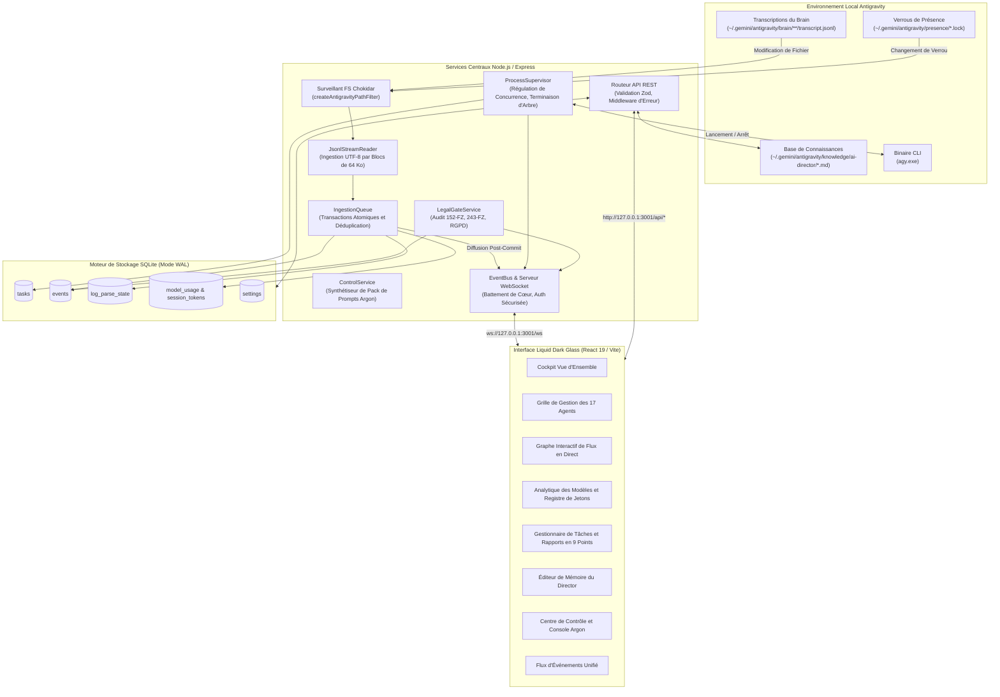
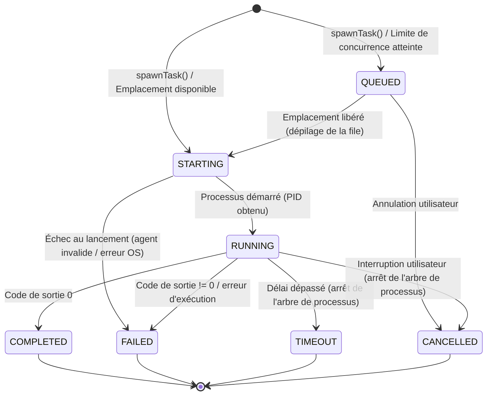

[English](ARCHITECTURE.md) • [Русский](ARCHITECTURE.ru.md) • [Español](ARCHITECTURE.es.md) • [Français](ARCHITECTURE.fr.md) • [Português](ARCHITECTURE.pt.md)

# Architecture du Système

Ce document détaille les plans d'architecture, les interactions entre composants internes et la conception du stockage des données d'**Antigravity Apex**.

---

## 1. Architecture Système de Haut Niveau

Antigravity Apex relie l'environnement d'exécution multi-agents local de **Google Antigravity** à un tableau de bord de pilotage en temps réel via un backend réactif événementiel sans relectures superflues sur le disque.



---

## 2. Services Centraux du Backend

### 2.1 JsonlStreamReader (Moteur sans Relecture Disque)
Situé dans [`server/src/services/jsonl-stream-reader.ts`](../server/src/services/jsonl-stream-reader.ts).

Les analyseurs de journaux classiques relisent les fichiers depuis la ligne 0 à chaque modification, ce qui engendre une surcharge disque et CPU majeure à mesure que les transcriptions grossissent. `JsonlStreamReader` élimine ce goulot d'étranglement :
- **Suivi par Décalage d'Octets (Byte-Offset)** : Enregistre l'offset exact (`last_offset`) dans la table SQLite `log_parse_state`.
- **Lecture par Blocs de 64 Ko** : Lit uniquement les nouvelles données ajoutées au moyen de descripteurs de fichiers natifs (`fs.readSync`).
- **Sécurité Multi-Octets UTF-8** : Si un caractère cyrillique (2 octets) ou un émoji (4 octets) se trouve à cheval sur la frontière de 64 Ko, la séquence d'octets partielle est conservée et préfixée au bloc suivant.
- **Détection des Rotations et Troncatures** : Compare la taille actuelle du fichier, son numéro d'inode et sa date de création avec les métadonnées enregistrées. Si le fichier est tronqué ou renouvelé, l'offset est réinitialisé à 0 de façon propre sans exception non gérée.

### 2.2 IngestionQueue et Diffusion Post-Commit
Situé dans [`server/src/services/ingestion-queue.ts`](../server/src/services/ingestion-queue.ts).

- **Déduplication Déterministe d'Événements** : Calcule une signature SHA-256 à partir des attributs immuables de l'événement (`conversation_id:step_number:type`). Les événements déjà présents sont ignorés silencieusement.
- **Transactions Atomiques** : Toutes les écritures en base (`events`, `session_token_usage`, `log_parse_state`) sont regroupées au sein d'une transaction SQLite unique (`db.transaction(...)`).
- **Invariant Post-Commit** : Les événements sont diffusés sur l'`EventBus` WebSocket **strictement après** la validation réussie (`commit`) de la transaction en base de données. Les clients ne reçoivent jamais d'événements fantômes dont la persistance aurait échoué.

### 2.3 ProcessSupervisor (Gestion du Cycle de Vie des Processus)
Situé dans [`server/src/services/process-supervisor.ts`](../server/src/services/process-supervisor.ts).

- **Limites de Concurrence** : Restreint l'exécution à `maxConcurrentAgents` (défaut : 3, maximum : 6). Les tâches excédentaires passent à l'état `QUEUED` et sont traitées dans l'ordre d'arrivée dès qu'un agent se libère.
- **Multiplexage des Flux en Direct** : Redirige la sortie standard `stdout` et d'erreur `stderr` du sous-agent directement vers des événements WebSocket (`task.updated`, avec fragments de sortie en direct) pour un affichage interactif dans le terminal du navigateur.
- **Terminaison d'Arborescence Garantie** : Lorsqu'une tâche expire ou est annulée par l'utilisateur, le superviseur déclenche l'arrêt complet de l'arbre de processus (`taskkill /pid <PID> /T /F` sous Windows) pour clore le processus parent ainsi que tous les compilateurs ou exécuteurs de tests enfants.

#### Machine à États Finis (FSM) du Superviseur de Processus



### 2.4 LegalGateService (Porte Qualité 2b)
Situé dans [`server/src/services/legal-gate.ts`](../server/src/services/legal-gate.ts).

Automatise le contrôle de conformité légale pour les juridictions de la Fédération de Russie (`RU`) et de l'Union Européenne (`EU_NL`) :
- **10 Critères de Juridiction** : Enregistrement de l'entité, nationalité des fondateurs, localisation des bases de données, public cible, moyens de paiement, registres réglementaires, canaux de distribution, intégrations tierces, droit applicable, territoire publicitaire.
- **Corpus Réglementaire** : 152-FZ, 156-FZ consentement explicite séparé, 23-FZ localisation primaire des bases de données, 149-FZ diffusion d'informations et registre ORI, 243-FZ régulation de l'IA (invariant temporel : obligations d'étiquetage et d'entraînement des Articles 8 à 10 applicables au 01.03.2027), Partie IV du Code Civil relative au droit d'auteur, 38-FZ/479-FZ publicité, RGPD/UAVG et AI Act européen.
- **Invariant Non Bloquant** : Lorsqu'un audit conclut à un statut `BLOCKED_RED`, seule la sous-opération en infraction est interrompue ; les développements sains parallèles (design UI, accessibilité, tests unitaires) continuent sans être entravés.

### 2.5 ControlService et Escalade Niveau 4 vers Argon
Situé dans [`server/src/services/control.ts`](../server/src/services/control.ts).

Met en œuvre le protocole d'escalade d'AI Development Director :
- **Encadrement des Retentatives** : Surveille le nombre d'échecs par tâche. Si une approche échoue à deux reprises, la tâche est verrouillée contre toute nouvelle tentative aveugle.
- **Synthèse du Pack de Prompts Argon** : Génère un pack Markdown autonome structuré en 10 points comprenant :
  1. Nom du composant et rôle attribué.
  2. Énoncé synthétique du problème en 2 phrases.
  3. Synthèse et preuves de l'échec 1.
  4. Synthèse et preuves de l'échec 2.
  5. Extrait minimal isolé pour reproduction (20 à 50 lignes).
  6. Question ciblée de diagnostic architectural.
  7. Instructions impératives de bascule manuelle pour l'opérateur humain.
- **Désescalade et Résolution du Verdict** : Dès que l'opérateur saisit le verdict fourni par Argon, la tâche est réassignée à un spécialiste Flash pour son implémentation logicielle.

---

## 3. Architecture de la Base de Données (SQLite WAL)

Le schéma de la base de données est géré via `better-sqlite3` dans [`server/src/db/database.ts`](../server/src/db/database.ts) :

### Mode WAL et Pragmas de Concurrence
```sql
PRAGMA journal_mode = WAL;
PRAGMA foreign_keys = ON;
PRAGMA busy_timeout = 5000;
```
- **Mode WAL** : Autorise des lectures simultanées sans jamais verrouiller les écritures.
- **Busy Timeout (5000 ms)** : Empêche les erreurs `SQLITE_BUSY` lors des rafales d'ingestion de journaux.

### Tables Principales de la Base de Données

| Nom de Table | Clé Primaire | Description |
|--------------|--------------|-------------|
| `events` | `id` (TEXT) | Tous les événements système, agents, tâches et audits juridiques avec charge utile JSON. |
| `tasks` | `id` (TEXT) | Tâches suivies, statuts, compteurs de retentatives, priorités et rapports en 9 points. |
| `log_parse_state` | `file_path` (TEXT) | Décalages d'octets, inodes, mtimes et compteurs de lignes pour chaque fichier journal. |
| `session_token_usage` | `conversation_id` (TEXT) | Ventilation des jetons (`input`, `output`, `cache_read`) par conversation active. |
| `model_usage` | `tier` (TEXT) | Totaux agrégés des exécutions, taux de réussite et volumes de jetons par modèle. |
| `settings` | `key` (TEXT) | Clés et paramètres opérationnels dynamiques au moment de l'exécution. |
| `escalations` | `id` (TEXT) | Escalades autonomes vers Gemini 4 Argon, signatures d'échecs, packs de prompts et verdicts. |

---

## 4. Architecture Frontend (React 19 & Liquid Dark Glass)

Le client frontend est conçu avec **React 19**, **TypeScript** et **Tailwind CSS v3** :

- **Orientation Esthétique** : Interface dark glass inspirée des logiciels professionnels Apple Pro Tools, rehaussée de lueurs ambiantes subtiles (`backdrop-blur-deep`, `bg-neutral-900/80`, `border-neutral-800`).
- **Synchronisation d'État Temps Réel** : Le composant racine `App.tsx` entretient une connexion WebSocket continue avec `/ws`. Les événements entrants mettent à jour le tableau des tâches, les indicateurs clés et le fil télémétrique instantanément sans rafraîchissement manuel.
- **Invariant Zéro Erreur Console** : Typage rigoureux, gestionnaires d'erreurs d'affichage (Error Boundaries) et validation des données assurent une console de développement parfaitement vierge sous toutes conditions réseau.
