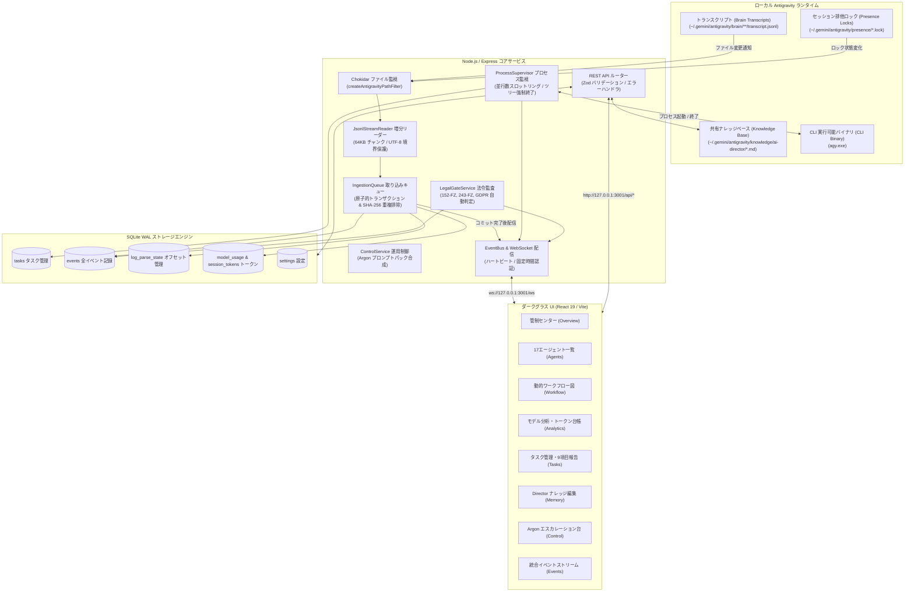
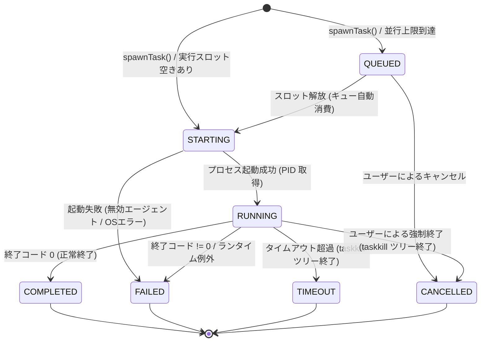

[English](ARCHITECTURE.md) • [Русский](ARCHITECTURE.ru.md) • [简体中文](ARCHITECTURE.zh.md) • [日本語](ARCHITECTURE.ja.md) • [Deutsch](ARCHITECTURE.de.md)

# システムアーキテクチャ設計書

本文書は、**Antigravity Apex** のアーキテクチャ概要、内部コンポーネント間の連携フロー、プロセス監視、および SQLite データベース設計について詳述します。

---

## 1. ハイレベル・システムアーキテクチャ

Antigravity Apex は、イベント駆動型かつディスク消費ゼロ（Zero-Disk-Churn）のバックエンドを通じて、ローカルの **Google Antigravity** マルチエージェント実行環境とフロントエンド管制ダッシュボードを緊密に統合します：



---

## 2. バックエンド・コアサービス詳解

### 2.1 JsonlStreamReader（ゼロディスクリード増分エンジン）
実装ファイル：[`server/src/services/jsonl-stream-reader.ts`](../server/src/services/jsonl-stream-reader.ts)。

従来のログパーサーは、ファイルが更新されるたびに先頭行（オフセット0）から全データを再読み込みするため、ログが肥大化すると激しい CPU 高負荷とディスク I/O ボトルネックを引き起こします。`JsonlStreamReader` は以下の手法でこれを完全に解消します：
- **バイトオフセット追跡**：SQLite の `log_parse_state` テーブルに各ファイルの最終読み取り位置（`last_offset`）をバイト単位で記録。
- **64 KB チャンクストリーミング**：ネイティブファイル記述子（`fs.readSync`）を用いて、前回のオフセット以降に追加されたデータのみを 64 KB 単位で増分取得。
- **マルチバイト UTF-8 分割安全機構**：日本語などのマルチバイト文字（3〜4バイト）や Emoji が 64 KB バッファの境界で分断された場合、末尾の不完全なバイト列を次回の読み込みまで保持して復元。
- **ファイルローテーション＆切り捨て検知**：ファイルサイズ、Inode、作成時刻（birthtime）を比較し、ログがローテーションまたはクリアされた場合は例外を出さずに安全にオフセットを 0 にリセット。

### 2.2 IngestionQueue（原子的取り込みとコミット後配信）
実装ファイル：[`server/src/services/ingestion-queue.ts`](../server/src/services/ingestion-queue.ts)。

- **決定論的イベント重複排除**：不変属性（`conversation_id:step_number:type`）から計算した SHA-256 ハッシュを基に既存イベントをサイレントに除外。
- **原子的トランザクション処理**：複数テーブル（`events`, `session_token_usage`, `log_parse_state`）への書き込みを単一の SQLite トランザクション（`db.transaction(...)`）内で完結。
- **コミット後配信の不変条件（Post-Commit Invariant）**：WebSocket `EventBus` へのイベントブロードキャストは、**DB トランザクションが正常コミットされた直後にのみ** 実行。未永続化イベントがクライアントに届くことを防止。

### 2.3 ProcessSupervisor（プロセスツリーライフサイクル管理）
実装ファイル：[`server/src/services/process-supervisor.ts`](../server/src/services/process-supervisor.ts)。

- **並行性スロットリング**：同時実行数を `maxConcurrentAgents`（デフォルト 3、最大 6）に制限。超過したタスクは `QUEUED` 状態で待機し、スロットが空き次第自動実行。
- **標準入出力ストリーム多重化**：サブエージェントの `stdout` と `stderr` を WebSocket イベント（`task.updated`）としてリアルタイム分割配信し、Web ブラウザ上で滑らかなターミナル表示を実現。
- **プロセスツリー完全強制終了**：タイムアウト時や手動キャンセル時に、親プロセスだけでなく配下のコンパイラやテストランナーも含めてプロセスツリー全体を強制終了（Windows: `taskkill /pid <PID> /T /F`、Unix: `kill -9 -<PGID>`）し、ゾンビプロセスの発生を根絶。

#### プロセス監視ステートマシン (FSM)



### 2.4 LegalGateService（品質ゲート 2b: 法令監査エンジン）
実装ファイル：[`server/src/services/legal-gate.ts`](../server/src/services/legal-gate.ts)。

ロシア連邦（`RU`）および欧州連合（`EU_NL`）の法令遵守を自動判定：
- **10の管轄判定基準**：法人登記地、創業者国籍、DB設置場所、対象ユーザー層、決済通貨、公的登録簿、配布経路、外部連携、準拠法、広告配信地域。
- **適用法令**：152-FZ、156-FZ 単独同意、23-FZ 初期ローカライズ義務、149-FZ 情報法＆ORI 登録、243-FZ AI 規制（経過措置：第8〜10条は 2027-03-01 施行）、民法第4部著作権、38-FZ/479-FZ 広告規制、GDPR/UAVG、EU AI Act。
- **非ブロッキング分離不変条件（Non-Blocking Invariant）**：監査で `BLOCKED_RED` が判定された場合、法令違反の疑いがある特定のサブ操作のみを遮断。UI スタイリングや単体テストなどの安全な作業は中断させません。

### 2.5 ControlService＆Level 4 Argon エスカレーション
実装ファイル：[`server/src/services/control.ts`](../server/src/services/control.ts)。

AI Development Director のエスカレーション規程を実行：
- **盲目的リトライの抑止**：同一アプローチで 2 回連続失敗した場合、即座にタスクをロック。
- **18項目マスク済みプロンプトパック合成**：課題概要、2回の失敗証拠、20〜50行の最小再現コード、診断クエスチョン、手動切り替え指示書を内包した Markdown を自動生成。
- **閉ループ裁定の還元**：Gemini 4 Argon で得た裁定を入力後、Director がタスクを Flash 専門家へ再配分して実装に落とし込みます。

---

## 3. データベース設計（SQLite WAL）

データベースは `better-sqlite3` を採用しています（[`server/src/db/database.ts`](../server/src/db/database.ts)）：

### WAL モードと並行性パラメータ
```sql
PRAGMA journal_mode = WAL;
PRAGMA foreign_keys = ON;
PRAGMA busy_timeout = 5000;
```
- **WAL モード**：書き込みトランザクション中であっても読み取り処理が一切ブロックされません。
- **Busy Timeout (5000 ms)**：突発的な書き込み集中時でも最大5秒間リトライ待機を行い、`SQLITE_BUSY` エラーを完全に防止。

### 主要テーブル定義

| テーブル名 | 主キー | 説明・主な用途 |
|------------|--------|----------------|
| `events` | `id` (TEXT) | システム内の全イベント記録（JSON ペイロードとタイムスタンプ） |
| `tasks` | `id` (TEXT) | タスク状態、リトライ回数、優先度、9項目完了レポート |
| `log_parse_state` | `file_path` (TEXT) | 各ログファイルの絶対バイトオフセット、Inode、行数 |
| `session_token_usage` | `conversation_id` (TEXT) | 会話ごとのトークン消費内訳（入力、出力、キャッシュ読み取り） |
| `model_usage` | `tier` (TEXT) | モデル別の実行回数、成功率、累積トークン消費量 |
| `settings` | `key` (TEXT) | コントロールセンターの動的構成キー＆値 |
| `escalations` | `id` (TEXT) | Level 4 Argon エスカレーション記録、障害指紋、裁定結果 |

---

## 4. フロントエンド設計（React 19 & ダークグラス美学）

クライアントは **React 19**、**TypeScript**、**Tailwind CSS v3** で構成されています：

- **デザイン方針**：ハイエンドなプロツールを彷彿とさせるダークグラススタイル（`backdrop-blur-deep`、`bg-neutral-900/80`、`border-neutral-800`）。
- **リアルタイム状態同期**：`App.tsx` が WebSocket（`/ws`）に常時接続。受信イベントに応じてタスクボードや KPI カウンターが瞬時にリアクティブ更新されます。
- **コンソールエラー 0 件の不変条件**：厳格な Null 安全性チェック、エラーバウンダリ、型検証により、ネットワーク断絶時でもコンソールを一切汚しません。
