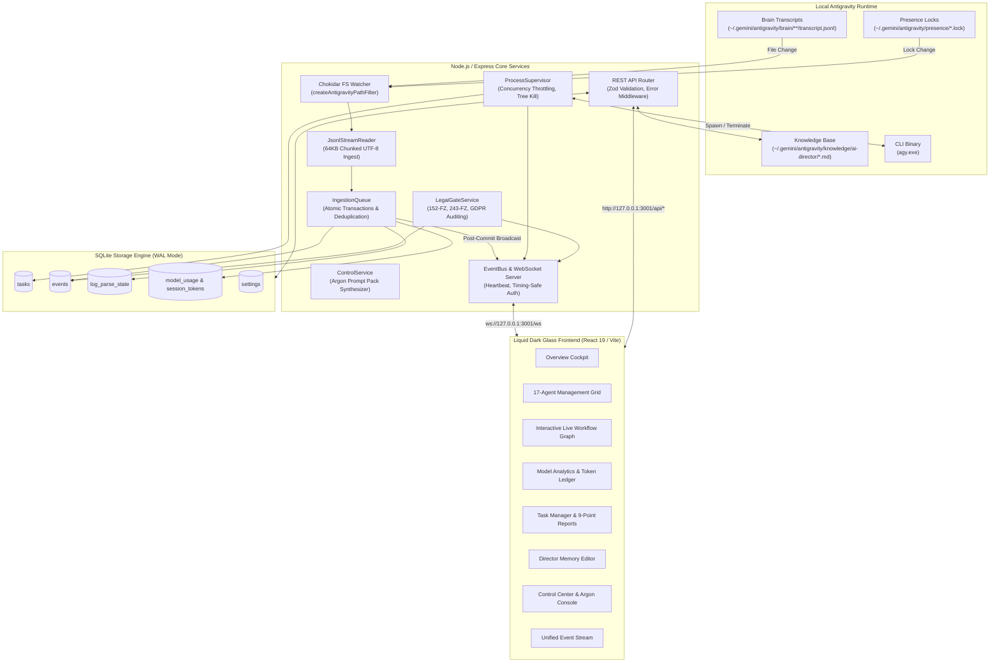
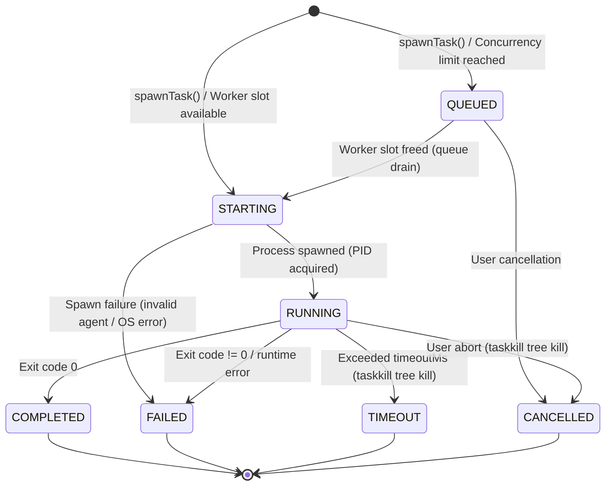

[English](ARCHITECTURE.md) • [Русский](ARCHITECTURE.ru.md) • [Español](ARCHITECTURE.es.md) • [Français](ARCHITECTURE.fr.md) • [Português](ARCHITECTURE.pt.md)

# System Architecture

This document details the architectural blueprint, internal component interactions, and data storage design of **Antigravity Apex**.

---

## 1. High-Level System Architecture

Antigravity Apex connects the local **Google Antigravity** multi-agent runtime with a real-time management dashboard through an event-driven, zero-disk-churn backend.



---

## 2. Core Backend Services

### 2.1 JsonlStreamReader (Zero-Disk-Read Engine)
Located in [`server/src/services/jsonl-stream-reader.ts`](../server/src/services/jsonl-stream-reader.ts).

Traditional log parsers read entire files from line 0 on every modification, causing massive disk I/O and CPU spikes as transcripts grow. `JsonlStreamReader` solves this:
- **Byte-Offset Tracking**: Remembers the exact file offset (`last_offset`) in the `log_parse_state` SQLite table.
- **64 KB Chunked Streaming**: Reads newly appended data in fixed 64 KB buffers using native file descriptors (`fs.readSync`).
- **Multi-Byte UTF-8 Safety**: If a Cyrillic character (2 bytes) or emoji (4 bytes) is split across the 64 KB buffer boundary, the partial trailing byte sequence is retained and prepended to the next chunk.
- **File Rotation & Truncation Detection**: Compares current file size and file inode/birthtime against stored metadata. If a file is truncated or rotated, the offset resets to 0 cleanly without throwing unhandled exceptions.

### 2.2 IngestionQueue & Post-Commit Broadcast
Located in [`server/src/services/ingestion-queue.ts`](../server/src/services/ingestion-queue.ts).

- **Deterministic Event Deduplication**: Computes a SHA-256 hash from immutable event attributes (`conversation_id:step_number:type`). Existing events are silently ignored.
- **Atomic Transactions**: All database insertions (`events`, `session_token_usage`, `log_parse_state`) are wrapped in a single SQLite transaction (`db.transaction(...)`).
- **Post-Commit Invariant**: Events are broadcast to the WebSocket `EventBus` **strictly after** the database transaction has committed successfully. Clients never receive ghost events that failed database persistence.

### 2.3 ProcessSupervisor (Process Tree Lifecycle)
Located in [`server/src/services/process-supervisor.ts`](../server/src/services/process-supervisor.ts).

- **Concurrency Limits**: Throttles execution to `maxConcurrentAgents` (default: 3, maximum: 6). Additional tasks wait in the `QUEUED` state and drain automatically as active workers finish.
- **Real-Time Stream Multiplexing**: Pipes subagent `stdout` and `stderr` directly into WebSocket events (`task.updated`, with live output chunks) for interactive terminal rendering in the browser.
- **Guaranteed Tree Termination**: When a task times out or is aborted by the user, the supervisor executes a complete process tree kill (`taskkill /pid <PID> /T /F` on Windows) to terminate the parent and all child compiler or test runner sub-processes.

#### Process Supervisor Finite State Machine (FSM)



### 2.4 LegalGateService (Quality Gate 2b)
Located in [`server/src/services/legal-gate.ts`](../server/src/services/legal-gate.ts).

Automates statutory compliance verification across Russian Federation (`RU`) and European Union (`EU_NL`) jurisdictions:
- **10 Jurisdiction Criteria**: Entity registration, founder citizenship, database location, target audience, payment methods, regulatory registries, distribution channels, third-party integrations, applicable law, advertising territory.
- **Statutory Rules**: 152-FZ, 156-FZ isolated consent, 23-FZ database primary localization, 149-FZ information dissemination & ORI register, 243-FZ AI regulation (temporal invariant: marking & training Articles 8–10 effective 01.03.2027), Part IV Civil Code copyright, 38-FZ/479-FZ advertising, GDPR/UAVG, and EU AI Act.
- **Non-Blocking Invariant**: When an audit returns `BLOCKED_RED`, only the non-compliant sub-operation is blocked; safe sibling operations (UI design, accessibility, unit tests) proceed without interruption.

### 2.5 ControlService & Level 4 Argon Escalation
Located in [`server/src/services/control.ts`](../server/src/services/control.ts).

Implements the AI Development Director escalation protocol:
- **Retry Enforcement**: Monitors task failure counts. If an approach fails twice, the task is locked against further blind retries.
- **Argon Prompt Pack Synthesis**: Generates a self-contained, 10-point escalation markdown prompt pack containing:
  1. Component name and role.
  2. Concise 2-sentence problem statement.
  3. Failure attempt 1 summary and evidence.
  4. Failure attempt 2 summary and evidence.
  5. Minimal isolated reproduction snippet (20–50 lines).
  6. Targeted architectural diagnostic question.
  7. Strict manual switching instructions for the human operator.
- **Closed-Loop Verdict De-escalation**: Once the operator inputs the Argon verdict, the task de-escalates to a Flash specialist for code implementation.

---

## 3. Database Architecture (SQLite WAL)

The database schema is managed via `better-sqlite3` in [`server/src/db/database.ts`](../server/src/db/database.ts):

### WAL Mode & Concurrency Pragmas
```sql
PRAGMA journal_mode = WAL;
PRAGMA foreign_keys = ON;
PRAGMA busy_timeout = 5000;
```
- **WAL Mode**: Allows concurrent readers without blocking write transactions.
- **Busy Timeout (5000 ms)**: Prevents `SQLITE_BUSY` errors when file watchers ingest rapid bursts of transcripts.

### Key Database Tables

| Table Name | Primary Key | Description |
|------------|-------------|-------------|
| `events` | `id` (TEXT) | All system, agent, task, and legal events with full JSON payload. |
| `tasks` | `id` (TEXT) | Tracked tasks, statuses, retry counts, priorities, and 9-point reports. |
| `log_parse_state` | `file_path` (TEXT) | Byte offsets, inodes, mtimes, and line counters for each transcript file. |
| `session_token_usage` | `conversation_id` (TEXT) | Token breakdown (`input`, `output`, `cache_read`) per active conversation. |
| `model_usage` | `tier` (TEXT) | Aggregated run counts, completion rates, and token expenditures per model. |
| `settings` | `key` (TEXT) | Dynamic runtime configuration keys and values. |
| `escalations` | `id` (TEXT) | Autonomous Level 4 Argon escalations, failure signatures, 18-point prompt packs, and verdicts. |

---

## 4. Frontend Architecture (React 19 & Liquid Dark Glass)

The frontend client is built with **React 19**, **TypeScript**, and **Tailwind CSS v3**:

- **Aesthetic Direction**: Apple Pro Tools dark glass aesthetic with subtle ambient glows (`backdrop-blur-deep`, `bg-neutral-900/80`, `border-neutral-800`).
- **Real-Time State Synchronization**: The `App.tsx` component maintains a persistent WebSocket connection to `/ws`. Incoming event payloads update the active task board, KPI counters, and telemetry ticker instantly without requiring manual page refreshes.
- **Zero Console Errors Invariant**: Strict null checks, error boundaries, and validated data types ensure the browser console remains clean under all network conditions.
