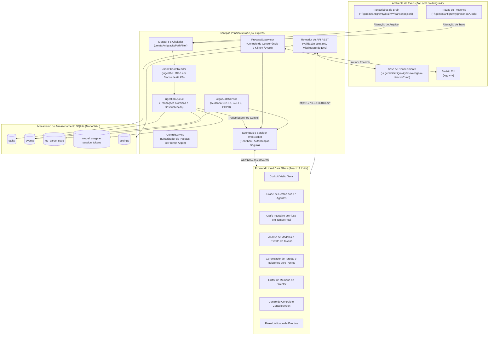
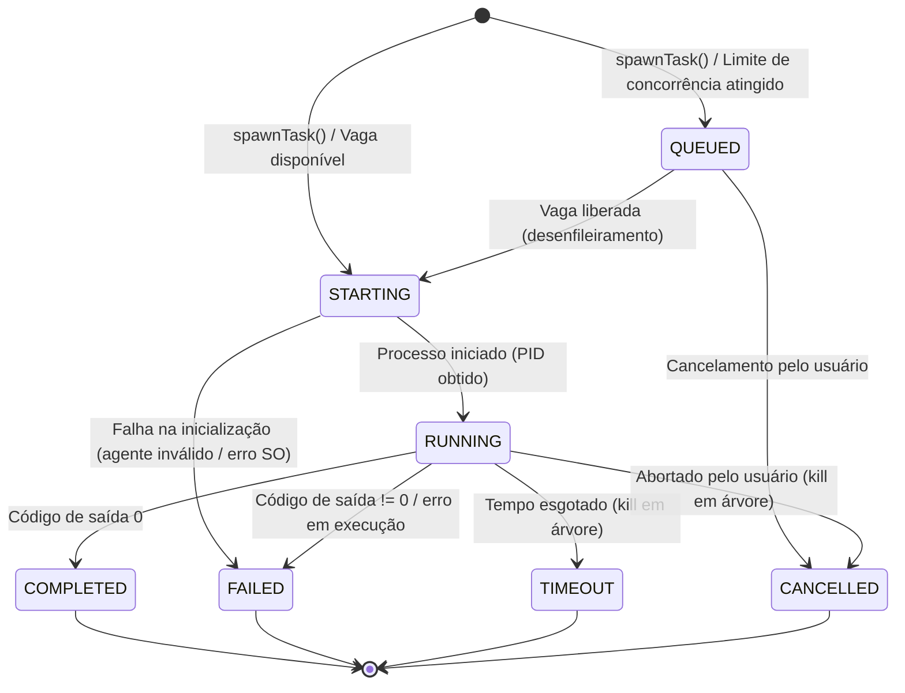

[English](ARCHITECTURE.md) • [Русский](ARCHITECTURE.ru.md) • [Español](ARCHITECTURE.es.md) • [Français](ARCHITECTURE.fr.md) • [Português](ARCHITECTURE.pt.md)

# Arquitetura do Sistema

Este documento descreve detalhadamente a estrutura arquitetural, os fluxos entre componentes internos e o modelo de persistência do **Antigravity Apex**.

---

## 1. Arquitetura de Alto Nível do Sistema

O Antigravity Apex integra o ambiente de execução multiagente local do **Google Antigravity** a um painel de controle operacional em tempo real por meio de um backend reativo orientado a eventos e sem leituras redundantes de disco.



---

## 2. Serviços Principais do Backend

### 2.1 JsonlStreamReader (Motor sem Releitura em Disco)
Localizado em [`server/src/services/jsonl-stream-reader.ts`](../server/src/services/jsonl-stream-reader.ts).

Processadores convencionais de logs leem arquivos inteiros a partir da linha 0 a cada modificação, gerando alta contenção de I/O de disco e consumo de CPU conforme as transcrições aumentam. O `JsonlStreamReader` resolve essa limitação:
- **Rastreamento por Deslocamento de Bytes (Byte-Offset)**: Salva o ponteiro de leitura (`last_offset`) na tabela `log_parse_state` do SQLite.
- **Streaming em Fragmentos de 64 KB**: Lê exclusivamente os novos dados adicionados utilizando descritores nativos de arquivos (`fs.readSync`).
- **Segurança Multibyte UTF-8**: Se um caractere cirílico (2 bytes) ou emoji (4 bytes) for repartido na fronteira do bloco de 64 KB, a sequência parcial restante é armazenada e prefixada no próximo fragmento lido.
- **Detecção de Truncamento e Rotação**: Confronta o tamanho real do arquivo, número do inode e data de criação com os metadados arquivados. Caso o arquivo seja rotacionado ou encurtado, o offset é resetado para 0 sem gerar exceções não capturadas.

### 2.2 IngestionQueue e Transmissão Pós-Commit
Localizado em [`server/src/services/ingestion-queue.ts`](../server/src/services/ingestion-queue.ts).

- **Desduplicação Determinística de Eventos**: Produz uma assinatura SHA-256 baseada nos parâmetros imutáveis do evento (`conversation_id:step_number:type`). Eventos já cadastrados são descartados em silêncio.
- **Transações Atômicas**: Todas as inserções no banco (`events`, `session_token_usage`, `log_parse_state`) são executadas em uma única transação SQLite (`db.transaction(...)`).
- **Invariante Pós-Commit**: Os eventos só são disparados para o `EventBus` do WebSocket **estritamente após** a confirmação bem-sucedida (`commit`) da transação no banco. Nenhum cliente recebe notificações de eventos cuja persistência falhou.

### 2.3 ProcessSupervisor (Ciclo de Vida da Árvore de Processos)
Localizado em [`server/src/services/process-supervisor.ts`](../server/src/services/process-supervisor.ts).

- **Limites de Concorrência**: Restringe as tarefas ativas a `maxConcurrentAgents` (padrão: 3, teto: 6). Tarefas adicionais recebem o status `QUEUED` e são processadas na ordem à medida que os agentes terminam suas tarefas.
- **Multiplexação de Logs em Tempo Real**: Conecta a saída padrão `stdout` e de erro `stderr` do subagente diretamente em eventos do WebSocket (`task.updated`, com trechos de saída contínuos) para visualização dinâmica no navegador.
- **Encerramento Garantido de Árvore**: Em caso de timeout ou cancelamento manual, o supervisor executa o kill em árvore (`taskkill /pid <PID> /T /F` no Windows) para eliminar o processo principal e todos os subprocessos filhos subordinados (compiladores, executores de teste).

#### Máquina de Estados Finitos (FSM) do Supervisor de Processos



### 2.4 LegalGateService (Portão de Qualidade 2b)
Localizado em [`server/src/services/legal-gate.ts`](../server/src/services/legal-gate.ts).

Automatiza a checagem de conformidade estatutária para as jurisdições da Federação Russa (`RU`) e União Europeia (`EU_NL`):
- **10 Critérios de Jurisdição**: Sede jurídica, nacionalidade dos fundadores, localização de servidores, público-alvo, meios de pagamento, cadastros regulatórios, canais de distribuição, dependências de terceiros, foro legal, praça publicitária.
- **Base Regulatória**: 152-FZ, consentimento separado 156-FZ, localização primária de bancos 23-FZ, 149-FZ sobre disseminação de dados e cadastro ORI, 243-FZ sobre inteligência artificial (invariante de transição: rotulagem e treinamento dos Artigos 8–10 com eficácia a partir de 01.03.2027), Parte IV do Código Civil relativa a direitos autorais, 38-FZ/479-FZ sobre propaganda, GDPR/UAVG e AI Act europeu.
- **Invariante Não Bloqueante**: Quando um parecer aponta `BLOCKED_RED`, apenas a subtarefa irregular é paralisada; atividades paralelas seguras (estilização de interface, acessibilidade, testes de unidade) continuam sem qualquer atraso.

### 2.5 ControlService e Escalonamento de Nível 4 para Argon
Localizado em [`server/src/services/control.ts`](../server/src/services/control.ts).

Materializa o protocolo de escalonamento do AI Development Director:
- **Gestão de Retentativas**: Registra as tentativas com erro de cada tarefa. Havendo duas falhas consecutivas em uma abordagem, a tarefa é trancada contra repetições cegas.
- **Síntese de Prompt Packs para o Argon**: Constrói um pacote autônomo em Markdown com 10 pontos:
  1. Identificação do componente e papel especialista.
  2. Definição do problema em duas frases sucintas.
  3. Resumo e evidências do erro 1.
  4. Resumo e evidências do erro 2.
  5. Trecho mínimo isolado para reprodução (20 a 50 linhas).
  6. Pergunta arquitetural direcionada.
  7. Instruções expressas de troca manual para o operador humano.
- **Desescalonamento por Veredito**: Uma vez que o operador insere o parecer do Argon no sistema, a tarefa é rebaixada para especialistas Flash efetuarem os ajustes no código.

---

## 3. Arquitetura do Banco de Dados (SQLite WAL)

O esquema do banco de dados é operado através do `better-sqlite3` em [`server/src/db/database.ts`](../server/src/db/database.ts):

### Modo WAL e Pragmas de Concorrência
```sql
PRAGMA journal_mode = WAL;
PRAGMA foreign_keys = ON;
PRAGMA busy_timeout = 5000;
```
- **Modo WAL**: Viabiliza leituras simultâneas sem bloquear gravações.
- **Busy Timeout (5000 ms)**: Elimina ocorrências de erro `SQLITE_BUSY` durante rajadas volumosas de ingestão de logs.

### Tabelas Principais do Banco de Dados

| Nome da Tabela | Chave Primária | Descrição |
|----------------|----------------|-----------|
| `events` | `id` (TEXT) | Todos os eventos do sistema, agentes, tarefas e auditorias legais com carga JSON completa. |
| `tasks` | `id` (TEXT) | Tarefas acompanhadas, status, contagem de retentativas, prioridades e relatórios de 9 pontos. |
| `log_parse_state` | `file_path` (TEXT) | Offsets em bytes, inodes, mtimes e contadores de linha para cada arquivo de log. |
| `session_token_usage` | `conversation_id` (TEXT) | Divisão detalhada de tokens (`input`, `output`, `cache_read`) por conversa ativa. |
| `model_usage` | `tier` (TEXT) | Totalizadores consolidados de chamadas, taxas de sucesso e custos de tokens por modelo. |
| `settings` | `key` (TEXT) | Parâmetros e chaves de configuração dinâmica em tempo de execução. |
| `escalations` | `id` (TEXT) | Escalonamentos autônomos para o Gemini 4 Argon, assinaturas de erro, pacotes de 18 pontos e vereditos. |

---

## 4. Arquitetura do Frontend (React 19 & Liquid Dark Glass)

A interface web é implementada em **React 19**, **TypeScript** e **Tailwind CSS v3**:

- **Conceito Visual**: Painel de instrumentos em dark glass no estilo Apple Pro Tools com iluminação sutil de ambiente (`backdrop-blur-deep`, `bg-neutral-900/80`, `border-neutral-800`).
- **Sincronização de Estado em Tempo Real**: O componente mestre `App.tsx` mantém um canal WebSocket contínuo com `/ws`. Eventos que chegam refletem no quadro de tarefas, nos cartões de KPI e no feed de eventos instantaneamente sem atualizar a página.
- **Invariante de Zero Erros no Console**: Tipagem estrita, captura defensiva de erros com Error Boundaries e validação de dados garantem um console do navegador totalmente limpo sob qualquer cenário de rede.
