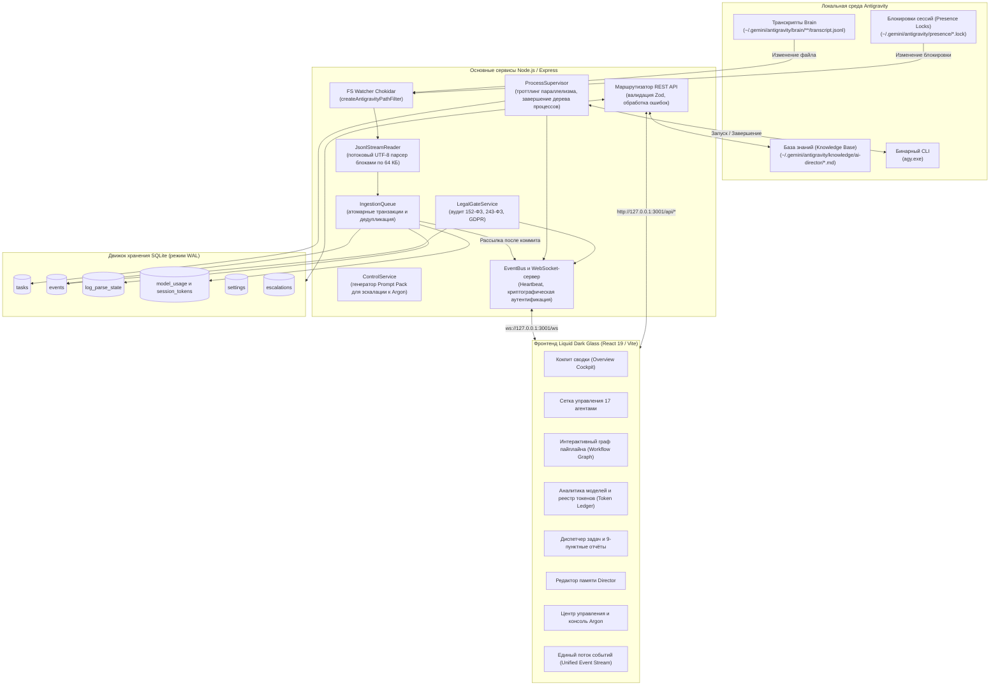
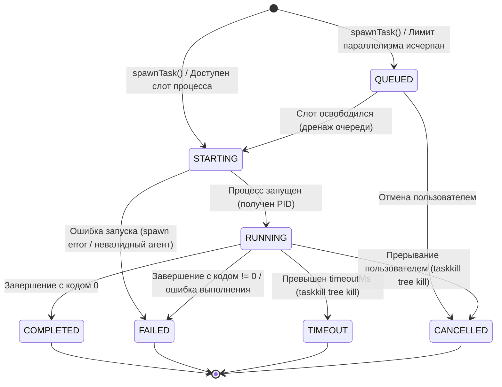

[English](ARCHITECTURE.md) • [Русский](ARCHITECTURE.ru.md)

# Архитектура системы

В данном документе подробно описаны архитектурный проект, внутреннее взаимодействие компонентов и структура хранения данных **AI Command Center**.

---

## 1. Высокоуровневая архитектура системы

AI Command Center связывает локальную среду выполнения мультиагентной системы **Google Antigravity** с интерактивным дашбордом управления реального времени через событийно-ориентированный (event-driven) бэкенд с нулевой паразитной нагрузкой на диск (zero-disk-churn).



---

## 2. Ключевые сервисы бэкенда

### 2.1 JsonlStreamReader (Движок чтения логов с нулевой избыточной нагрузкой / Zero-Disk-Read Engine)
Расположен в [`server/src/services/jsonl-stream-reader.ts`](../server/src/services/jsonl-stream-reader.ts).

Традиционные парсеры логов перечитывают файлы целиком со строки 0 при каждом их изменении. Это приводит к колоссальным всплескам операций ввода-вывода (Disk I/O) и нагрузки на процессор по мере роста транскриптов. `JsonlStreamReader` полностью устраняет эту проблему:
- **Побайтовое отслеживание смещения (Byte-Offset Tracking)**: Запоминает точную позицию в файле (`last_offset`) в таблице `log_parse_state` базы данных SQLite.
- **Потоковое чтение блоками по 64 КБ (64 KB Chunked Streaming)**: Считывает только новые добавленные данные фиксированными порциями по 64 КБ (`CHUNK_SIZE = 64 * 1024`) через нативный файловый дескриптор (`fs.promises.open` и метод `read`).
- **Безопасность многобайтовых последовательностей UTF-8**: Использует модуль `string_decoder` (`StringDecoder('utf8')`). Если многобайтовый символ кириллицы (2 байта) или эмодзи (4 байта) разрезается на границе буфера 64 КБ, незавершённая байтовая последовательность сохраняется и объединяется со следующим чанком.
- **Детекция ротации и усечения файлов**: Сопоставляет текущий размер файла (`stat.size`), идентификатор inode (`stat.ino`) и время создания (`stat.birthtimeMs`) с сохранёнными метаданными. Если файл был усечён или перезаписан с нуля, смещение корректно сбрасывается в 0 без падений и необработанных исключений.
- **Защита от переполнения памяти (OOM Guard)**: Максимальный размер строки ограничен `MAX_LINE_SIZE = 5 * 1024 * 1024` (5 МБ). При обнаружении повреждённой сверхдлинной строки фрагмент сбрасывается с фиксацией ошибки без исчерпания памяти Node.js.
- **Извлечение событий и метрик токенов**: Парсит вызовы субинструментов (`invoke_subagent` -> `agent.started`), ошибки (`status === 'ERROR'` -> `agent.failed`), шаги рассуждений, а также инкременты токенов (`input_tokens`, `output_tokens`, `cache_read_tokens`).

---

### 2.2 IngestionQueue и рассылка событий strictly post-commit
Расположен в [`server/src/services/ingestion-queue.ts`](../server/src/services/ingestion-queue.ts).

- **Детерминированная дедупликация событий**: Вычисляет уникальный идентификатор события на основе неизменяемых атрибутов шага (`conversation_id:step_number:type`). Уже обработанные события отсекаются без повторных вызовов.
- **Атомарные транзакции**: Все операции записи в БД (`events`, `session_token_usage`, `model_usage`, `log_parse_state`) объединяются в одну транзакцию SQLite (`db.transaction(...)`). Это гарантирует согласованность данных при сбоях.
- **Инвариант Post-Commit**: События отправляются в шину `EventBus` для рассылки по WebSocket **строго после** успешной фиксации (commit) транзакции в базе данных. Клиенты гарантированно не получают «фантомных» событий, запись которых в БД завершилась сбоем.

---

### 2.3 ProcessSupervisor и конечный автомат процесса (FSM)
Расположен в [`server/src/services/process-supervisor.ts`](../server/src/services/process-supervisor.ts).

- **Управление параллелизмом**: Ограничивает одновременное выполнение субагентов параметром `maxConcurrentAgents` (по умолчанию: 3, максимум: 6). Избыточные задачи помещаются в состояние `QUEUED` и автоматически запускаются по мере освобождения рабочих слотов.
- **Мультиплексирование потоков реального времени**: Направляет потоки `stdout` и `stderr` процесса субагента напрямую в события WebSocket (`task.updated` с порциями консольного вывода) для интерактивного отображения терминала в браузере.
- **Гарантированное уничтожение дерева процессов (Tree Kill)**: При истечении таймаута (`timeoutMs`) или принудительной отмене задачи пользователем супервизор выполняет уничтожение полного дерева процессов (`taskkill /pid <PID> /T /F` на Windows) для немедленного прекращения работы родительского процесса и всех дочерних компиляторов или тест-раннеров.

#### Конечный автомат состояний процесса (Process Supervisor FSM)



#### Матрица состояний `ProcessState`

| Состояние | Описание | Триггер перехода | Следующие допустимые состояния |
|-----------|----------|-------------------|--------------------------------|
| `QUEUED` | Задача поставлена в очередь на исполнение | Достигнут лимит `maxConcurrentAgents` | `STARTING`, `CANCELLED` |
| `STARTING` | Инициализация и порождение процесса | Слот свободен, вызывается `spawn()` | `RUNNING`, `FAILED` |
| `RUNNING` | Процесс активно выполняется в ОС | Получен нативный PID, открыты пайпы ввода-вывода | `COMPLETED`, `FAILED`, `TIMEOUT`, `CANCELLED` |
| `COMPLETED` | Успешное выполнение задачи | Процесс завершился с `exitCode === 0` | Финальное состояние |
| `FAILED` | Ошибка исполнения или аварийный останов | `exitCode !== 0` или ошибка потока процесса | Финальное состояние |
| `TIMEOUT` | Превышен лимит времени выполнения | Сработал таймер `timeoutMs`, выполнено дерево завершения | Финальное состояние |
| `CANCELLED` | Задача прервана оператором вручную | Вызов метода `terminateTask()`, послан сигнал завершения | Финальное состояние |

---

### 2.4 LegalGateService (Юридический шлюз качества / Gate 2b)
Расположен в [`server/src/services/legal-gate.ts`](../server/src/services/legal-gate.ts).

Автоматизирует аудит соблюдения законодательных требований в юрисдикциях Российской Федерации (`RU`) и Европейского Союза (`EU_NL`):
- **10 критериев определения юрисдикции**: Регистрация юридического лица, гражданство фаундеров, локализация баз данных, целевая аудитория, способы приёма платежей, регуляторные реестры, каналы дистрибуции, сторонние интеграции, применимое право, территория рекламы.
- **Нормативная база**:
  - **152-ФЗ**: Принципы обработки персональных данных, уведомления об инцидентах в Роскомнадзор (24 ч первичный отчёт / 72 ч расследование).
  - **156-ФЗ (в силе с 01.09.2025)**: Обязательное изолированное согласие на обработку ПДн отдельным чекбоксом без скрытых слияний с офертой.
  - **23-ФЗ (в силе с 01.07.2025)**: Первичная локализация баз данных на территории РФ с запретом первичной записи за рубеж.
  - **149-ФЗ**: Статья 10.1 (реестр ОРИ), статья 10.6 (социальные сети с аудиторией > 500 тыс. пользователей), запрещённая информация.
  - **243-ФЗ об ИИ от 26.07.2026 (в силе с 01.09.2026)**: Временной инвариант: требования к маркировке сгенерированного контента и обучению моделей (статьи 8–10) вступают в силу с **01.03.2027** как будущие требования.
  - **Ч. IV Гражданского кодекса РФ**: Авторские права на программы для ЭВМ (ст. 1261), открытые лицензии (ст. 1286.1), служебные произведения (ст. 1295).
  - **38-ФЗ и 479-ФЗ**: Маркировка интернет-рекламы токенами erid, отчёты в ОРД/ЕРИР и обязательные отчисления 3%.
  - **Закон РФ «О защите прав потребителей» (2300-1) и 69-ФЗ (в силе с 01.09.2025)**: Дистанционная торговля (ст. 26.1) и прямой запрет предпроставленных галочек и dark patterns при оформлении заказов.
  - **GDPR / Dutch UAVG и EU AI Act**: Регламент ЕС по искусственному интеллекту (уровни риска, требования прозрачности ст. 50, правила для GPAI).
- **Неблокирующий инвариант (Non-Blocking Invariant)**: При вердикте аудита `BLOCKED_RED` блокируется исключительно конкретная рискованная подзадача. Безопасные параллельные задачи (верстка UI, дизайн-токены, тесты доступности a11y, unit-тесты) продолжаются без задержек.

---

### 2.5 ControlService и эскалация к Gemini 4 Argon (Уровень 4)
Расположен в [`server/src/services/control.ts`](../server/src/services/control.ts).

Реализует регламент эскалации AI Development Director:
- **Контроль повторных попыток (Retry Enforcement)**: Фиксирует количество неудачных подходов. Если стратегия не сработала дважды, задача блокируется от слепых перезапусков во избежание прожигания токенов и зацикливания.
- **Синтез пакета эскалации Argon Prompt Pack**: Генерирует автономный, самодостаточный пакет эскалации из 10 пунктов в формате Markdown:
  1. Имя компонента и задействованная роль специалиста.
  2. Сжатая формулировка архитектурного тупика (строго 2 предложения).
  3. Сводка и фактические логи первой неудачной попытки.
  4. Сводка и фактические логи второй неудачной попытки со сменой стратегии.
  5. Минимальный изолированный сниппет для воспроизведения бага (20–50 строк).
  6. Целевой архитектурный вопрос по диагностике и декомпозиции.
  7. Инструкции по ручному переключению модели для человека-оператора.
- **Замкнутый цикл деэскалации (Closed-Loop Verdict De-escalation)**: После того как оператор вставляет вердикт и архитектурный чертёж от Gemini 4 Argon в систему, статус задачи понижается (de-escalate), и реализация передаётся Flash-специалисту для написания кода с обязательной верификацией на Уровне 2.

---

### 2.6 Протокол шины событий EventBus и WebSocket

Шина событий связывает бэкенд и браузер через высоконадежный WebSocket-сервер:
- **Адрес подключения**: `ws://127.0.0.1:3001/ws` (или порт из переменной `PORT`).
- **Сетевая безопасность и CORS**:
  - Проверка заголовка `Origin` по белому списку `CONFIG.ALLOWED_ORIGINS`. При несовпадении сокет закрывается с кодом `1008 (Unauthorized: Origin not allowed)`.
  - Аутентификация через постоянный криптографический ключ `COMMAND_CENTER_API_KEY`:
    - Query-параметр: `?token=<API_KEY>`
    - Заголовок: `Authorization: Bearer <API_KEY>`
    - Заголовок: `x-api-key: <API_KEY>`
  - Сравнение токена выполняется с защитой от атак по времени через `crypto.timingSafeEqual`.
- **Лимит размера кадра (Payload Ceiling)**: Максимальный размер входящего сообщения ограничен `MAX_WS_PAYLOAD = 64 * 1024` (64 КБ). При превышении сокет немедленно закрывается с кодом `1009 (Message too large)` и терминируется.
- **Heartbeat и поддержание соединений**:
  - Каждые 30 секунд сервер инициирует проверку активности (`ping`).
  - Клиент отвечает кадром `pong`.
  - Неактивные соединения (`isAlive === false`) удаляются из реестра и принудительно разрываются (`client.terminate()`).
- **Формат сообщений**:
  - Системное приветствие при рукопожатии:
    ```json
    {
      "channel": "system",
      "message": "Connected to AI Command Center Event Stream",
      "timestamp": "2026-11-01T18:00:00.000Z"
    }
    ```
  - Рассылка бизнес-событий:
    ```json
    {
      "channel": "events",
      "event": {
        "id": "evt-1730485000000-abc12",
        "timestamp": "2026-11-01T18:00:00.000Z",
        "project_id": "ai-command-center",
        "task_id": "task-001",
        "agent_id": "backend-developer",
        "type": "task.updated",
        "source": "INTERNAL_BRIDGE",
        "data": { "processState": "RUNNING", "stdoutChunk": "Compiling schema..." }
      }
    }
    ```

---

## 3. Архитектура базы данных (SQLite WAL)

Схема базы данных управляется с помощью библиотеки `better-sqlite3` в файле [`server/src/db/database.ts`](../server/src/db/database.ts).

### Прагмы режима WAL и параллелизма
```sql
PRAGMA journal_mode = WAL;
PRAGMA foreign_keys = ON;
PRAGMA busy_timeout = 5000;
```
- **Режим WAL (Write-Ahead Logging)**: Позволяет параллельным читателям выполнять неблокирующее чтение одновременно с активными операциями записи.
- **Таймаут блокировки (5000 мс)**: Предотвращает ошибки `SQLITE_BUSY` при одновременной записи событий из файловых наблюдателей, супервизора процессов и REST API.

---

### Основные таблицы базы данных

#### 1. Таблица `events` (Журнал системных и агентных событий)
```sql
CREATE TABLE IF NOT EXISTS events (
  id TEXT PRIMARY KEY,
  timestamp TEXT NOT NULL,
  project_id TEXT NOT NULL,
  task_id TEXT,
  agent_id TEXT,
  type TEXT NOT NULL,
  source TEXT NOT NULL,
  data TEXT NOT NULL
);

CREATE INDEX IF NOT EXISTS idx_events_timestamp ON events(timestamp DESC);
CREATE INDEX IF NOT EXISTS idx_events_type ON events(type);
CREATE INDEX IF NOT EXISTS idx_events_agent ON events(agent_id);
CREATE INDEX IF NOT EXISTS idx_events_task ON events(task_id);
```

#### 2. Таблица `tasks` (Реестр задач и отчётов)
```sql
CREATE TABLE IF NOT EXISTS tasks (
  id TEXT PRIMARY KEY,
  title TEXT NOT NULL,
  description TEXT,
  status TEXT NOT NULL,
  priority TEXT NOT NULL,
  assigned_agent TEXT NOT NULL,
  stage TEXT NOT NULL,
  created_at TEXT NOT NULL,
  updated_at TEXT NOT NULL,
  report TEXT,
  retry_count INTEGER DEFAULT 0,
  max_retries INTEGER DEFAULT 2,
  is_demo INTEGER DEFAULT 0,
  result_summary TEXT,
  error_log TEXT
);

CREATE INDEX IF NOT EXISTS idx_tasks_status ON tasks(status);
CREATE INDEX IF NOT EXISTS idx_tasks_priority ON tasks(priority);
CREATE INDEX IF NOT EXISTS idx_tasks_updated ON tasks(updated_at DESC);
CREATE INDEX IF NOT EXISTS idx_tasks_agent ON tasks(assigned_agent);
```

#### 3. Таблица `settings` (Динамические настройки рантайма)
```sql
CREATE TABLE IF NOT EXISTS settings (
  key TEXT PRIMARY KEY,
  value TEXT NOT NULL
);
```

#### 4. Таблица `model_usage` (Агрегированная статистика моделей)
```sql
CREATE TABLE IF NOT EXISTS model_usage (
  tier TEXT PRIMARY KEY,
  display_name TEXT NOT NULL,
  runs_count INTEGER DEFAULT 0,
  tasks_completed INTEGER DEFAULT 0,
  escalation_count INTEGER DEFAULT 0,
  input_tokens INTEGER DEFAULT 0,
  output_tokens INTEGER DEFAULT 0,
  is_estimate INTEGER DEFAULT 0,
  provenance TEXT DEFAULT 'DEMO',
  updated_at TEXT NOT NULL
);
```

#### 5. Таблица `session_token_usage` (Посессионный учёт токенов)
```sql
CREATE TABLE IF NOT EXISTS session_token_usage (
  conversation_id TEXT PRIMARY KEY,
  file_path TEXT NOT NULL,
  input_tokens INTEGER DEFAULT 0,
  output_tokens INTEGER DEFAULT 0,
  cache_read_tokens INTEGER DEFAULT 0,
  model_tier TEXT NOT NULL DEFAULT 'gemini-3.8-flash-high',
  step_count INTEGER DEFAULT 0,
  last_updated TEXT NOT NULL
);

CREATE INDEX IF NOT EXISTS idx_session_token_model ON session_token_usage(model_tier);
```

#### 6. Таблица `log_parse_state` (Смещение и состояние парсинга логов)
```sql
CREATE TABLE IF NOT EXISTS log_parse_state (
  file_path TEXT PRIMARY KEY,
  conversation_id TEXT NOT NULL,
  last_offset INTEGER NOT NULL DEFAULT 0,
  last_line_number INTEGER NOT NULL DEFAULT 0,
  file_size INTEGER NOT NULL DEFAULT 0,
  file_inode TEXT,
  file_birthtime_ms REAL NOT NULL DEFAULT 0,
  file_mtime_ms REAL NOT NULL DEFAULT 0,
  last_parsed_at TEXT NOT NULL,
  status TEXT NOT NULL DEFAULT 'ACTIVE',
  error_count INTEGER NOT NULL DEFAULT 0,
  last_error TEXT
);

CREATE INDEX IF NOT EXISTS idx_log_parse_conv ON log_parse_state(conversation_id);
CREATE INDEX IF NOT EXISTS idx_log_parse_status ON log_parse_state(status);
CREATE INDEX IF NOT EXISTS idx_log_parse_updated ON log_parse_state(last_parsed_at DESC);
```

#### 7. Таблица `escalations` (Эскалации Уровня 4 к Gemini 4 Argon)
```sql
CREATE TABLE IF NOT EXISTS escalations (
  id TEXT PRIMARY KEY,
  task_id TEXT NOT NULL,
  task_title TEXT NOT NULL,
  reason TEXT NOT NULL,
  priority TEXT NOT NULL,
  status TEXT NOT NULL,
  attempts_count INTEGER DEFAULT 1,
  involved_agents TEXT NOT NULL,
  failure_signatures TEXT NOT NULL,
  evidence TEXT NOT NULL,
  prompt_pack TEXT NOT NULL,
  argon_response TEXT,
  director_analysis TEXT,
  created_at TEXT NOT NULL,
  updated_at TEXT NOT NULL,
  copied_at TEXT,
  sent_at TEXT,
  completed_at TEXT
);

CREATE INDEX IF NOT EXISTS idx_escalations_task ON escalations(task_id);
CREATE INDEX IF NOT EXISTS idx_escalations_status ON escalations(status);
CREATE INDEX IF NOT EXISTS idx_escalations_priority ON escalations(priority);
CREATE INDEX IF NOT EXISTS idx_escalations_created ON escalations(created_at DESC);
```

---

## 4. Архитектура фронтенда (React 19 и Liquid Dark Glass)

Клиентская часть приложения построена на базе **React 19**, **TypeScript** и **Tailwind CSS v3**:

- **Эстетическое направление**: Инженерная эстетика тёмного стекла в духе Apple Pro Tools и Refero / Vercel с аккуратным рассеянным свечением (`backdrop-blur-deep`, `bg-neutral-900/80`, `border-neutral-800`), а также полноценная светлая тема оформления.
- **Синхронизация состояния в реальном времени**: Корневой компонент `App.tsx` поддерживает постоянное WebSocket-соединение с `/ws`. Поступающие события моментально обновляют канбан-доску задач, счётчики KPI и бегущую строку телеметрии без необходимости перезагружать страницу вручную.
- **Инвариант чистоты консоли (Zero Console Errors Invariant)**: Строгий TypeScript без использования `any`, строгая проверка на `null`/`undefined`, изолирующие предохранители ошибок (Error Boundaries) и валидация данных гарантируют отсутствие ошибок в консоли разработчика в любых сетевых сценариях.
