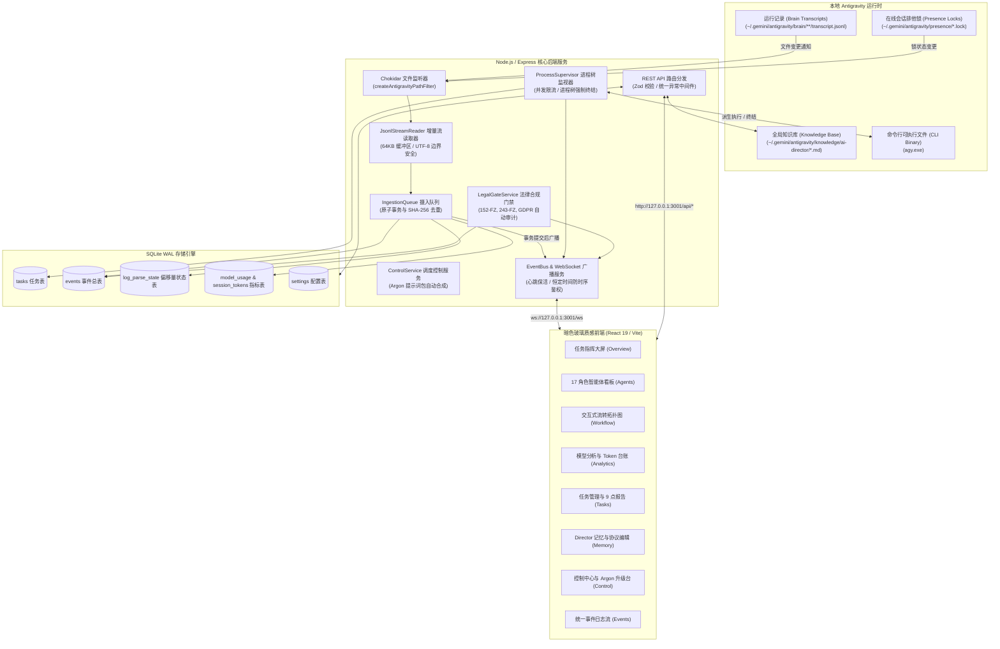
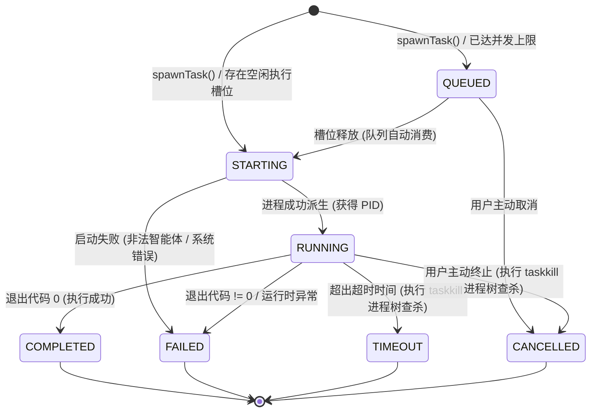

[English](ARCHITECTURE.md) • [Русский](ARCHITECTURE.ru.md) • [简体中文](ARCHITECTURE.zh.md) • [日本語](ARCHITECTURE.ja.md) • [Deutsch](ARCHITECTURE.de.md)

# 系统架构设计白皮书

本文档详述 **Antigravity Apex** 的宏观架构蓝图、核心后端服务交互流程、进程生命周期以及 SQLite 数据库持久化设计。

---

## 1. 高层系统架构

Antigravity Apex 采用全事件驱动、零磁盘浪费（Zero-Disk-Churn）的后端架构，将本机的 **Google Antigravity** 多智能体运行时与前端现代化管理控制台无缝桥接：



---

## 2. 核心后端服务原理

### 2.1 JsonlStreamReader (零磁盘全量读取流式引擎)
源码位置：[`server/src/services/jsonl-stream-reader.ts`](../server/src/services/jsonl-stream-reader.ts)。

传统日志监控方案在文件每次变更时都会从第 0 行重新扫描整个文件。在长会话中，运行日志迅速膨胀至数十兆字节，会导致严重的 CPU 飙升与磁盘 I/O 拥堵。`JsonlStreamReader` 采用创新的增量机制：
- **精确字节偏移量断点记忆**：在 SQLite 的 `log_parse_state` 数据表中记录每个日志文件的绝对字节偏移量（`last_offset`）。
- **64 KB 定长分块流式读取**：借助原生文件句柄（`fs.readSync`），仅从上次记录的偏移点开始增量读取新增数据。
- **UTF-8 多字节截断保护机制**：若多字节字符（如中文字符占 3 字节，Emoji 占 4 字节）恰好被 64 KB 缓冲区边界分割，系统自动保留末尾不完整的字节碎片，并在读取下一个分块时拼装恢复。
- **文件轮转与截断检测**：对比当前文件大小、Inode 与创建时间（birthtime）。一旦检测到文件被清空或重建，偏移量优雅重置为 0，防止异常崩溃。

### 2.2 IngestionQueue (原子摄入队列与提交后广播)
源码位置：[`server/src/services/ingestion-queue.ts`](../server/src/services/ingestion-queue.ts)。

- **确定性事件去重**：基于事件不可变字段（`conversation_id:step_number:type`）计算 SHA-256 唯一哈希特征，已有事件被静默跳过。
- **单事务原子批处理**：针对数据表（`events`、`session_token_usage`、`log_parse_state`）的所有插入操作全部打包在单个 SQLite 事务中执行（`db.transaction(...)`）。
- **提交后广播不变量 (Post-Commit Invariant)**：事件推送到 WebSocket `EventBus` 的操作**严格位于数据库事务成功 Commit 之后**。客户端绝不会收到未持久化的幽灵事件。

### 2.3 ProcessSupervisor (进程树全生命周期管理)
源码位置：[`server/src/services/process-supervisor.ts`](../server/src/services/process-supervisor.ts)。

- **并发限流调度**：严格将并发进程限制在 `maxConcurrentAgents`（默认 3，最高 6）。超出任务自动进入 `QUEUED` 状态排队，随空闲槽位释放依次唤醒。
- **实时标准流多路复用**：将子智能体的 `stdout` 与 `stderr` 实时打散为小块数据通过 WebSocket 推送（`task.updated` 事件），在浏览器控制台中呈现平滑的交互式终端输出。
- **有保障的跨平台进程树终结**：当任务超时或被用户主动取消时，监视器执行彻底的进程树查杀（Windows: `taskkill /pid <PID> /T /F`，Unix: `kill -9 -<PGID>`），消灭所有子编译器和测试进程，彻底杜绝僵尸进程。

#### 进程监视器有限状态机 (FSM)



### 2.4 LegalGateService (质量门禁 2b: 法律合规引擎)
源码位置：[`server/src/services/legal-gate.ts`](../server/src/services/legal-gate.ts)。

实现跨俄罗斯联邦（`RU`）与欧盟（`EU_NL`）管辖权的自动化法定合规审计：
- **10 项管辖权判定要素**：主体登记地、创始人国籍、数据库实际所在地、目标用户群、结算方式、监管名录、分发渠道、第三方集成、准据法与广告投放地域。
- **适用法律体系**：152-FZ、156-FZ 隔离授权、23-FZ 数据本地化首录原则、149-FZ 信息法与 ORI 名录、243-FZ AI 法规（时间不变量：第 8–10 条标识与训练条款于 2027-03-01 生效）、民法典第四部分著作权、38-FZ/479-FZ 广告法、GDPR/UAVG 与欧盟 AI Act。
- **非阻塞隔离特性 (Non-Blocking Invariant)**：审计返回 `BLOCKED_RED` 时，仅阻断涉及违法风险的特定技术子操作；UI 样式开发、无障碍适配与单元测试等安全任务继续正常推进。

### 2.5 ControlService & 4 级 Argon 升级闭环
源码位置：[`server/src/services/control.ts`](../server/src/services/control.ts)。

贯彻落实 AI Development Director 升级协议：
- **防盲目重试机制**：监测任务失败频次。同一思路连续失败 2 次后强制加锁，禁止无休止盲目重试。
- **18 点脱敏提示词包合成**：自动打包包含问题陈述、两次失败的对比证据、20–50 行极简隔离复现用例、精准诊断提问与操作指南的 Markdown 提示词包。
- **闭环裁决落地**：操作人员在 Gemini 4 Argon 环境执行诊断并回传裁决方案后，系统自动降级回派给 Flash 专家执行工程落地。

---

## 3. 数据库架构设计 (SQLite WAL)

数据库由 `better-sqlite3` 驱动，位于 [`server/src/db/database.ts`](../server/src/db/database.ts)：

### WAL 模式与并发优化参数
```sql
PRAGMA journal_mode = WAL;
PRAGMA foreign_keys = ON;
PRAGMA busy_timeout = 5000;
```
- **WAL 模式**：读写分离，读操作完全不阻塞写事务。
- **Busy Timeout (5000 ms)**：在高频日志写入时提供 5 秒的自动排队重试窗口，彻底消除 `SQLITE_BUSY` 锁表错误。

### 核心数据表结构

| 数据表名 | 主键 | 描述与主要用途 |
|----------|------|----------------|
| `events` | `id` (TEXT) | 存储系统全部事件，包含完整 JSON Payload 与时间戳 |
| `tasks` | `id` (TEXT) | 任务状态、重试次数、优先级、执行结果与 9 点标准报告 |
| `log_parse_state` | `file_path` (TEXT) | 记录各日志文件的绝对字节偏移量、Inode、mtime 与行数 |
| `session_token_usage` | `conversation_id` (TEXT) | 会话级 Token 明细统计（输入、输出、缓存命中） |
| `model_usage` | `tier` (TEXT) | 按模型层级聚合的调用次数、成功率与累计 Token 开销 |
| `settings` | `key` (TEXT) | 运行时动态可配置的控制中心键值对 |
| `escalations` | `id` (TEXT) | 4 级 Argon 升级记录、失败指纹、18 点提示词包与专家裁决 |

---

## 4. 前端架构 (React 19 & 深色玻璃工效学)

客户端基于 **React 19**、**TypeScript** 与 **Tailwind CSS v3** 构建：

- **设计美学**：采用高端生产力工具设计语言，深色微光玻璃质感（`backdrop-blur-deep`、`bg-neutral-900/80`、`border-neutral-800`）。
- **实时状态同步**：`App.tsx` 维持指向 `/ws` 的长连接，实时事件流直接以纳秒级响应驱动看板、KPI 计数器与活动日志刷新，完全无需手动刷新页面。
- **浏览器控制台零报错不变量**：严谨的空值保护（Optional Chaining）、错误边界（Error Boundaries）与强类型校验，确保在任何网络抖动或异常报文下浏览器控制台始终纯净无报错。
