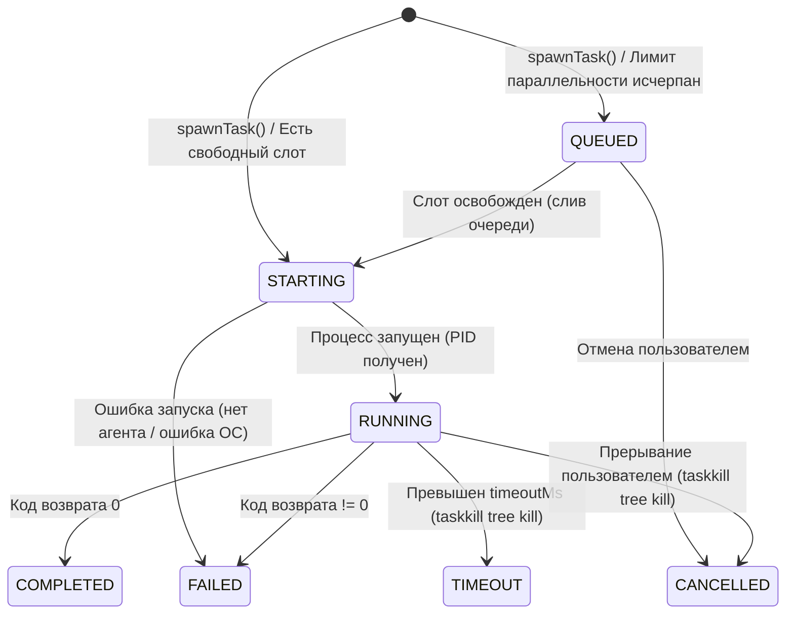

# Antigravity Apex — Public Launch & Promotion Campaign Pack
**Repository**: [https://github.com/fen3211/antigravity-apex](https://github.com/fen3211/antigravity-apex)  
**Author**: Lead Technical Writer & Growth Specialist (`legal-compliance`)  
**Target Release**: v1.0.0 General Public Launch  

---

## Table of Contents
1. [Reddit Launch Post (`r/LocalLLaMA`, `r/ArtificialIntelligence`, `r/ChatGPTCoding`)](#1-reddit-launch-post)
2. [Hacker News (Show HN) Submission](#2-hacker-news-show-hn-submission)
3. [Product Hunt Launch Kit](#3-product-hunt-launch-kit)
4. [Хабр (Habr.com) — Полный черновик статьи для публикации](#4-хабр-habrcom--полный-черновик-статьи)
5. [Twitter / X Viral Thread (5 Tweets)](#5-twitter--x-viral-thread)
6. [LinkedIn Executive & Engineering Post](#6-linkedin-executive--engineering-post)

---

## 1. Reddit Launch Post

**Target Subreddits**: `r/LocalLLaMA`, `r/ArtificialIntelligence`, `r/ChatGPTCoding`, `r/programming`, `r/ClaudeAI`  
**Post Type**: Link / Text Post with Media & Code  
**Flair**: `Project / Tool` / `Open Source`

### Title:
> **Show LocalLLaMA: We built Antigravity Apex — an open-source, local-first Mission Control & Process Supervisor for Google Antigravity Multi-Agent Systems (1-click installer, 17 roles, zero-disk streaming, Level 4 Argon escalation)**

### Content:

Hey r/LocalLLaMA!

If you’ve been experimenting with autonomous multi-agent coding frameworks or the new **Google Antigravity SDK**, you’ve probably hit the "agentic chaos" wall:

1. **Zombie Processes & Leaked Compilers**: Background test runners and language servers spawn unchecked, pegging CPU at 100% and orphan-locking files.
2. **Infinite Blind Loops**: Agents fail twice on a subtle concurrency bug, burn through context windows and tokens, and keep repeating the same broken fix.
3. **Black-Box JSONL Transcripts**: Multi-megabyte transcripts buried in `~/.gemini/antigravity/brain/**/transcript.jsonl` with zero real-time visibility into who is running what.
4. **Data Leakage & Compliance Blindness**: Sending sensitive personal data, proprietary codebase logic, or third-party scraper outputs without verifying localization (152-FZ/GDPR) or AI attribution laws (EU AI Act / 243-FZ).

To solve this, we built and open-sourced **Antigravity Apex**: a local-first, production-grade telemetry dashboard and process supervisor engineered specifically for Google Antigravity.

👉 **GitHub Repository**: [https://github.com/fen3211/antigravity-apex](https://github.com/fen3211/antigravity-apex)  
📦 **1-Click Windows EXE**: [Download Standalone Setup.exe](https://github.com/fen3211/antigravity-apex/releases/latest/download/Antigravity-Apex-Setup.exe)  
🌐 **Languages**: English, Russian, German, Spanish, French, Portuguese, Chinese, Japanese.

---

### What Makes It Different?

#### 1. ⚡ Local-First & Zero Telemetry
Everything binds strictly to `127.0.0.1`. No external SaaS analytics, no telemetry phoned home, and all session state persists locally in a high-performance **SQLite WAL** database. Cryptographic token auth uses `crypto.timingSafeEqual` to guard local endpoints against timing attacks.

#### 2. 🛡 Process Supervisor FSM & Guaranteed Tree Kill
Antigravity Apex manages subagent execution via a deterministic Finite State Machine (`QUEUED` $\to$ `STARTING` $\to$ `RUNNING` $\to$ `COMPLETED` / `FAILED` / `TIMEOUT` / `CANCELLED`).
- Enforces dynamic concurrency limits (up to 6 parallel subagents, default 3).
- On task timeout or manual abort, it executes a recursive process tree kill (`taskkill /T /F` on Windows, PGID signal propagation on POSIX). **Zero zombie processes left behind.**

#### 3. 🚀 Zero-Disk-Read Incremental Stream Ingestion
Traditional file watchers re-read massive JSONL logs from byte 0, crushing NVMe drives and throttling CPU. Our `JsonlStreamReader` engine:
- Remembers byte offsets in SQLite.
- Reads newly appended logs in **64 KB chunks** directly via low-level file descriptors.
- Guarantees multi-byte UTF-8 boundary integrity across chunk splits (Cyrillic characters and 4-byte astral emojis never split or corrupt).
- Detects file rotations, inode switches, and truncations on the fly.

#### 4. 👥 17 Canonical Specialist Roles (AI Development Director Framework)
Instead of asking a generalist model to do everything, tasks are routed across 17 dedicated specialist roles:
- **Director / Orchestrator** (Gemini 3.8 Flash High)
- **Senior Architect** (Gemini Pro)
- **Frontend / Backend / UI-UX / QA / Code Reviewer**
- **Security Engineer** (OWASP, prompt injection audits)
- **Legal Advisor & Tech Writer** (Automated statutory gate)
- **Data / Database / Performance / Accessibility / DevOps Specialists**

#### 5. 💎 Closed-Contour Level 4 Argon Escalation Engine
When subagents encounter an architectural impasse (2 consecutive failed attempts):
- The system halts retries to save tokens.
- Generates a sanitized **18-Point Markdown Prompt Pack** (with auto-stripped API keys and sanitized system paths: `C:\Users\username` $\to$ `~`).
- Operator executes the prompt in **Gemini 4 Argon (High)**, pastes the verdict into the modal, and the Director de-escalates the blueprint back to Flash specialists for clean implementation.

#### 6. ⚖️ Quality Gate 2b: Automated Legal Compliance Gate
The first multi-agent orchestrator with built-in statutory compliance checks across Russian (`RU`) and European (`EU_NL`) jurisdictions:
- Audits 152-FZ, 156-FZ isolated consent, 23-FZ primary database localization, 243-FZ AI Law, Part IV Civil Code copyright, GDPR/UAVG, and EU AI Act.
- **Non-blocking invariant**: If a compliance violation is flagged (`BLOCKED_RED`), it halts *only* the infringing sub-operation while safe parallel tasks (UI, unit tests, CSS) continue unimpeded.

---

### How to Run in 60 Seconds

#### Option A: Standalone Windows Installer (Zero CLI & Zero Git)
1. Download **[Antigravity-Apex-Setup.exe](https://github.com/fen3211/antigravity-apex/releases/latest/download/Antigravity-Apex-Setup.exe)** from GitHub Releases.
2. Run the installer. It configures the environment, installs all 17 agents into `~/.gemini`, runs the 19-point diagnostic doctor, and pops up the dashboard in your default browser.

#### Option B: Terminal Remote One-Liner
**Windows (PowerShell)**:
```powershell
irm https://raw.githubusercontent.com/fen3211/antigravity-apex/main/scripts/get.ps1 | iex
```

**Linux / macOS (Bash)**:
```bash
curl -fsSL https://raw.githubusercontent.com/fen3211/antigravity-apex/main/scripts/get.sh | bash
```

#### Option C: From Cloned Repo
```bash
git clone https://github.com/fen3211/antigravity-apex.git
cd antigravity-apex
# Windows: double-click setup.cmd
# Linux/macOS:
chmod +x setup.sh && ./setup.sh
```

#### Option D: 1-Click Cloud Workspace
Launch directly in your browser with zero local installation:
[](https://codespaces.new/fen3211/antigravity-apex)

---

### Verify Your System Anytime
```bash
npm run doctor
# Runs 19 automated diagnostics verifying Node.js, SQLite WAL integrity,
# Antigravity CLI bridges, 17 agent definitions, and skills.
```

### Tech Stack
- **Frontend**: React 19.3, TypeScript 5.7, Tailwind CSS v3, Refero/Vercel Engineering Aesthetic (Dark & Light modes).
- **Backend**: Node.js 18+, Express, WebSocket server, `better-sqlite3` (WAL mode).
- **Integration**: Direct IPC & event-driven file hooks into Google Antigravity runtime.

The repository is 100% open-source under the **MIT License**.

⭐ If you appreciate local-first AI tooling, **[please star our GitHub repo](https://github.com/fen3211/antigravity-apex)**!  
We’d love to hear your feedback, bug reports, and PRs in the comments below!

---

## 2. Hacker News (Show HN) Submission

**Submission URL / Text**: Text post with URL reference  
**Title**:
> **Show HN: Antigravity Apex – Local supervisor and mission control for Google Antigravity**

### Pitch Content:

Hi HN,

We built Antigravity Apex ([https://github.com/fen3211/antigravity-apex](https://github.com/fen3211/antigravity-apex)), an open-source, local-first process supervisor and real-time dashboard for multi-agent workflows running on Google Antigravity.

When running local multi-agent coding sessions, the failure modes are rarely in the raw prompt; they are in process management:
1. Zombie child processes spawned by subagents during test/build execution remain alive after parent termination, holding file locks and exhausting CPU.
2. Log ingestion at scale causes disk churn: agents write continuously to JSONL transcripts, and standard file watchers attempt to read entire files from byte 0, causing quadratic I/O as session logs exceed tens of megabytes.
3. Uncontrolled retries: agents hit an architectural deadlock, exhaust tokens repeating the exact same diff, and fail silently.

Here is how we addressed these challenges architecturally:

### 1. Zero-Disk-Read 64 KB Stream Ingestion (`JsonlStreamReader`)
Instead of re-reading transcripts, `JsonlStreamReader` maintains an offset pointer in SQLite (`log_parse_state`). Newly appended data is read using chunked 64 KB buffers via native file descriptors (`fs.readSync`). 
To handle multi-byte UTF-8 character boundaries (e.g., Cyrillic characters requiring 2 bytes or astral emojis requiring 4 bytes) that might be split across chunk boundaries, partial byte sequences at buffer ends are cached in memory and prepended to the subsequent chunk before JSON deserialization. File rotation and truncation are identified by tracking inode and birthtime metadata.

### 2. Process Supervisor Finite State Machine (FSM)
Subagent lifecycles are governed by an explicit FSM:
`QUEUED` $\to$ `STARTING` $\to$ `RUNNING` $\to$ `COMPLETED` | `FAILED` | `TIMEOUT` | `CANCELLED`.
- Dynamic concurrency throttling limits active processes to `maxConcurrentAgents` (default: 3, hard ceiling: 6) with an automated FIFO drainage queue.
- Process tree termination: upon timeout or user abort, the supervisor issues a recursive tree kill (`taskkill /pid <PID> /T /F` on Windows; process group signal propagation on POSIX), eliminating orphaned compilers, Vitest runners, or Webpack daemons.

### 3. Atomic Storage & Post-Commit Invariant
The state store runs on SQLite in WAL mode (`better-sqlite3`, `PRAGMA busy_timeout = 5000`).
- Event deduplication computes a SHA-256 digest of immutable event fields (`conversation_id:step_number:type`).
- Ingestion inserts are batched in atomic SQLite transactions.
- WebSockets operate on a strict **post-commit invariant**: events are pushed to connected clients only after the database commit succeeds, eliminating ghost state.

### 4. Security & Local Loopback Isolation
- Network interfaces bind exclusively to `127.0.0.1`.
- API and WebSocket tokens are verified using `crypto.timingSafeEqual` to eliminate timing side-channels.
- Path traversal guardrails validate all file access against canonical directory roots.

### 5. Level 4 Argon Escalation Protocol
When a subagent fails twice consecutively on the same task, execution is paused to prevent token exhaustion. The engine generates an 18-point Markdown prompt pack with automatic scrubbing of file system paths (`C:\Users\username` $\to$ `~`) and API keys. The operator runs the escalation pack in Gemini 4 Argon, inputs the structural blueprint into the dashboard modal, and the supervisor routes the task back to Flash specialists for code generation.

### 6. Legal Compliance Gate (Gate 2b)
Includes a static compliance auditor for projects touching personal data or AI outputs. It evaluates operations against 152-FZ, 156-FZ, 23-FZ (database localization), 243-FZ (Russian AI regulation), and EU GDPR/AI Act with a non-blocking invariant (blocking only the non-compliant endpoint while letting UI and test suites proceed).

The project is written in TypeScript (Node.js/Express backend, React 19/Vite frontend) and licensed under MIT.

Repository: [https://github.com/fen3211/antigravity-apex](https://github.com/fen3211/antigravity-apex)  
Documentation: [https://github.com/fen3211/antigravity-apex/tree/main/docs](https://github.com/fen3211/antigravity-apex/tree/main/docs)

We welcome your feedback and technical critiques.

---

## 3. Product Hunt Launch Kit

### Basic Information
- **Product Name**: Antigravity Apex
- **Tagline**: Local Mission Control & Supervisor for Google Antigravity *(56 characters)*
- **Topics / Categories**: `Developer Tools`, `Artificial Intelligence`, `Open Source`, `Productivity`, `Task Management`
- **Pricing**: 100% Free & Open Source (MIT)
- **Links**:
  - Website / Repo: `https://github.com/fen3211/antigravity-apex`
  - Download Link: `https://github.com/fen3211/antigravity-apex/releases/latest/download/Antigravity-Apex-Setup.exe`
  - Demo Video / GIF: `.github/assets/hero-banner.svg` & `public/screenshots/dark-overview.png`

### Short Description (Elevator Pitch, 250 characters)
> Antigravity Apex is an open-source, local-first mission control dashboard & process supervisor for Google Antigravity. Features 17 specialist AI roles, 6-agent concurrency, zero-disk streaming, Level 4 Argon escalation, and zero telemetry.

### Detailed Product Description (Formatted for Product Hunt)

**Tired of multi-agent coding assistants becoming black boxes that burn your API tokens and leave zombie processes on your machine?**

Meet **Antigravity Apex** — the next-generation, local-first mission control dashboard and operational supervisor built for **Google Antigravity**.

Whether you're coordinating complex full-stack refactors, auditing security vulnerabilities, or running multi-agent swarms, Antigravity Apex brings deterministic engineering order to autonomous AI development.

#### 🌟 Key Highlights:
- **⚡ 1-Click Installation**: Download the native standalone Windows EXE installer, run a one-line curl/PowerShell command, or launch instantly in GitHub Codespaces. Zero manual configuration required.
- **🛡 True Process Tree Supervision**: Eliminates orphaned background processes with guaranteed tree-killing (`taskkill /T /F` on Win32, PGID signals on POSIX) and throttled concurrency (up to 6 parallel subagents).
- **🚀 Zero-Disk-Read Stream Ingestion**: Incrementally parses live agent transcripts using 64 KB UTF-8 safe buffers and byte-offset tracking in SQLite WAL. No disk thrashing, no lag.
- **👥 17-Role Canonical Specialist Pool**: Orchestrated by the **AI Development Director** framework, dynamically routing work across 17 dedicated roles (Senior Architect, QA, Frontend, Backend, Security, Legal, DevOps, etc.).
- **💎 Level 4 Argon Escalation Engine**: Automatically halts failing tasks after 2 retries, synthesizes a sanitized 18-point prompt pack, and enables manual escalation to Gemini 4 Argon before de-escalating back to Flash specialists.
- **⚖️ Automated Legal Compliance Gate (Gate 2b)**: Built-in verification for 152-FZ, 156-FZ, 23-FZ localization, 243-FZ AI regulations, and GDPR with a non-blocking invariant.
- **🎨 Refero / Vercel Engineering Aesthetic**: High-contrast, pixel-perfect dark and light themes with zero FOUT and WCAG 2.1 AA accessibility.
- **🔒 100% Local & Private**: Binds to `127.0.0.1`, features `crypto.timingSafeEqual` token auth, and transmits zero telemetry.

---

### First Maker Comment (By Creator)

> Hey Product Hunt community! 👋
> 
> I’m Vladislav, maker of **Antigravity Apex**.
> 
> Over the past several months, our team has been pushing the boundaries of autonomous multi-agent development using Google Antigravity. While the raw reasoning power of modern LLMs (like Gemini 3.8 Flash High and Gemini 4 Argon) is astonishing, we kept running into the same frustrating operational bottlenecks:
> - Subagents spawning hidden background compilers and test runners that never died.
> - Multi-megabyte JSONL log files crushing disk performance.
> - Tasks failing silently or looping blindly through dozens of repeated prompt attempts.
> - A total lack of visibility into which agent was modifying which file.
> 
> We realized that **multi-agent AI development doesn’t need more chatbots — it needs an industrial-grade process supervisor and mission control cockpit.**
> 
> That’s why we engineered **Antigravity Apex**.
> 
> We built it from scratch in TypeScript, React 19, and SQLite WAL to run 100% locally on your machine with zero external telemetry. We included a 1-click Windows installer, shell one-liners for Linux/macOS, a 19-check diagnostic doctor (`npm run doctor`), and an intelligent Level 4 Argon escalation protocol that stops runaway token spend dead in its tracks.
> 
> The entire project is free and open-source under the MIT license.
> 
> We’d love for you to try it, give it a spin on your local machine or in GitHub Codespaces, and let us know what you think! We’ll be hanging out in the comments all day to answer your questions.
> 
> Thank you for your support, and happy coding! 🚀⭐

---

## 4. Хабр (Habr.com) — Полный черновик статьи

**Хабы**: `Разработка веб-сайтов`, `Искусственный интеллект`, `Open source`, `Управление разработкой`, `Node.js`  
**Теги**: `google antigravity`, `мультиагентные системы`, `искусственный интеллект`, `supervisor`, `sqlite wal`, `legaltech`, `open source`, `react 19`, `gemini`  

---

### Заголовок:
# Наводим порядок в мультиагентах: Как мы написали Antigravity Apex — локальный супервизор, диспетчер процессов и Legal Gate для Google Antigravity

В последние полгода разработка ПО с помощью ИИ перешла из эпохи «попроси чат-бота написать функцию» в эру **автономных мультиагентных систем**. Мы запускаем целые команды агентов: архитектор продумывает схему, фронтендер верстает React-компоненты, бэкендер поднимает эндпоинты, а QA пишет интеграционные тесты.

Когда Google выпустил свой **Antigravity SDK**, открылись потрясающие возможности для построения сложных цепочек. Однако любой разработчик, запустивший больше трех агентов одновременно на своей рабочей машине, мгновенно сталкивается с суровой реальностью:
1. **Зомби-процессы пожирают процессор**: Агент запустил тесты или сборщик в фоновом терминале, упал по таймауту, а дочерний процесс `node.exe` или `pytest` остался висеть, удерживая системные порты и файлы.
2. **Бесконечный цикл слива токенов**: Агент дважды споткнулся о тонкий баг синхронизации, зациклился и повторяет одну и ту же неработающую правку, выжигая контекстное окно и деньги.
3. **«Черный ящик» на диске**: Транскрипты сессий складываются в огромные файлы `transcript.jsonl` в недрах `~/.gemini/antigravity/brain/`. Понять, кто из агентов прямо сейчас пишет код, а кто застрял — невозможно без грепания гигабайтных логов.
4. **Юридическая слепота (Compliance)**: Агенты легко затаскивают непроверенные библиотеки, генерируют код с нарушением локализации персональных данных (152-ФЗ, 23-ФЗ) или используют непромаркированный генеративный ИИ-контент (243-ФЗ, EU AI Act).

Чтобы решить эти проблемы раз и навсегда, мы спроектировали и выложили в open-source **[Antigravity Apex](https://github.com/fen3211/antigravity-apex)** — локальную панель управления, супервизор процессов и систему арбитража для Google Antigravity.

В этой статье мы подробно разберем техническое устройство системы: потоковый парсинг 64 КБ без нагрузки на SSD, супервизор дерева процессов с FSM, трехуровневую верификацию и уникальный юридический шлюз (Gate 2b).

---

## Архитектура: как связать хаос агентов воедино

Основная инженерная концепция Antigravity Apex — **zero-disk-churn** и **строгая локальность (local-first)**. Никакой телеметрии наружу, никаких тяжелых внешних СУБД. Бэкенд слушает локальные события Antigravity и стримит состояние в браузерный UI через WebSockets:

```
[ Antigravity Runtime ] 
   │ (транскрипты .jsonl, lock-файлы)
   ▼
[ Chokidar FS Watcher ] 
   │ (события файловой системы)
   ▼
[ JsonlStreamReader ] ── 64 KB Chunked Streaming (UTF-8 safe)
   │
   ▼
[ IngestionQueue ] ── Дедупликация SHA-256 + Атомарные транзакции
   │
   ├──► [ SQLite WAL Engine ] (events, tasks, parse_state)
   │
   ▼ (Post-commit invariant)
[ WebSocket EventBus ] ── timingSafeEqual Token Auth
   │
   ▼ (ws://127.0.0.1:3001/ws)
[ React 19 Frontend Dashboard ] (Refero Vercel Aesthetic, Dark/Light)
```

Разберем ключевые узлы этой архитектуры.

---

### 1. Zero-Disk-Read: Парсинг логов кусками по 64 КБ без спама SSD

Обычный подход к парсингу растущих логов — перечитывать файл целиком или считывать строки с начала при каждом изменении. Когда сессия мультиагентной системы длится несколько часов, транскрипт разрастается до сотен мегабайт, приводя к чудовищному I/O и просадкам FPS.

Мы разработали движок `JsonlStreamReader`:
1. В таблице SQLite `log_parse_state` сохраняется точный байтовый оффсет (`last_offset`) для каждого файла транскрипта.
2. При срабатывании файлового вотчера чтение происходит строго с сохраненного оффсета фиксированными блоками по **64 КБ** через системные файловые дескрипторы (`fs.readSync`).
3. **Защита границ многобайтового UTF-8**: Если двухбайтовый кириллический символ или четырехбайтовый эмодзи попадает ровно на стык 64-килобайтного буфера, хвостовые байты сохраняются в буфере памяти и склеиваются со следующим чанком. Кириллица никогда не бьется.
4. **Контроль ротации и обнуления логов**: Движок отслеживает `inode` и время создания (`birthtime`). Если файл был перезаписан или урезан (truncation), оффсет корректно сбрасывается в 0 без падений бэкенда.

---

### 2. Супервизор процессов: FSM и гарантированное уничтожение зомби

Для управления параллелизмом мы внедрили супервизор процессов с детерминированным конечным автоматом:



- **Дросселирование конкурентности**: Параллельно могут выполняться не более 6 субагентов (по умолчанию 3). Все остальные задачи встают в очередь FIFO и запускаются автоматически.
- **Tree Kill (убийство дерева процессов)**: При отмене задачи или срабатывании таймаута нельзя просто послать `SIGINT` родительскому процессу. Мы выполняем рекурсивное уничтожение всего дерева процессов (`taskkill /pid <PID> /T /F` на Windows и `kill -- -PGID` на Unix). Никаких зависших фоновых компиляторов и раннеров тестов.

---

### 3. База данных: Почему SQLite WAL уделывает внешние базы

Для локального инструмента разработчика поднимать PostgreSQL или Docker — неоправданный оверхед. Мы используем встроенный `better-sqlite3` с обязательными прагмами:

```sql
PRAGMA journal_mode = WAL;
PRAGMA foreign_keys = ON;
PRAGMA busy_timeout = 5000;
```

Журналирование WAL (Write-Ahead Logging) позволяет фронтенду читать данные параллельно, пока бэкенд пачками пишет новые события. Таймаут в 5000 мс полностью устраняет ошибки `SQLITE_BUSY` при пиковых всплесках файловых событий.

**Post-Commit Invariant**: Сообщения в WebSocket рассылаются строго **после** успешной фиксации транзакции в SQLite. Клиент в браузере никогда не получит «фантомное» событие, которое не смогло сохраниться в базе.

---

### 4. Ролевая модель: 17 канонических специалистов

Вместо одного универсального промпта Antigravity Apex реализует методологию **AI Development Director**. Задачи делятся на три класса:
- **Мелкие (<15 строк, фикс опечатки)**: Решаются Директором соло на быстрой модели Gemini 3.8 Flash High.
- **Средние (1–3 файла)**: Делегируются ровно одному профильному спецу.
- **Крупные (сквозные фичи, модуль + UI + API)**: Распараллеливаются между независимыми субагентами (до 6 параллельно).

Всего в пуле 17 ролей:
`director`, `senior-architect`, `researcher`, `frontend-developer`, `backend-developer`, `ui-ux-designer`, `qa-engineer`, `code-reviewer`, `legal-compliance`, `security-engineer`, `devops-engineer`, `product-manager`, `ai-evaluation-engineer`, `performance-engineer`, `accessibility-specialist`, `database-specialist`, `data-engineer`.

---

### 5. Интеллектуальная эскалация к Gemini 4 Argon (Уровень 4)

Что делать, когда агент зашел в тупик? Например, не проходит сложный интеграционный тест из-за гонки данных в WebSocket.

В обычных системах агент будет повторять попытки, пока не кончится лимит сообщений. В Antigravity Apex работает **Argon Escalation Engine**:
1. Если подход терпит неудачу **2 раза подряд**, задача блокируется.
2. Система синтезирует **18-пунктный Prompt Pack**: формулирует суть проблемы в двух предложениях, прикладывает выжимки двух неудачных попыток, изолированный сниппет воспроизведения (20–50 строк) и диагностический вопрос к архитектуре.
3. Все пути к файловой системе (`C:\Users\username\...`) маскируются под `~`, а ключи API вырезаются регулярными выражениями.
4. Разработчик переключает модель на **Gemini 4 Argon (High)**, вставляет готовый промпт-пак, получает фундаментальное архитектурное решение и вставляет вердикт обратно в окно Apex.
5. Директор парсит вердикт и передает реализацию обратно Flash-специалистам.

---

### 6. Уникальная фича: Юридический шлюз (Gate 2b)

Самая необычная и мощная часть нашей системы — встроенный автоматизированный юридический аудит (`legal-compliance`).

В 2025–2026 годах правовое регулирование IT в РФ и ЕС претерпело тектонические сдвиги:
- **152-ФЗ и 156-ФЗ (в силе с 01.09.2025)**: Запрещено собирать согласие на обработку персональных данных «в куче» с публичной офертой. Согласие обязано быть предметным, оформленным отдельным чекбоксом.
- **23-ФЗ (в силе с 01.07.2025)**: Ужесточение первичной локализации баз данных граждан РФ.
- **243-ФЗ об искусственном интеллекте (в силе с 01.09.2026)**: Обязанности разработчиков и операторов ИИ-систем, включая требования к маркировке ИИ-контента (статьи 8–10 вступают в силу с 01.03.2027).
- **GDPR и EU AI Act**: Градация рисков ИИ-систем и прозрачность синтетического контента.

Когда агент реализует форму авторизации, платежный шлюз или модуль интеграции с внешней нейросетью, срабатывает **Gate 2b**.

#### Неблокирующий инвариант
Если юридический аудит выявил критический риск (`BLOCKED_RED`), блокируется **только** конкретный опасный эндпоинт или операция. Разработка фронтенда, верстка дизайн-системы, unit-тесты и доступность (a11y) продолжаются параллельно без задержек!

---

### 7. Диагностика одной командой: `npm run doctor`

Мы ненавидим сложные инструкции по установке, в которых на третьем шаге отваливается половина скриптов. Поэтому в проект встроен медицинский «Доктор»:

```bash
npm run doctor
```

Он автоматически прогоняет 19 тестов:
- Версии Node.js, npm и Git.
- Целостность таблиц и активный режим WAL в SQLite.
- Доступность CLI-моста Antigravity (`agy.exe`).
- Наличие всех 17 определений агентов и оркестрационных правил в `~/.gemini/config/plugins/ai-director`.
- Валидность токенов и переменных окружения.

---

## Как запустить Antigravity Apex за 1 минуту

Мы предусмотрели варианты установки для любых сценариев:

### 1. Нативный установщик Windows (Zero CLI)
Просто скачайте скомпилированный инсталлятор из релизов GitHub:  
👉 **[Antigravity-Apex-Setup.exe (v1.0.0)](https://github.com/fen3211/antigravity-apex/releases/latest/download/Antigravity-Apex-Setup.exe)**  
Два клика — инсталлятор сам все распакует, настроит агентов в вашей системе и откроет дашборд в браузере.

### 2. Удаленный запуск в терминале (One-Liner)
**Windows (PowerShell)**:
```powershell
irm https://raw.githubusercontent.com/fen3211/antigravity-apex/main/scripts/get.ps1 | iex
```

**Linux / macOS (Bash)**:
```bash
curl -fsSL https://raw.githubusercontent.com/fen3211/antigravity-apex/main/scripts/get.sh | bash
```

### 3. Запуск в облаке (GitHub Codespaces)
Если не хочется ставить ничего локально, запустите готовый контейнер прямо в браузере:  
[](https://codespaces.new/fen3211/antigravity-apex)

---

## Заключение

Автономная разработка не должна быть хаотичной игрой в угадайку с висящими процессами и бесконтрольным сливом бюджета на токены. Antigravity Apex превращает локальный мультиагентный пайплайн в прозрачный, управляемый и предсказуемый инженерный конвейер.

Проект полностью открыт под лицензией MIT.

⭐ **Репозиторий на GitHub**: [https://github.com/fen3211/antigravity-apex](https://github.com/fen3211/antigravity-apex)

Заходите, тестируйте на своих проектах, ставьте звезды репозиторию и делитесь в комментариях: как вы контролируете своих агентов и какие метрики для вас важнее всего?

---

## 5. Twitter / X Viral Thread

### Tweet 1 (Hook & Hero Video) 🧵
Running multi-agent AI coding sessions locally without a supervisor is like flying blind into a storm.

Compiler zombies eating 100% CPU. Runaway token spend. Inode locks.

We built the fix: **Antigravity Apex** — the local-first mission control for Google Antigravity.

100% Open Source. ⚡👇

*(Attach video or hero banner: `.github/assets/hero-banner.svg`)*

---

### Tweet 2 (Process Tree Supervisor) ⚙️
The #1 pain of local subagents? Orphaned processes.

An agent times out, but its background test runner or dev server keeps running in the shadows.

Apex features an explicit FSM with guaranteed process tree killing (`taskkill /T /F` & PGID signals).

Zero zombies. Clean ports. Always. 🛡️

---

### Tweet 3 (Zero-Disk 64KB Streaming & SQLite WAL) 🚀
Transcripts can reach hundreds of MBs. Normal watchers re-read from line 0 and murder your SSD.

Our `JsonlStreamReader` reads strictly from SQLite byte-offsets in **64 KB chunks**.
- Multi-byte UTF-8 safe (emojis & Cyrillic never break)
- Atomic SQLite transactions in WAL mode
- Zero ghost events

---

### Tweet 4 (Argon Escalation & Legal Gate 2b) 💎⚖️
Two killer superpowers you won't find anywhere else:

1️⃣ **Argon L4 Escalation**: Halts repeated failure loops, auto-generates a sanitized 18-point prompt pack for Gemini 4 Argon.
2️⃣ **Legal Gate 2b**: Audits 152-FZ, 243-FZ AI & GDPR with a non-blocking invariant.

---

### Tweet 5 (Call to Action & Links) ⭐
Install Antigravity Apex in 60 seconds:

📦 Native 1-Click Windows EXE (zero CLI)
💻 macOS/Linux one-liner: `curl -fsSL https://raw.githubusercontent.com/fen3211/antigravity-apex/main/scripts/get.sh | bash`
☁️ GitHub Codespaces ready

If you love local-first AI, drop us a ⭐ on GitHub:
👉 https://github.com/fen3211/antigravity-apex

---

## 6. LinkedIn Executive & Engineering Post

**Target Audience**: CTOs, VPs of Engineering, Lead AI Architects, Tech Leads  

### Post Copy:

The software engineering industry is reaching an inflection point: we are moving rapidly from single-turn AI code completion to **autonomous multi-agent engineering swarms**.

Frameworks like the **Google Antigravity SDK** enable teams of autonomous agents to plan architectures, write full-stack code, and execute test suites in parallel.

However, moving from agent demos to production-grade engineering environments reveals major infrastructure hurdles:
- **Orphaned Process Sprawl**: Autonomous build tools and test runners linger in memory after failures, consuming CPU and causing port collisions.
- **Runaway Token Economics**: Subagents caught in edge-case loops blindly repeat the same diff, draining API quotas with zero progress.
- **Lack of Governance & Compliance**: Code generated autonomously frequently bypasses local data privacy laws (GDPR, 152-FZ) and AI transparency frameworks (EU AI Act, 243-FZ).

To address these challenges, we are open-sourcing **Antigravity Apex** — an enterprise-grade, local-first mission control dashboard and process supervisor for Google Antigravity.

### Key Architectural Pillars:
🔹 **Deterministic Concurrency & Process Tree Supervision**: An explicit Finite State Machine throttles concurrent workers (up to 6 subagents) and guarantees full-tree process termination upon timeout or cancellation.
🔹 **Zero-Disk-Churn Stream Ingestion**: Incrementally ingests live agent transcripts in 64 KB buffers using native file descriptors and SQLite WAL offsets, preventing SSD wear and eliminating quadratic read latency.
🔹 **Closed-Contour Level 4 Escalation**: When subagents encounter an architectural impasse (2 consecutive failures), the system halts execution and compiles a sanitized 18-point prompt pack for escalation to **Gemini 4 Argon**.
🔹 **Statutory Quality Gate (Gate 2b)**: The industry’s first built-in legal compliance auditor for personal data localization, AI attribution, and open-source licensing — engineered with a non-blocking invariant to protect compliance without stalling unrelated development streams.
🔹 **Zero Telemetry**: Binds strictly to `127.0.0.1` with `crypto.timingSafeEqual` authentication, ensuring your proprietary code and intellectual property never leave your local environment.

Antigravity Apex is available now under the MIT License, featuring a 1-click native Windows installer, remote shell one-liners, and pre-configured GitHub Codespaces.

Explore the architecture and star the project on GitHub:  
👉 **https://github.com/fen3211/antigravity-apex**

How is your engineering organization tackling governance, process supervision, and token expenditure in multi-agent workflows? Let's discuss in the comments.

#SoftwareEngineering #ArtificialIntelligence #MultiAgentSystems #GoogleAntigravity #DevOps #OpenSource #TechLeadership #TypeScript #Gemini
